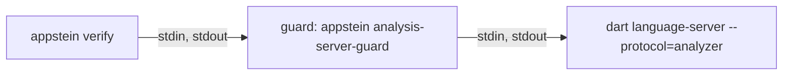

<!-- covers:
packages/appstein_engine/lib/src/verify/**
packages/appstein_protocol/lib/src/verify/**
packages/appstein_cli/lib/src/verify_command.dart
packages/appstein_engine/lib/src/mcp/verify_tool.dart
packages/appstein_engine/lib/src/analysis/**
packages/appstein_cli/lib/src/analysis_guard_command.dart
-->

# Verify

`appstein verify` checks a project against its knowledge and reports **findings** (spec §9). An agent runs it after a change and before it says a task is done. It is the part of Appstein that says "no".

This page covers the frame and the checks of slice 1d.1, and what slice 1d.2 has built so far: the analysis server, the first code check, `dart.error`, and the server `appstein mcp` keeps running so the `verify` tool answers from warm analysis. The other code checks (deprecated use, warnings, lints, format, fixes, tests), the lint rules, the package gate and the Android and iOS checks arrive later in slice 1d.2 and in slices 1d.3 to 1d.6.

## What a run does

[`runVerify`](../../packages/appstein_engine/lib/src/verify/verify_run.dart) does six things, in this order:

1. **Refresh the knowledge**, as `appstein sync --detect` does ([`refreshKnowledge`](../../packages/appstein_engine/lib/src/knowledge/knowledge_refresh.dart), shared with `appstein docs`). The MCP server has already done this before every tool call, so it passes its result in and the knowledge is refreshed once.
2. **Gather what is slow**, before the lock. Each selected check that implements `GatheringCheck` gets a `VerifyGathering` and asks it for what it will judge. Today that is one thing, the code analysis's reading, taken **once per run** however many checks ask: every check judges the same reading, as every check judges the same knowledge. It comes after the refresh, which may fetch the packages the analysis reads. See [gathering](#gathering-before-the-lock).
3. **Take the knowledge lock** and read the knowledge once. Every check gets the same [`VerifyContext`](../../packages/appstein_engine/lib/src/verify/verify_check.dart): the project folder, its `appstein.yaml`, its packs, one `KnowledgeSnapshot`, the decision records and what was gathered. Under the lock a check only judges; nothing asks the analysis server there.
4. **Run the checks** the mode selects. `fast` runs the fast checks; `full` (the default) runs every check.
5. **Apply `verify.severity`** from `appstein.yaml`, which can raise or lower a finding's severity.
6. **Apply the suppressions**, then sort the findings.

**When the knowledge can't be refreshed** (no Flutter SDK, packages not fetched, a map file that can't be read, another sync holding the lock), the run still happens. A busy lock is waited for once, for the lock timeout; the checks then run without it, because files are replaced whole and reading is safe.

- it reports `knowledge.stale` as an **error**, with the reason;
- a check that reads the project map (`needsMap`) is not run, and is named in `notRun`;
- every other check runs. One that reads the map for only part of its work asks `context.mapProblem`, leaves that part out and reports it with `context.skipped(id)`, which names it in `notRun` too. The decisions check does this for `stack.provider`;
- a suppression of a check that did not run, or ran in part, is not reported as unused: its finding may only be missing.

Old map files usually stay on disk when a refresh fails, and they still parse. `mapProblem` is set all the same: a check judging an old map would give wrong answers that look right, which is worse than saying it didn't run. Nothing is judged against old knowledge, and nothing is skipped silently (spec §9).

The same holds when `.appstein` itself can't be opened (it is a file, or the folder is read-only): `knowledge.stale` with the reason, never a crash.

**A check that throws** is Appstein's failure, not the project's: `runVerify` throws a `VerifyCheckError` naming the check, and the CLI exits 3. The same happens when a check reports an ID it didn't declare.

**An analysis server that can't answer** is Appstein's failure too, but no check's: `runVerify` passes the `CodeAnalysisException` on as it is, and the CLI prints its reason and exits 3. It is never a finding, and never read as "no errors". See [when the server can't answer](#when-the-server-cant-answer).

### Gathering, before the lock

The knowledge lock is shared: while `verify` holds it, an `appstein sync` or another agent's MCP call waits, and gives up after 10 s. An analysis server can take far longer than that to start. So nothing slow happens under the lock.

- **A check with slow work implements `GatheringCheck`.** Its `gather` runs before the lock and asks the run's [`VerifyGathering`](../../packages/appstein_engine/lib/src/verify/verify_check.dart); its `run` runs under the lock and reads the answer from the context.
- **`gathering.code()`** is the code analysis's reading. The first check that calls it asks the analysis server; the others get the same reading. A run in which no selected check calls it asks nothing, and starts no server.
- **`context.code`** is that reading, for a check that asked for it in its own `gather`. Any other check that reads it gets a `StateError` that names it and fails the run, also when another check of the run gathered the reading: a check that only works beside another one would read nothing in a run that leaves the other out. A check can therefore never take "nobody asked" for "no diagnostics".
- **A check is not asked to gather** when the mode doesn't select it, or when it needs the map and the refresh failed: it will not run.
- **Later slow work goes in the same place.** A file's formatting, the pending fixes (17 s) and a test run (minutes) are each a method on `VerifyGathering` that a check calls from `gather`, and a getter on the context.

## The checks so far

[`checksFor`](../../packages/appstein_engine/lib/src/verify/engine_checks.dart) builds the list: the engine's checks, then each pack's. Two checks that declare the same ID are a `StateError`.

| ID | Severity | Mode | Needs the map | What it finds |
|---|---|---|---|---|
| `knowledge.stale` | error | both | | The knowledge could not be brought up to date. Reported by the frame, not a check |
| `docs.stale` | warning | full | yes | A page of the human docs is missing, behind the app, edited by hand, in a merge conflict, or no longer rendered |
| `decision.drift` | warning | full | | An accepted decision names a check that no longer holds, or a check no pack provides |
| `decision.unreadable` | warning | full | | A decision file or the folder can't be read, or decisions supersede each other in a circle |
| `decision.duplicate` | warning | full | | Two decision files have the same number |
| `memory.lessons_long` | info | full | | `.appstein/memory/lessons.md` has more than 200 lines |
| `verify.test_required` | warning | full | yes | A feature has no test |
| `dart.error` | error | both | | An analyzer error, anywhere in the project |
| `dart.plugin_failed` | error | both | | An analyzer plugin could not be loaded, so its rules were not checked. The ID is provisional until the owner confirms it |
| `suppression.no_reason` | error | both | | A suppression has no `reason` |
| `suppression.unknown_check` | error | both | | A suppression names an ID no check reports |
| `suppression.unused` | warning | full | | A suppression hides nothing |

`dart.error` and `dart.plugin_failed` are the fast checks so far, so `verify --fast` on a project whose code compiles reports nothing.

**`dart.error`** ([source](../../packages/appstein_engine/lib/src/verify/checks/dart_error_check.dart)) reads the run's code reading and reports each diagnostic of error level. It reports them wherever they are, in a fast run too: breaking a class in one file gives an error in the file that uses it, and that is the one the agent must hear about.

- It reports what `dart analyze` shows as an error. That includes an error in a file the analyzer reads that isn't Dart, such as `analysis_options.yaml` or `pubspec.yaml`, and a `TODO` comment the project made an error in `analysis_options.yaml`.
- The message is the analyzer's own, followed by its code in backticks, such as ``The getter 'sides' isn't defined for the type 'Shape'. (`undefined_getter`)``. The code is what a developer looks up or names in `analysis_options.yaml`.
- The fix hint is the analyzer's suggested correction, when it has one.
- The file is from the project root with `/` on every system, and the line is the analyzer's.
- It needs no map, so it runs while the knowledge is stale. A project whose code doesn't resolve gets its `dart.error` findings beside `knowledge.stale`.
- Warnings and info-level diagnostics are not reported yet; they get their own checks later in the slice.
- It is a known ID like any other: a `suppressions:` entry hides it and `verify.severity` changes it.

**`dart.plugin_failed`** ([source](../../packages/appstein_engine/lib/src/verify/checks/plugin_failed_check.dart)) reports each analyzer plugin the analysis server could not load or run, for example one whose package can't be resolved. The server says so once and then reports its analysis done as usual, without that plugin's rules. Without this finding, a project whose lint plugin is broken would read as a project with no lint problems. `dart analyze` prints the same message and fails (its exit code depends on what else it found).

- It is an error about the project as a whole (no file), so no suppression hides it.
- The message is the server's own, on one line, without its stack trace. The fix hint names the plugin's entry under `plugins:` in `analysis_options.yaml` and `appstein doctor`.
- The ID is written in one place, the constant `pluginFailedId`, because the owner has not confirmed it yet.

**`docs.stale`** ([source](../../packages/appstein_engine/lib/src/verify/checks/docs_stale_check.dart)) calls `prepareDocs`, the same function `appstein docs` and `appstein docs --check` use, so the three can never disagree about a page. It writes nothing. See [human-docs](human-docs.md).

**The decision findings** ([source](../../packages/appstein_engine/lib/src/verify/checks/decisions_check.dart)) come from one check:

- Only an **accepted** decision is checked. The status is the readers' status: a decision another one replaces counts as superseded, whatever its own `status:` line says.
- A decision names checks in `checks:`. Each name is a [`DecisionCheck`](../../packages/appstein_engine/lib/src/verify/decision_check.dart): `paths.exist` comes from the engine, and `stack.provider` from the `official_mvvm` pack.
- A finding points at the line of `checks:` in the decision file (`paths:` for `paths.exist`). The line is the same with CRLF line endings or a byte order mark.
- A decision check that reads the map is left out while the map can't be used, and named as not run.

**`paths.exist`** ([source](../../packages/appstein_engine/lib/src/verify/checks/paths_exist_check.dart)) says each path pattern of the decision still matches a file or a folder.

- **It never leaves the project.** An absolute path, `..` as a segment or inside braces (also the forms Windows reads as `..`, such as `.. ` with a trailing space) and a path through a link are reported as "could leave the project" and never followed. A decision file can't make `verify` look at folders outside the project.
- **A `\` in a path is read two ways, and the path matches when either reading does.** A `\` is a Windows separator (`lib\ui\x.dart`), or it escapes a glob character (`lib/a\[1\].dart` names the file `a[1].dart`). So a path has up to two readings: *(a)* every `\` is a separator; *(b)* a `\` right before `[`, `]`, `{` or `}` escapes that character and every other `\` is a separator. A reading that is not a valid glob is dropped; the path is "not a valid pattern" only when no reading is valid. The guards above apply to each reading. For example `lib\{ui,data}\x.dart` matches `lib/ui/x.dart` through reading (a), because reading (b) is not a valid glob. The rule is one function, [`decisionPathReadings`](../../packages/appstein_engine/lib/src/decisions/decision_path.dart), which the `decisions` tool uses too (see [decisions-and-memory](decisions-and-memory.md#paths-and-backslashes)).
- **Letter case counts on every system.** `LIB/main.dart` does not match `lib/main.dart`, on Windows too. Otherwise a decision would hold on a laptop and drift in CI on Linux.
- **It is quick on a large project.** The search starts in the folders the pattern names before its first wildcard (`lib/ui/**/x` starts in `lib/ui`), stops at the first match, and never looks in `.dart_tool`, `.git` or `build` at the top of the project unless the pattern names that folder. A folder that can't be listed is skipped; it doesn't decide the others.

**`stack.provider`** ([source](../../packages/appstein_engine/lib/src/packs/official_mvvm/stack_provider_check.dart)) says the app depends on `provider` directly, and no file under `lib/` imports another state-management package. The list of those packages is the pack's knowledge. A `provider` that `pubspec.lock` calls `direct overridden` (it is in `dependency_overrides`) counts when `pubspec.yaml` also lists it under `dependencies`.

**`verify.test_required`** ([source](../../packages/appstein_engine/lib/src/verify/checks/test_required_check.dart)) reads `map/features.json`. What a feature is, and where its tests live, stays the stack pack's knowledge.

## Findings

A [`Finding`](../../packages/appstein_protocol/lib/src/verify/finding.dart) has an `id`, a `severity` and a `message`, and when they apply a `file`, a `line`, a `fixHint`, a `knowledgeRef`, the `pack` that reported it and a `docs` link (spec §9.3). An ID is stable once released.

A [`VerifyResult`](../../packages/appstein_protocol/lib/src/verify/verify_result.dart) holds the findings, how many a suppression hid (`suppressed`), how many suppressions hid at least one (`activeSuppressions`), and the checks that did not run.

## Output

**Text** (`formatVerify`): the findings in groups, one per file, with `(project)` for findings about no file. A group with an error comes before a group without one. Then the checks that did not run, then under `Note:` the result's notices when it has any (see [stopping](#stopping)), then one summary line. This is from a real run on the fixture app with a decision and three suppressions added, with some groups left out:

```text
appstein.yaml
  error suppression.unknown_check (line 9): No check of this project reports `docs.stael`.
    fix: Did you mean `docs.stale`?
  warning suppression.unused (line 6): The suppression of `verify.test_required` on `lib/ui/booking` hides no finding.
    fix: Remove it, so it can't hide the same finding if it comes back.

.appstein/decisions/0001-state.md
  warning decision.drift (line 7): The path `lib/state/**` matches no file.
    fix: Bring the code back in line, or replace the decision with a new one (`record_decision` with `supersedes`).
  warning decision.drift (line 8): The project does not depend on `provider`.
    fix: Bring the code back in line, or replace the decision with a new one (`record_decision` with `supersedes`).

lib/ui/settings
  warning verify.test_required: The feature `settings` has no test.
    fix: Add a test under `test/ui/settings/`.

1 error, 4 warnings, 0 info. 1 finding suppressed by 1 suppression.
```

With nothing found, the output is the summary line alone. The line gives both numbers about suppressions, because one broad entry can hide many findings: `40 findings suppressed by 1 suppression.` says something `1 suppression` alone would not. With nothing hidden it says `No findings suppressed.`

**JSON** (`--format json`) is one object, and the `verify` MCP tool returns the same object:

```json
{
  "findings": [
    {
      "id": "verify.test_required",
      "severity": "warning",
      "file": "lib/ui/settings",
      "message": "The feature `settings` has no test.",
      "fixHint": "Add a test under `test/ui/settings/`.",
      "knowledgeRef": ".appstein/map/features.json"
    }
  ],
  "summary": {"errors": 0, "warnings": 1, "info": 0},
  "suppressed": 0,
  "activeSuppressions": 0,
  "notRun": []
}
```

Fields without a value are left out, never written as null. A result with notices has one more field, `notices`, a list of plain lines; a result without any doesn't have the field, so a reader written before it existed reads every result as before.

## Exit codes

| Code | When |
|---|---|
| 0 | No finding is an error. Warnings, info findings and checks that did not run never fail a run on their own |
| 1 | A finding is an error |
| 3 | Appstein itself failed: no project, an invalid `appstein.yaml`, bad flags, a check that threw, an analysis server that could not answer |

Exit code 2 (hook mode) arrives with `--hook` in slice 1d.7.

## Suppressions

A project accepts a finding with a `suppressions:` entry in `appstein.yaml` ([config](config.md)):

```yaml
suppressions:
  - id: verify.test_required
    path: lib/ui/profile
    reason: covered by the integration tests
```

- `path` is a file, a folder (everything below it) or a glob.
- `reason` is required. An entry without one hides nothing and is itself an error.
- A finding about the whole project (no file) is never hidden.
- Severity overrides are applied first, then suppressions.

Four IDs can't be suppressed, and `verify.severity` can't change them: `knowledge.stale`, `suppression.no_reason`, `suppression.unknown_check` and `suppression.unused`. Otherwise one line in `appstein.yaml` could make the verifier quiet about its own blind spots.

The code is [`applySuppressions`](../../packages/appstein_engine/lib/src/verify/suppressions.dart).

## The MCP tool

`verify` takes `scope`: `fast` or `full`. See [mcp-server](mcp-server.md). Three things differ from the other tools:

- **Stale knowledge is a finding, not an error reply.** The reply still has `knowledge.stale`, `notRun` and a `freshness` marked `stale`.
- **`summary` is the counts**, as in the JSON above. Every other tool's `summary` is a sentence; `verify`'s sentence is in the reply's text only.
- **It answers from warm analysis.** `appstein mcp` keeps one analysis server for the project between calls, where a terminal run starts and stops its own. Both ask the same `AnalysisServer`, so the two give the same findings on the same files. See [a kept server](#a-kept-server-warm-analysis).

## The analysis server

The code checks ask a **Dart analysis server**: the program behind `dart analyze` and every Dart IDE. Appstein starts the one of the project's own SDK as a child process, asks it, and stops it. The engine's `analysis/` folder owns it. Why a server and not the analyzer the project map already has, and why this protocol, is decided in [decision record 0001](../adr/0001-analysis-server-beside-the-map-analyzer.md).

| File | What it holds |
|---|---|
| [`code_analysis.dart`](../../packages/appstein_engine/lib/src/analysis/code_analysis.dart) | `CodeAnalysis`, the one interface a run asks; `CodeReading`, `CodeDiagnostic` and `DiagnosticLevel`; `CodeAnalysisScope`; `CodeAnalysisException` |
| [`analysis_server.dart`](../../packages/appstein_engine/lib/src/analysis/analysis_server.dart) | `AnalysisServer`, the real `CodeAnalysis`; `ownAnalysisServer`, the scope a terminal run uses; `projectDartExecutable`; `analysisReadyTimeout` |
| [`kept_analysis_server.dart`](../../packages/appstein_engine/lib/src/analysis/kept_analysis_server.dart) | `KeptAnalysisServer`, one server kept between uses, which `appstein mcp` uses; `analysisIdleStop` |
| [`disk_look.dart`](../../packages/appstein_engine/lib/src/analysis/disk_look.dart) | `DiskLook`, one look at the files the analysis depends on, which a kept server's readings compare |
| [`process_identity.dart`](../../packages/appstein_engine/lib/src/analysis/process_identity.dart) | `ProcessIdentity` and `lookUpProcess`: how a process is shown to be one Appstein started before it is ended by its ID |
| [`analysis_guard.dart`](../../packages/appstein_engine/lib/src/analysis/analysis_guard.dart) | `runAnalysisGuard`, the guard process's whole job |
| [`analysis_guard_command.dart`](../../packages/appstein_cli/lib/src/analysis_guard_command.dart) | In the CLI: the hidden `analysis-server-guard` command, and `analysisGuardCommand`, which says how to start it |



### What a run asks

No check starts a process, and no check asks the server: `runVerify` asks, once, through `VerifyGathering` (see [gathering](#gathering-before-the-lock)). The interface has one question today:

- **`read()`** gives a `CodeReading`, everything in it from the same moment:
  - `diagnostics`: every diagnostic `dart analyze` would show for the project as its files are now, in file and line order. A `CodeDiagnostic` has the file (from the project root, with `/`), the 1-based line, the analyzer's code such as `unused_import`, its message, its level (`error`, `warning` or `info`, after the project's `analysis_options.yaml`) and the analyzer's suggested correction when it has one.
  - `pluginFailures`: what the server said about each plugin it could not load. While it isn't empty, the diagnostics lack that plugin's rules.

**The diagnostics are the set `dart analyze` shows**, compared on the pinned SDK on 2026-10-12:

| What the server sends | `dart analyze` | The reading |
|---|---|---|
| A `TODO`, `FIXME` or `HACK` comment (type `TODO`, level info) | hidden | left out |
| The same comment after `analysis_options.yaml` made its code a warning or an error | shown | included, at that level |
| A diagnostic in `analysis_options.yaml` or `pubspec.yaml` | shown | included |
| A plugin that failed (`server.pluginError`) | printed, and the command fails | in `pluginFailures` |

The interface is small on purpose. The later checks of the slice add their questions to it (can this diagnostic be fixed automatically, which fixes are pending, would this file's formatting change).

**Who owns the server is decided outside the checks**, by a `CodeAnalysisScope`: a function that runs a body with a `CodeAnalysis` and releases it afterwards. `runVerify` takes the `CodeAnalysis`; the caller wraps the run in a scope.

- **A terminal run** uses `terminalCodeAnalysis` in [`verify_command.dart`](../../packages/appstein_cli/lib/src/verify_command.dart), which is the engine's `ownAnalysisServer` with the CLI's guard command: a new `AnalysisServer` for the body, closed in a `finally` when the body ends, normally or with an error. A question asked after that throws a `StateError`: it would start a server nobody stops.
- **`appstein mcp`** uses `KeptAnalysisServer.use`, built by `keptCodeAnalysis` in [`mcp_command.dart`](../../packages/appstein_cli/lib/src/mcp_command.dart): one `AnalysisServer` for the project, kept between the `verify` calls. Nothing in the checks or in `runVerify` differs for that. See [a kept server](#a-kept-server-warm-analysis).
- **Tests** pass `ScriptedCodeAnalysis().scope`. The stand-in lives in the tests' support folders, one copy per package ([engine](../../packages/appstein_engine/test/support/scripted_code_analysis.dart), [CLI](../../packages/appstein_cli/test/support/scripted_code_analysis.dart)), as `dart_sdk.dart` does.

### A kept server: warm analysis

A cold start costs 7 to 20 s on a 200-file app, and a running server answers an edit in about 0.1 s. So `appstein mcp` keeps one server for the project ([`KeptAnalysisServer`](../../packages/appstein_engine/lib/src/analysis/kept_analysis_server.dart)):

- **Starting `appstein mcp` starts no server.** The first `verify` call that asks starts it and waits for it. A session that never verifies holds none (decision record 0001, "Memory").
- **Uses come one at a time.** A use that arrives while the server is starting, or while another is being answered, waits its turn, so two uses never start two servers.
- **It is stopped, with its guard, after 10 minutes without a use.** The time is the constant `analysisIdleStop`. It is counted from the end of the last use and never runs during one, so a slow start or a long run is never cut off. The stop takes a turn like a use: a call that arrives meanwhile waits for it, then starts a new server. The timer is made by `newTimer`, which a test replaces with one it fires itself, and the kept object is any `StoppableCodeAnalysis`, so the tests of these rules use a stand-in and depend on no real time.
- **`close` stops it for good**, and returns when the server and its guard have ended, also when an idle stop was under way. A use that loses to a close fails as an analysis that can't answer ("it was closed, because Appstein is stopping"), not as a bug. `appstein mcp` calls it when the MCP server is done (its input closed). When `appstein mcp` is killed instead, the [guard](#the-guard) ends the server.

**A reading takes in what changed on disk before it is taken.** A running server learns of a changed file from its own file watcher, some time later, and of a file outside the project folder never. Measured on the Windows development machine (2026-10-14, a 42-file project, 120 readings each taken at once after a change): with nothing done about it, 61 of the 120 readings were from before the change. Waiting would only make that rarer. So before every reading, `AnalysisServer.read` makes the server take the changes in:

1. **It looks at the files the analysis depends on** ([`DiskLook`](../../packages/appstein_engine/lib/src/analysis/disk_look.dart)) and compares them with its last look. The first look is taken before the server is started. It holds:
   - **Dart files, by time and size:** every one under the project folder, and the source of every package the package configuration places outside pub's cache and the SDK: a path dependency, whether pub wrote its location as a relative one or an absolute one (it writes an absolute one for a `path:` given as one, and for a package on another drive), and a member of a pub workspace. Pub's cache is found as pub finds it (`PUB_CACHE`, else `%LOCALAPPDATA%\Pub\Cache` and the older `%APPDATA%\Pub\Cache` on Windows, `~/.pub-cache` elsewhere), and the SDK is the one whose `dart` runs the server, with the Flutter SDK around it (`unchangingFolders`). Their packages don't change while a session runs, and they are large;
   - **settings, by their text:** every `analysis_options.yaml` and `pubspec.yaml` under the project folder; the nearest `analysis_options.yaml` above a project that has none of its own; every file one of those includes, by a path or with `package:`, and what that includes in turn (a file is followed once, so includes that go round end); and the package configuration, `.dart_tool/package_config.json`, of the project or else the nearest above it, and the one beside each `pubspec.yaml` below it.
   
   Folders whose name starts with a dot are left out, as the server leaves them out. The look reads folders and file times without blocking, so the other MCP tools are answered meanwhile.
2. **It tells the server each Dart file that changed, appeared or is gone**, with `analysis.updateContent` and the change `remove`. Taking an overlay away, also where there is none, makes the server read that file from disk again at once, add it when it is new, and take back the diagnostics of a file that is gone. It works for a package's file outside the project folder too (12 of 12 on the real server; untold, such a change was not seen after 3 s).
3. **It asks for the errors of one file of the project** (`analysis.getErrors`), a changed one when there is one, and waits for the answer. The answer is not used: diagnostics still come from the notifications. It is asked because the server can only answer it after it has taken the changes in and said that it is analyzing. A project without a Dart file is asked `server.getVersion`, which the server answers in order.
4. **It waits until the server says its analysis is done**, as for a first reading.

With that, 0 of 120 readings were old in the same measurement, and the engine's tests make such readings in every run: 100 in the project (an edit, a new file, a deleted file), 20 on the source of a path dependency at a relative location and 20 at an absolute one, and several on each kind of settings file outside the project. The review found 0 old readings across ten kinds of change outside the project, a real pub workspace among them (a member edited, 0 of 20; the root's options changed, 0 of 6; a new member after `pub get`, seen at once).

**A file whose time is within 2 s of the last look is told again, changed or not** (`diskClockStep`): a file written twice to the same size within one step of a coarse file-system clock has the same time and size both times. A test of the look alone, with no server, shows the rule, and fails when the rule is taken out; a server test can't, because the server's own file watcher usually wins that race.

**What it costs** (Windows development machine, 2026-10-14, the 200-file app with its packages, the reviewer's script):

| Project | A reading with nothing changed, median | At once after one edit, median | The event loop stood still for at most |
|---|---|---|---|
| The app | 51 ms | 95 ms | 33 ms |
| The app with a `build/` folder of 6,000 files | 79 ms | 107 ms | 37 ms |
| The app with a `build/` folder of 26,000 files | 173 ms | 200 ms | 61 ms |

Before the look stopped blocking, the event loop stood still for 100 to 146 ms on the app and about 0.5 s with the largest `build/`. None of the 60 readings after an edit was old. The look's time grows with the number of folders and files under the project, whatever they are. A folder that `analysis_options.yaml` excludes is still walked: an excluded file that another file imports is still read by the analyzer, so leaving it out could miss a change. Each package kept beside the project adds a walk of its source folder; the fixture app's three small packages added nothing that could be measured. With the `appstein_lints` plugin on a 33-file project, 50 readings after an edit took 37 ms at the median, and the plugin's diagnostic was right in all 50 (by hand, not a test).

**A reading is never taken from a server that has died.** Every reading follows a request the server answered during that same reading (step 3, or `server.getVersion` when nothing changed), and a dead server answers nothing. So a server that died since the last call is found out by this reading, not by the next one. A server that had answered before and is found dead is replaced, and the new server answers this reading. Only when the new one fails too does the reading fail.

**When a settings file changed, the server is started again.** The settings are the files step 1 lists. Seen on the real server:

- the server takes such a change in by itself, about 0.2 s later, and rebuilds everything. Nothing it sends says that this has begun or that it covers the latest change;
- `analysis.reanalyze` is answered at once, and the rebuild starts about 0.2 s after the answer, so it is no better;
- telling the server the file, as for a Dart file, does nothing for `analysis_options.yaml` and the package configuration (the review: 0 of 12 and 6 of 12 fresh);
- **`pubspec.yaml` is among them, on evidence.** The lint `depend_on_referenced_packages`, which the recommended lints switch on, reads the dependencies from its text. With the dependency taken out of `pubspec.yaml` and the server told both files, the reading taken at once was old in 4 of 4 tries, and right 3 s later. So a told `pubspec.yaml` is not safe, and it keeps the restart, also for a change that can't matter, such as a `version:` line;
- a plugin that can't be loaded is told once per rebuild (`server.pluginError`), and nothing is sent when its cause is removed.

A new server has read the files as they are, and tells the plugin failure again when it still holds. So a `dart.plugin_failed` finding is reported only while it holds, without restarting `appstein mcp`. The cost is one start for that call: 8.8 to 9.3 s on the 200-file app without a plugin (it was 13.6 to 23 s before the [stop](#stopping) was made quick). Several settings files changed before one call, as `flutter pub get` may change them, are one restart. A call made while `pub get` is still writing restarts for what it sees, and the next call restarts again if more has changed since.

**Not covered.** These are the changes a kept server's reading can miss, where a terminal run, which starts a new server, would not:

- A package inside pub's cache or the SDK that someone edits by hand while a session runs.
- A Dart file outside the project folder that is in no package of the package configuration: for example one a file reaches with `import '../../shared/x.dart'`.
- A file whose text changed while its size stayed the same and its time was put back to the old value more than 2 s after the last look. It is seen at its next change. It takes a tool that restores file times (accepted by the owner, 2026-10-14).
- `AndroidManifest.xml` and `lib/fix_data.yaml`, which the analyzer can also read. A linked file or folder is not followed.
- Over this protocol the server's "done" includes its plugins', but that was only seen, not promised: the measurement of decision record 0001 saw the plugin's diagnostic before "done" in 10 of 10 edits, and 50 of 50 by hand here.

A real pub workspace is not among these: the review ran one (see above). The engine's test of it moves a hand-written configuration to the folder above, which is where a workspace keeps it.

### How the server is started

`AnalysisServer` starts nothing when it is created. The first question starts the server, so an owner that never asks holds no process.

1. **It finds the SDK's real `dart`.** `projectDartExecutable` detects the project's Flutter SDK with `SdkDetector`, the way the rest of Appstein does (see [sdk-lookups](sdk-lookups.md)), and takes `bin/cache/dart-sdk/bin/dart` inside it (`dart.exe` on Windows). It is never the `dart.bat` wrapper or FVM's: each costs about a second per start on Windows. So `verify` runs the same analyzer as the developer's `dart analyze` and IDE.
2. **It starts the guard**, with that `dart` as the guard's one argument, and reads the line in which the guard names its own process and the server's.
3. **It tells the server what to send and where the project is**: `server.setSubscriptions` for the status, then `analysis.setAnalysisRoots` with the project folder.

It speaks the **legacy analyzer protocol**: one JSON object per line. A request has an `id`; a notification has an `event`. Appstein does not pass `--suppress-analytics`: the server keeps the developer's own Dart setting (the owner's decision, in the decision record).

### When it is ready, and where the diagnostics come from

- **Ready is the server's own word.** The server sends `server.status` with `isAnalyzing: true` when it starts work and `false` when it is done. A question waits for a `false` that follows a `true`. Over this protocol that includes the analyzer plugins, which is why this protocol was chosen: `verify` can't say "no errors" while a plugin is still running.
- **Diagnostics are taken from notifications only.** The server sends `analysis.errors` for each file, with all of that file's diagnostics, and sends it again when they change. `AnalysisServer` keeps the latest list per file, and drops a file when the server sends `analysis.flushResults` for it. The answer to `analysis.getErrors` leaves a plugin's diagnostics out, so it is never used as diagnostics: the one such request a kept server's reading sends (step 3 [above](#a-kept-server-warm-analysis)) is sent for when its answer comes, and the answer is thrown away.
- **Only the project's own files are returned.** A file outside the project folder is left out, and each path is made relative with `/`.

### The guard

A server on this protocol does not end when its parent is killed: it keeps running, with its memory, until the next edit of a project file. So Appstein never starts it directly. It starts a **guard**, a second process that does one job (`runAnalysisGuard`):

- it starts the server and names both processes on stderr: `guarding`, its own process ID, then the server's;
- it passes its stdin to the server and the server's stdout back, byte for byte, and the server's stderr to its own;
- **when its stdin closes, it kills the server and exits.** A process's stdin closes when the process that started it ends in any way, including being killed. That is the whole trick;
- when the server ends first (it was asked to stop, or it crashed), the guard exits with the server's exit code;
- **it ends its own process with `exit`**, in both places that run it (the hidden command and the tests' `guard_main.dart`). Setting the exit code and returning was not enough: a guard that had passed a request on to a server that had just been killed said `guard ended`, returned, and its process stayed (seen on Windows in about 1 run in 5 of the test that kills the server and asks at once; what kept the Dart VM running was not found). The reading then waited the whole 180 s;
- before it ends, it says `guard ended` on stderr, after a line end of its own, because the server's last words may have had none. A guard that ends without saying so was killed itself, and its server is still running. The reader accepts the words at the end of a line too, and takes what stands before them as the server's.

**The guard is the `appstein` binary itself**, in a mode of its own: `appstein analysis-server-guard` followed by the `dart` executable. The command is hidden, so `appstein --help` doesn't list it; nobody types it. Nothing extra is installed.

**How it is started** is `analysisGuardCommand`:

| Appstein is | The guard is started as |
|---|---|
| a compiled binary | the same binary again, with `analysis-server-guard` |
| run from source (its own tests, `dart run`) | the running `dart`, with `bin/appstein.dart` of the CLI package and `analysis-server-guard` |

The second row is the same command through the same code, only slower to start, because `dart` compiles the script first (about 15 s in the CLI's tests, against no measurable time compiled). A compiled binary is recognized by having no package configuration to ask (`Isolate.resolvePackageUriSync` gives nothing).

The engine's own tests can't start the CLI, which depends on the engine. They start [`guard_main.dart`](../../packages/appstein_engine/test/analysis/support/guard_main.dart), a script of a few lines that calls the same `runAnalysisGuard`.

### Stopping

`AnalysisServer.stop` ends both processes and returns when they are gone:

1. it closes the guard's stdin, which makes the guard kill the server at once and end;
2. when the guard is still there 5 s later, it kills the process it holds, and the guard and the server by the process IDs the guard named, each only when it is shown to be the process that was started (below).

**What really ends the server is a kill, by its guard.** Appstein does not ask the server to stop first. It did in an earlier version: it sent `server.shutdown` and waited a quarter of a second for the answer. In 60 of 60 stops measured in the review, no answer came in that time, so every stop ended with the guard's kill anyway, a quarter of a second later; the request was taken out. The server of the 200-file app took more than 2 s to answer `server.shutdown` and about 4 s to end by itself, and nobody asks a stopped server anything again. `dart analyze` too ends its own server with a kill, after the request (`pkg/dartdev/lib/src/analysis_server.dart` in the Dart SDK). So this stop is no harder on the server's cache on disk than every `dart analyze`, or than Appstein being killed. Measured on the 200-file app: a stop that waited for the server to end took 4.1 to 4.2 s, one with the quarter-second wait 0.28 to 0.29 s; the starts that followed six such stops took as long as before (8.3 to 8.8 s), and a reading after a settings change went from 13.6 to 17 s down to 8.8 s. A terminal `appstein verify` ends with the same stop.

**A guard that was killed alone** leaves its server running, and closing a dead guard's stdin does nothing. So whenever the guard's process has ended without saying `guard ended`, `AnalysisServer` ends the server by the process ID the guard named, at once, without waiting to be asked or stopped. When the guard did say it, the server has ended, and nothing is looked at.

**Appstein never ends a process it can't show to be its own.** A process ID alone shows nothing: Windows gives the ID of an ended process to a new one, often within seconds (the review counted 15 of 400 short processes). So the two places that end a process by its ID first ask who has the ID now ([`process_identity.dart`](../../packages/appstein_engine/lib/src/analysis/process_identity.dart)):

- **A process is its ID, its start and its program** (`ProcessIdentity`). `lookUpProcess` asks the system: on Windows `kernel32` directly through `dart:ffi` (`OpenProcess` with the least access right, `GetExitCodeProcess`, `GetProcessTimes`, `QueryFullProcessImageNameW`; microseconds, no package, every handle closed), elsewhere `ps -o lstart=,comm=` (milliseconds). The library is opened only on Windows. It gives one of three answers (`ProcessSeen`): **running**, with the identity; **gone**, for no process, an ended one (also while someone still holds its handle) or another user's; and **unknown**, when who has the ID can't be told (a question that failed, or a `ps` without `lstart` such as BusyBox's, where `/proc` still shows the process exists).
- **The guard and the server are recorded the moment the guard names them.** Before a kill by ID the process is looked up again. The same identity: it is killed. Gone, or another process with that ID: the one that was started has ended, and nothing is done. No identity was recorded and something has the ID, or who has it is unknown: nothing is killed, and the process is noted as left, once however many times a stop meets it.
- **A process that was left is told, and looked at again.** Every reading first looks at each one (`AnalysisServer.leftProcesses`): one that is gone, or whose ID another process has now, is forgotten; one that was shown to be Appstein's own and is still there is killed again; one that still can't be shown, or can't be told about at all, is a line in the reading's `notices`, never dropped. `runVerify` puts the lines in the result (`VerifyResult.notices`, in the JSON only when there are any), `appstein verify` prints them under `Note:`, and the `verify` tool carries them in `notices` and in its text. They are no findings and change no count or exit code. A terminal run's stop comes after its result is made, so `ownAnalysisServer` tells its `onLeft` what the stop left, and the command adds it to what it prints. `appstein mcp` writes what its last stop left to stderr.

  ```text
  Note:
    Process 4711 (C:\sdk\bin\dart.exe) may be an analysis server that Appstein started and could not stop. Appstein could not confirm that it is its own, so it did not end it. To end it by hand: `taskkill -PID 4711 -FI "IMAGENAME eq dart.exe" -F`
  ```

  The command is `kill <ID>` on Linux and macOS. On Windows it ends the process only while it still runs the recorded program, and it is written with `-` switches, so it works as it is in cmd, PowerShell and Git Bash (Git Bash turns a `/PID` into a path; the `-` form was tried in all three on the development machine). When who has the ID can't be told, the line says "could not tell what the process is", has no program, and the command is `taskkill -PID <ID> -F`.

Stopping twice, or before anything was started, does nothing. A question asked after `stop` starts a new server; after `close` it throws.

Measured on the Windows development machine with the compiled binary (2026-10-12): a normal `appstein verify` left no process, and when `appstein verify` was killed while its server was starting, the guard and the server were gone within 0.1 s (3 of 3).

### When the server can't answer

A server that can't answer is **Appstein failing**, never a finding and never "no errors". Every such case throws a `CodeAnalysisException` with the reason:

| Case | The reason says |
|---|---|
| The project has no usable Flutter SDK | so, with the SDK lookup's own problem |
| The SDK has no `dart` executable | the path where it was looked for |
| The guard can't be started | the command and the system's message |
| The server refuses a request, or reports a fatal error (`server.error` with `isFatal`) | what it said |
| The server sends a diagnostic in a form Appstein doesn't know | the file it was for |
| The server ends by itself | its exit code and the last lines it wrote to stderr |
| The guard ends without its server (it was killed) | the guard's exit code |
| Its analysis isn't done within `analysisReadyTimeout` (180 s) | the limit |

Before the exception is thrown, the failed server's processes are ended, the server of a killed guard included, so a failure leaves nothing running. One case in the table is not a failure: a kept server that had answered before and has ended since is replaced by a new one, which answers (see [a kept server](#a-kept-server-warm-analysis)). A plugin that fails to load is not in this table: the server still answers, so it is a finding, `dart.plugin_failed`. `runAppstein` prints the reason and "Run `appstein doctor` to check your setup." and exits 3:

```text
The Dart analysis server could not answer: its analysis was not done within 180 s.
Run `appstein doctor` to check your setup.
```

The 180 s limit comes from the starts measured for the decision record: 7 to 22 s normally, and up to 71 s for a first start.

**One consequence for a machine without a usable SDK.** Before slice 1d.2, `appstein verify` there reported `knowledge.stale` and exited 1. Now the code checks can't run either, which is Appstein failing, so the run exits 3 with the reason.

### Tests

| Test | What it covers |
|---|---|
| `packages/appstein_engine/test/analysis/analysis_server_test.dart` | **Real servers:** an error with its file, line, code and message, an error in a file that uses a broken class, a warning's level, a `TODO` comment left out, paths with a space and a non-ASCII letter; a plugin that can't be resolved; both processes gone after a stop, after a failed body, after the guard alone is killed (and the next question answered by a new server), and within seconds of a killed parent (a separate process, [`server_holder.dart`](../../packages/appstein_engine/test/analysis/support/server_holder.dart)); a question after the scope ended; no `dart`, no SDK, no guard, a server that is never ready ([`silent_guard.dart`](../../packages/appstein_engine/test/analysis/support/silent_guard.dart)) and a server that dies before it has answered. **A scripted server** behind the guard ([`fake_server_guard.dart`](../../packages/appstein_engine/test/analysis/support/fake_server_guard.dart)), for what a real one can't be made to do: a file taken back with `analysis.flushResults`, a file outside the project, the levels of a `TODO`, a plugin failure told twice, a fatal error, a refused request, a malformed diagnostic, two questions at once, a stop while the analysis is running, a guard killed before its server has answered, and the exact requests a reading sends after an edit, a new file and a deleted file. **A kill by process ID**, with a scripted guard that names a process of the test's own as its server and is then killed: that process is ended when it is shown to be the one named; left alone when its ID belongs to another process by then, and when it has ended; left alone and told once in every reading's `notices` when who has the ID can't be told at all, until it has ended; told once when a guard that ignores its input closing makes a stop and the orphan rule both weigh it; left alone and told in every reading's `notices`, with the command to end it by hand, when it could not be told at the naming, and forgotten once it has ended; and a run with a server of its own is told what its stop left |
| `packages/appstein_engine/test/analysis/disk_look_test.dart` | `DiskLook` alone, with no server: a file with the same size and time is told again while its time is within `diskClockStep` of the last look, and not when it is older (the test fails with the rule taken out); a changed, a new and a deleted file are told; a package at a relative or an absolute location is looked at, and one in pub's cache or the SDK is not; which folders those are (`unchangingFolders`) |
| `packages/appstein_engine/test/analysis/process_identity_test.dart` | `lookUpProcess` on processes the test starts: the same identity each time; two processes of one program differ; an ended process has none, also while its handle is held; 20,000 asks leave nothing open (Windows); the command to end one by hand |
| `packages/appstein_engine/test/analysis/analysis_freshness_test.dart` | **A real server kept between readings**, every reading asked for at once after the change: an edit, a new file and a deleted file, 25 times in a row from one server (100 readings, and it prints what a reading cost); a file changed to the same size with its time put back; a server killed and asked at once, five times, each answered by a new server; a plugin failure that is gone when its cause is removed from `analysis_options.yaml` and back when the cause is, and a changed severity there. **Outside the project folder:** a path dependency's source, 10 rounds on one server; an `analysis_options.yaml` above a project that has none; a file the options include by a path, through a second include and back to the first; a file they include from a package; a package configuration in the folder above; and the options and the package configuration changed together, which is one restart |
| `packages/appstein_engine/test/analysis/kept_analysis_server_test.dart` | `KeptAnalysisServer` with a stand-in server and timers the test fires, so no outcome depends on the machine's speed: nothing started until a use asks; stopped when the idle time ends and started again by the next use; no idle timer while the server starts or a use is answered; each use starting the idle time again; uses in turn sharing one server; a use arriving while the idle server is being stopped; a body that fails; `close` waiting for an idle stop that was under way; a use that loses to a close. One scripted server process closed while a use waits, and one real server stopped with its guard when the idle time ends |
| `packages/appstein_engine/test/mcp/mcp_warm_analysis_test.dart` | The `verify` tool with a real kept server: none started until the first `verify` call; an error added between calls appears and an error removed is gone, five rounds on one server; the tool's findings equal a terminal run's in both scopes, before and after an edit; a server that died is replaced by the next call; a server that can't start is an error reply and the MCP server keeps running |
| `packages/appstein_engine/test/verify/verify_dart_test.dart` | `runVerify` on the fixture app with a real server: the errors in a fast and a full run, suppressed and with another severity; the same app without the errors; and the app with its package configuration removed, where the knowledge is stale and the errors of the code that doesn't resolve appear beside `knowledge.stale` |
| `packages/appstein_engine/test/verify/verify_run_test.dart` | The frame and the checks with `ScriptedCodeAnalysis`: asked once per run, before any check runs and while the lock is free; every check sees one reading; not asked when no check gathers; a check that reads without gathering; which levels are reported; plugin failures; a server that fails |
| `packages/appstein_engine/test/mcp/appstein_mcp_server_test.dart` | The tool's error reply when the analysis can't answer, and that the server keeps running; the other tools answered while a `verify` call waits for its reading, and while it waits to get its code analysis at all; `verify` calls answered one after the other; a call that can't get its code analysis; a notice of the code analysis in the reply |
| `packages/appstein_cli/test/verify_command_test.dart` | The whole command with a real server and the real guard command; that no child process is left, and that every guard and server the runs named is gone |
| `packages/appstein_cli/test/mcp_command_test.dart` | `appstein mcp` with real processes: no server started with the command; one started by the first `verify` call and used by the next; the guard and the server gone when the client closes, and, with the command in a process of its own ([`mcp_process.dart`](../../packages/appstein_cli/test/support/mcp_process.dart)), when its input closes and when it is killed |

A real server costs about 2 s to start in the engine's tests. So a group that only reads starts one server in `setUpAll` and shares it, and no test of such a group edits a file. The helpers are in [`analysis_support.dart`](../../packages/appstein_engine/test/analysis/support/analysis_support.dart): the guard command, `realAnalysisServer`, `deleteProjectFile` (on Windows a file can't be deleted in the moment the server reads it, so the delete is tried again), and `recordProcesses`, `processAlive` and `goneWithin`, which look at processes the test itself recorded. A test never ends a process it didn't start.

**A process ID alone doesn't name a process.** Windows gives the ID of an ended process to a new one, often within seconds: a test once took an unrelated program for a server it had started, and a server started again can get the ID of the one that died. So these helpers know a process by its ID and the time it started. `processAlive` and `goneWithin` note the start the first time they see an ID, and a process with the same ID and another start is a different process. A test that learns IDs and then does something that starts processes calls `recordProcesses` first, while its processes run; a test that expects a new process calls it again for the new one, and never compares IDs. What was noted is forgotten when the test ends. The CLI's [`child_processes.dart`](../../packages/appstein_cli/test/support/child_processes.dart) does the same.

**The CLI's helpers start no process to ask about one.** They ask for a process's start through the product's `lookUpProcess` on Windows and through `/proc` on Linux; only on macOS do they run `ps`, which `childProcesses` leaves out by name. So a test that waits for its turn adds no child that a counting test would see. `childProcesses` and `processesUnder` leave out the lister they run themselves. When processes outlive `appstein mcp`, `survivorsAfter` names each with its program, start, command line and parent.

**The CLI's tests that start processes take turns** (`withChildProcessesToItself` there). The test files of a package run at the same time in one process, so a test that counts that process's children would count another file's analysis server. The turn is a file made with "must not exist yet", which two isolates can't both do. It names its holder by process ID and start: a turn left by a run that was killed, or by an earlier process that had the same ID, is taken away. The wait has a limit of 8 minutes, below the tests' own 10, so a test that hangs while it holds the turn makes the others fail with a message that says so. `child_processes_test.dart` tries all of this on a turn file of its own.

## Adding a check

See [how to add a check](how-to/add-a-check.md).
