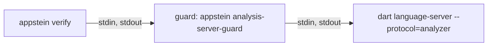

<!-- covers:
packages/appstein_engine/lib/src/verify/**
packages/appstein_protocol/lib/src/verify/**
packages/appstein_cli/lib/src/verify_command.dart
packages/appstein_engine/lib/src/mcp/verify_tool.dart
packages/appstein_engine/lib/src/analysis/**
packages/appstein_cli/lib/src/analysis_guard_command.dart
-->

# Verify

`appstein verify` checks a project against its knowledge and reports **findings** (spec §9). An agent runs it after a change and before it says a task is done. It is the part of Appstein that says "no".

This page covers the frame and the checks of slice 1d.1, and what slice 1d.2 has built so far: the analysis server, the code checks `dart.error`, `dart.deprecated`, `dart.warning`, `dart.lint`, `dart.unformatted`, `dart.fix_pending` and `dart.unreadable`, the [unverified files](#the-unverified-files) with `--files`, [`--apply`](#--apply), the test check, `test.failed`, the server `appstein mcp` keeps running so the `verify` tool answers from warm analysis, and the `// appstein:ignore` comments that hide a finding in Dart code. The lint rules, the package gate and the Android and iOS checks arrive in slices 1d.3 to 1d.6.

**`verify` writes no project file** unless it is given `--apply` (the tool's `apply`): every check only reads, and the pending fixes and the formatting are asked of the analysis server without writing anything. So a CI job can run it on the code it checks. The engine's tests prove it byte for byte on a project with pending fixes and unformatted files. (`flutter test`, which a full run starts, leaves its own outputs; see [the tests](#the-tests).)

## What a run does

With `--apply` (or the tool's `apply`), the caller first fixes and formats the project ([`--apply`](#--apply)), and then `runVerify` runs as below, so its refresh and its reading are of the rewritten files.

[`runVerify`](../../packages/appstein_engine/lib/src/verify/verify_run.dart) does eight things, in this order:

1. **Refresh the knowledge**, as `appstein sync --detect` does ([`refreshKnowledge`](../../packages/appstein_engine/lib/src/knowledge/knowledge_refresh.dart), shared with `appstein docs`). The MCP server has already done this before every tool call, so it passes its result in and the knowledge is refreshed once. The refresh is what adds changed files to the [unverified files](#the-unverified-files).
2. **Read the unverified files**, once, from `state.json`, and add the files the run was given (`--files`, or the tool's `files`). Every part of the run uses this one set.
3. **Gather what is slow**, before the lock. Each selected check that implements `GatheringCheck` gets a `VerifyGathering` and asks it for what it will judge. Today that is the code analysis's reading; for `dart.deprecated`, the `// ignore:` comments in the project's source files and whether `dart fix` can migrate each use on an unverified file; for `dart.unformatted`, which Dart files the project's formatter would change; and in a full run, for `dart.fix_pending`, the fixes `dart fix` would apply. The same pass over those files also reads the project's `// appstein:ignore` comments (see [in Dart code](#in-dart-code)). The reading is taken **once per run** however many checks ask: every check judges the same reading, as every check judges the same knowledge. It comes after the refresh, which may fetch the packages the analysis reads. A full run also runs the project's tests here, once ([the tests](#the-tests)). See [gathering](#gathering-before-the-lock).
4. **Take the knowledge lock** and read the knowledge once. Every check gets the same [`VerifyContext`](../../packages/appstein_engine/lib/src/verify/verify_check.dart): the project folder, its `appstein.yaml`, its packs, one `KnowledgeSnapshot`, the decision records, the mode, the unverified files and what was gathered. Under the lock a check only judges; nothing asks the analysis server there.
5. **Run the checks** the mode selects. `fast` runs the fast checks; `full` (the default) runs every check.
6. **Apply `verify.severity`** from `appstein.yaml`, which can raise or lower a finding's severity.
7. **Apply the suppressions**: the entries of `appstein.yaml` and the `// appstein:ignore` comments in Dart code ([suppressions](#suppressions)).
8. **Ask each `FollowingCheck` that ran** what it adds now that the findings that stay are known, apply `verify.severity` to that, then sort the findings. Only `test.failed` does this today ([hidden errors](#the-tests)). Still under the lock, it writes the unverified files the run leaves to `state.json` ([which files leave](#the-unverified-files)): a file whose errors were all hidden, by an entry or a comment, leaves as one with none, except a file that could not be read, which never leaves.

**When the knowledge can't be refreshed** (no Flutter SDK, packages not fetched, a map file that can't be read, another sync holding the lock), the run still happens. A busy lock is waited for once, for the lock timeout; the checks then run without it, because files are replaced whole and reading is safe.

- it reports `knowledge.stale` as an **error**, with the reason;
- a check that reads the project map (`needsMap`) is not run, and is named in `notRun`;
- every other check runs. One that reads the map for only part of its work asks `context.mapProblem`, leaves that part out and reports it with `context.skipped(id)`, which names it in `notRun` too. The decisions check does this for `stack.provider`;
- a suppression of a check that did not run, or ran in part, is not reported as unused: its finding may only be missing.

Old map files usually stay on disk when a refresh fails, and they still parse. `mapProblem` is set all the same: a check judging an old map would give wrong answers that look right, which is worse than saying it didn't run. Nothing is judged against old knowledge, and nothing is skipped silently (spec §9).

The same holds when `.appstein` itself can't be opened (it is a file, or the folder is read-only): `knowledge.stale` with the reason, never a crash.

**A check that throws** is Appstein's failure, not the project's: `runVerify` throws a `VerifyCheckError` naming the check, and the CLI exits 3. The same happens when a check reports an ID it didn't declare.

**An analysis server that can't answer** is Appstein's failure too, but no check's: `runVerify` passes the `CodeAnalysisException` on as it is, and the CLI prints its reason and exits 3. It is never a finding, and never read as "no errors". See [when the server can't answer](#when-the-server-cant-answer).

**Tests that can't be run at all** (no Flutter SDK, or `flutter test` could not be started) are the same kind of failure: `runVerify` passes the `TestRunException` on, and the CLI prints its reason and exits 3. A `flutter test` that started and gave no result is a finding. See [the tests](#the-tests).

### Gathering, before the lock

The knowledge lock is shared: while `verify` holds it, an `appstein sync` or another agent's MCP call waits, and gives up after 10 s. An analysis server can take far longer than that to start. So nothing slow happens under the lock.

- **A check with slow work implements `GatheringCheck`.** Its `gather` runs before the lock and asks the run's [`VerifyGathering`](../../packages/appstein_engine/lib/src/verify/verify_check.dart); its `run` runs under the lock and reads the answer from the context.
- **`gathering.code()`** is the code analysis's reading. The first check that calls it asks the analysis server; the others get the same reading. A run in which no selected check calls it asks nothing, and starts no server.
- **`context.code`** is that reading, for a check that asked for it in its own `gather`. Any other check that reads it gets a `StateError` that names it and fails the run, also when another check of the run gathered the reading: a check that only works beside another one would read nothing in a run that leaves the other out. A check can therefore never take "nobody asked" for "no diagnostics".
- **`gathering.deprecationIgnores()`** is the list of what tells the analyzer not to report deprecated use (the `// ignore:` comments and the `analysis_options.yaml` entries), read from the files the analysis server analyzed (see [`dart.deprecated`](#dartdeprecated)). The first call takes the run's reading, which says which files those are, and reads them once; a check reads the list from **`context.deprecationIgnores`** under the same rule as `context.code`: only the check that gathered it may read it.
- **`gathering.suppressionComments()`** is the list of `// appstein:ignore` and `// appstein:ignore-file` comments of those same files. Unlike the others it is not asked by a check: `runVerify` calls it itself once every check has gathered, and it comes from the same pass as `deprecationIgnores()`, so each file is read and parsed once. When no check took the code analysis's reading, none is taken for it: no server is started for the comments, and the list is empty.
- **A check is not asked to gather** when the mode doesn't select it, or when it needs the map and the refresh failed: it will not run.
- **`gathering.tests()`** runs the project's tests, once per run, and **`context.tests`** is what they gave, under the same rule: only for a check that asked for it in its own `gather`. A run in which no check calls it starts no test.
- **`gathering.dartFixes()`** asks the analysis server, after the reading, whether `dart fix` can migrate each use of a deprecated API on the unverified files (`CodeAnalysis.canDartFix`), and **`context.dartFixes`** holds the answers, by diagnostic, under the same rule. Uses elsewhere are not asked about. `dartFixBudget` (1 s) caps the time a run spends asking: each question is given the time left as `within` and the analysis gives it up (a `TimeoutException`) when that runs out, so the time the call spends waiting for the MCP server's turn is never counted; a question the analysis can't answer stops the asking, and that stays a soft fallback (a hint only makes a finding more or less specific, where a formatting question that fails fails the run); an unanswered use gets the general hint (see [`dart.deprecated`](#dartdeprecated)).
- **`gathering.unverified`** and **`context.unverified`** are the same `UnverifiedFiles`, read before any check gathers: what is gathered and what is judged never see two different sets, even when `state.json` changes while the run gathers. Any check may read it; it needs no gathering.
- **`gathering.formatting()`** asks the analysis server, after the reading, which Dart files its formatter would change (`CodeAnalysis.formatChanges`), and **`context.formatting`** holds the answer (a `FormatReading`), under the same rule. A fast run asks about the unverified files, a full run about every Dart file the reading lists. It is capped by a budget held by the analysis, reports what it could not ask or the server refused, and fails the run when the server fails (see [`dart.unformatted`](#dartunformatted)).
- **`gathering.pendingFixes()`** asks the analysis server, after the reading, for the fixes `dart fix` would apply to the whole project (`CodeAnalysis.pendingFixes`, in passes on overlays, never on disk), and **`context.pendingFixes`** holds the answer (a `PendingFixes`), under the same rule. Only `dart.fix_pending` asks, so only a full run. It is capped by `fixBudgetFull` (120 s), held by the analysis; passes not finished by then, or a pass the server refused, are said in `PendingFixes.unfinished`, and a server that fails fails the run (see [`dart.fix_pending`](#dartfix_pending)).
- **Later slow work goes in the same place:** a method on `VerifyGathering` that a check calls from `gather`, and a getter on the context, as the formatting and the pending fixes are.

**A check can name itself as not run.** A check that decides not to do its work calls `context.notRun(id, reason)` with a reason of its own, and the run names it in `notRun` with that reason. `test.failed` does this while the code has analyzer errors. A suppression of a check named this way is not reported as unused. (`context.skipped(id)` is the same thing with the fixed reason "the project map is not up to date".)

## The checks so far

[`checksFor`](../../packages/appstein_engine/lib/src/verify/engine_checks.dart) builds the list: the engine's checks, then each pack's. Two checks that declare the same ID are a `StateError`.

| ID | Severity | Mode | Needs the map | What it finds |
|---|---|---|---|---|
| `knowledge.stale` | error | both | | The knowledge could not be brought up to date. Reported by the frame, not a check |
| `docs.stale` | warning | full | yes | A page of the human docs is missing, behind the app, edited by hand, in a merge conflict, or no longer rendered |
| `decision.drift` | warning | full | | An accepted decision names a check that no longer holds, or a check no pack provides |
| `decision.unreadable` | warning | full | | A decision file or the folder can't be read, or decisions supersede each other in a circle |
| `decision.duplicate` | warning | full | | Two decision files have the same number |
| `memory.lessons_long` | info | full | | `.appstein/memory/lessons.md` has more than 200 lines |
| `verify.test_required` | warning | full | yes | A feature has no test |
| `dart.error` | error | both | | An analyzer error, anywhere in the project |
| `dart.plugin_failed` | error | both | | An analyzer plugin could not be loaded, so its rules were not checked. The ID is provisional until the owner confirms it |
| `dart.deprecated` | error | both | | A use of a deprecated API, anywhere in the project; an `// ignore:` or `// ignore_for_file:` comment that names such a use or says `type=hint`; an `analysis_options.yaml` entry that switches the diagnostic off |
| `dart.unreadable` | error | both | | A Dart file the analysis covers that could not be opened and read, so nothing in it was checked |
| `dart.warning` | warning | both | | An analyzer warning: in a fast run only on the unverified files, in a full run anywhere |
| `dart.lint` | info | both | | An info-level diagnostic (most lints): in a fast run only on the unverified files, in a full run anywhere |
| `dart.unformatted` | warning | both | | A Dart file whose formatting the project's own `dart format` would change: in a fast run only on the unverified files, in a full run anywhere. Generated and excluded files are left out |
| `dart.fix_pending` | warning | full | | The fixes `dart fix` would apply: one finding per file and code, with the count, on the file with no line |
| `test.failed` | error | full | | A failing test, a test file that can't be loaded, a test run that did not finish or gave no result, or tests not run because every analyzer error is hidden |
| `suppression.no_reason` | error | both | | A suppression has no `reason` |
| `suppression.unknown_check` | error | both | | A suppression names an ID no check reports |
| `suppression.unused` | warning | full | | A suppression hides nothing |

The `dart.*` checks but `dart.fix_pending` are the fast checks so far: a fast run never runs `dart.fix_pending`, and does not name it as not run. `verify --fast` on a project whose code compiles, uses no deprecated API and has no warning, lint or unformatted file among its unverified files reports nothing.

**`dart.error`** ([source](../../packages/appstein_engine/lib/src/verify/checks/dart_error_check.dart)) reads the run's code reading and reports each diagnostic of error level. It reports them wherever they are, in a fast run too: breaking a class in one file gives an error in the file that uses it, and that is the one the agent must hear about.

- It reports what `dart analyze` shows as an error. That includes an error in a file the analyzer reads that isn't Dart, such as `analysis_options.yaml` or `pubspec.yaml`, and a `TODO` comment the project made an error in `analysis_options.yaml`.
- The message is the analyzer's own, followed by its code in backticks, such as ``The getter 'sides' isn't defined for the type 'Shape'. (`undefined_getter`)``. The code is what a developer looks up or names in `analysis_options.yaml`.
- The fix hint is the analyzer's suggested correction, when it has one.
- The file is from the project root with `/` on every system, and the line is the analyzer's.
- It needs no map, so it runs while the knowledge is stale. A project whose code doesn't resolve gets its `dart.error` findings beside `knowledge.stale`.
- Warnings and info-level diagnostics are [`dart.warning` and `dart.lint`](#dartwarning-and-dartlint).
- One error is left to another check: the use of a deprecated API that the project raised to an error is a [`dart.deprecated`](#dartdeprecated) finding and is not reported here as well.
- It is a known ID like any other: a `suppressions:` entry hides it and `verify.severity` changes it.

**`dart.plugin_failed`** ([source](../../packages/appstein_engine/lib/src/verify/checks/plugin_failed_check.dart)) reports each analyzer plugin the analysis server could not load or run, for example one whose package can't be resolved. The server says so once and then reports its analysis done as usual, without that plugin's rules. Without this finding, a project whose lint plugin is broken would read as a project with no lint problems. `dart analyze` prints the same message and fails (its exit code depends on what else it found).

- It is an error about the project as a whole (no file), so no suppression hides it.
- The message is the server's own, on one line, without its stack trace. The fix hint names the plugin's entry under `plugins:` in `analysis_options.yaml` and `appstein doctor`.
- The ID is written in one place, the constant `pluginFailedId`, because the owner has not confirmed it yet.

### `dart.deprecated`

**`dart.deprecated`** ([source](../../packages/appstein_engine/lib/src/verify/checks/dart_deprecated_check.dart)) makes every use of a deprecated API an error, wherever it is in the project, in a fast run too. It is how `verify` checks "zero deprecated-API findings in final code" (spec §18, "M1 is done when"). Under the one ID it reports the uses the analyzer shows, and the three things that tell the analyzer not to show them: a comment that names the diagnostic, a comment that says `type=hint`, and an `analysis_options.yaml` entry.

**The deprecated-use codes** are a fixed list, `deprecatedUseCodes`, and `isDeprecatedUseCode` asks it, in any letter case. The same list serves the diagnostics and the comments. A name that only starts like one (`deprecated_member_use_foo`) is not on it.

| Name | What it is |
|---|---|
| `deprecated_member_use` | The analyzer's diagnostic for an API of another package or of the SDK. The code the server sends |
| `deprecated_member_use_with_message`, `deprecated_member_use_implicit`, `deprecated_member_use_implicit_with_message` | The longer names of that diagnostic's forms. The server never sends them; an `// ignore:` comment may use one, and it then hides only that form (`…_implicit` is the form for a type referenced implicitly, so above an ordinary call it hides nothing) |
| `deprecated_member_use_from_same_package` | The lint for the project's own deprecated APIs, which a project switches on in `analysis_options.yaml`. The code the server sends |
| `deprecated_member_use_from_same_package_with_message`, `…_without_message` | The longer names of the lint's two forms, for a comment |

The first four are read from the `analyzer` package the engine pins, and a test fails when an upgrade adds or removes one. The lint lives in the Dart SDK and no package lists its names, so the last three were established by running the pinned SDK's analyzer; a test with a real server fails when one of them stops hiding the lint, but none would notice a fourth name.

**A use the analyzer reports.** Each diagnostic whose code is on that list.

- The analyzer calls these info-level; the finding is an error all the same. A project that makes one a warning or an error in `analysis_options.yaml` changes nothing here.
- The message is the analyzer's own, followed by its code in backticks, as for `dart.error`.
- **The fix hint says what `dart fix` can do for the use, on an unverified file.** There the analysis server is asked, while gathering, for its fixes at the diagnostic's position (`edit.getFixes`, `CodeAnalysis.canDartFix`). When one of them is a data-driven fix (`dart.fix.dataDriven`, a migration the package that deprecated the API describes in its `fix_data.yaml`), the hint is `` The package that deprecated this API describes a migration for it (`fix_data.yaml`): `dart fix --apply` applies it, unless the package marks it for the IDE only. Or replace it with the API the message names. `` It says no more because the server offers a migration the package marked `bulkApply: false` the same way, and `dart fix --apply` skips that one (checked with a real server: both were offered by `edit.getFixes`; `edit.bulkFixes` for the file listed only the other). When none is offered, the hint is `` `dart fix` can't migrate this use: replace it with the API the message names. `` Elsewhere, and for a use that was not asked about, it stays general: replace the API with what the message names, and `dart fix --dry-run` lists what it can migrate. A test with a real server and a stand-in package's `fix_data.yaml` shows all three.
- **What the questions cost, and their cap.** On the fixture app, measured three times in the engine's test: a first question 15 to 68 ms, three questions 41 to 114 ms, and an answer asked again 0.02 to 0.03 ms. `AnalysisServer` keeps each answer by the file, the hash of the text the server analyzed, the offset and the code, for as long as the server runs, so a kept server asks about a use in an unchanged file once; a new server (after a settings change) asks again. The text is the one the reading was taken from: the file is read whole before and after the reading in which the server read it, and when the two reads differ the text is not known and no answer for that file is kept, so an edit between the reading and the question can't file an answer under the wrong text (tested with a real server: a use with a migration swapped for one without, at the same offset). `dartFixBudget` (1 s) is a real cap on the time a run spends asking: each question is given only the time left, a question still unanswered then is given up (the server's late answer is dropped), and no new one is asked. A question the analysis can't answer (a `CodeAnalysisException`: the server died after its reading, another call replaced it) stops the asking the same way; neither fails the run or names a check. Any other error is a bug and fails the run as the check's.
- The analyzer's other `deprecated_*` codes (`deprecated_export_use`, `deprecated_extend`, `deprecated_implement` and the rest) are not this check's: the spec names `deprecated_member_use*` only.

**A comment that names one of those codes.** An `// ignore:` or `// ignore_for_file:` comment that names a deprecated-use code can make the analyzer drop the diagnostic, and then the server's reading can't show it. The check therefore reads the source files itself, before the knowledge lock ([`deprecation_ignores.dart`](../../packages/appstein_engine/lib/src/verify/deprecation_ignores.dart)), and reports each such comment on its own line.

- **Which files:** exactly the files the analysis server analyzed for this run's reading. The server sends its diagnostics for every file it analyzes, with an empty list for a file that has none, and the reading keeps their names (`CodeReading.analyzedFiles`). So a file `analysis_options.yaml` excludes is not read, and a part file whose name doesn't end in `.dart` is. An `analysis_options.yaml` on the list is read for its entries (below). The other `.yaml` files and the `.xml` files on it are skipped: the analyzer reads those as something other than Dart.
- **How they are read:** a few at a time, without blocking, once per run. A file that names no such code is never parsed. Measured on the Windows development machine on 2026-10-14, on an idle machine, from source: a median of 43 ms for 200 files and 142 ms for 1,000, each of 120 lines, one in twenty with a comment. The first run of a process took 0.3 to 0.5 s, most of it compiling the parser.
- **A file that can't be read is left out here.** The analysis server can't read it either: it then lists the file as analyzed and reports no diagnostic for it, so the use and the comment go unreported together. That file is a [`dart.unreadable`](#dartunreadable) error instead, so it never reads as clean.
- **What counts as an ignore comment**, and which names it cites, is the analyzer's own code (`ignoreComments` and `ignoredElements` of its `ignore_info.dart`). That is how a comment is told from the same text in a string. It is in the analyzer's `src/` folder, which is why `pubspec.yaml` pins the analyzer exactly, and it is the rule of **that package, not of the analyzer in the project's SDK** that answers the server. The two can differ after an SDK upgrade.

**A comment is reported for naming the code, not for what it hides.** Whether the analyzer drops a diagnostic because of it depends on the use it stands at, which the check doesn't look at. The two differ in both directions:

| In the source | Does the analyzer drop a diagnostic? | Reported |
|---|---|---|
| `// ignore: deprecated_member_use` alone on the line above the use, or at the end of its line | yes | yes |
| `//ignore:deprecated_member_use`, `// ignore: DEPRECATED_MEMBER_USE`, `/// ignore: deprecated_member_use` | yes | yes |
| `// ignore: unused_import, deprecated_member_use, and some words` | yes | yes |
| `// ignore_for_file: deprecated_member_use`, anywhere in the file | yes | yes |
| The name of another form or of the other diagnostic: `…_implicit` above an ordinary call, `…_from_same_package` above another package's API, or the reverse | no | yes |
| The comment with a blank line or another comment line between it and the use, or at the end of a statement that began on an earlier line | no: it is read for the next line, or for its own (not run; it follows from the analyzer's code) | yes |
| `// ignore: some_plugin/deprecated_member_use` | no: it names a plugin's code | yes |
| `// ignore: deprecated_member_use_foo`, `// ignore: unused_import` and any other name | no | no |
| The same text in a string, in a doc comment's code sample (`/// // ignore: …`), or in a block comment | no | no |
| `/// ignore_for_file: deprecated_member_use`, `// ignore : …`, `// see ignore: …`, `// ignore: unused_import deprecated_member_use` (no comma) | no | no |
| `// ignore: type=hint`, `// ignore_for_file: TYPE = HINT`, alone or among codes | yes: every hint, `deprecated_member_use` among them | yes, for saying `type=hint` |
| `// ignore: type=lint` | yes, but only the same-package lint | **no** (the owner's decision: a project chooses to have that lint, and generated files carry `type=lint` widely) |
| `// ignore: type=warning`, `type=hints`, `type=hint.` | no | no |

Except where a row says otherwise, each was compared with `dart analyze` of the pinned SDK (3.13.4) on 2026-10-14.

- The message says which codes the comment names, or that it says `type=hint`, and what that tells the analyzer to do. It doesn't claim that a use is hidden, or that a deprecated API is used there: a `type=hint` comment is reported for hiding every hint, deprecated use included. A comment that both names a code and says `type=hint` gives two findings.
- The fix hint names the visible way out: take the code out of the comment (or name the hints to hide in place of `type=hint`) and replace the API, or accept the finding with a `suppressions:` entry for `dart.deprecated` with a `reason` in `appstein.yaml` (spec §9.7).

**An `analysis_options.yaml` entry that switches the diagnostic off.** Under `analyzer: errors:`, an entry that names a deprecated-use code the analyzer accepts there, with a value it reads as "ignore", is a finding on that file, on the entry's line (`deprecationSwitchesIn`); so is such an entry in a file an options file includes (below). It says the entry tells the analyzer not to report deprecated use in the files that options file covers, and its fix hint names the same way out.

```yaml
analyzer:
  errors:
    deprecated_member_use: ignore   # dart.deprecated, line 3
```

- **Every options file the analysis covers is read:** the root's and any in a folder below it, and, when the project root has no `analysis_options.yaml` of its own, the nearest one in a folder above it. The first two kinds are on the server's list of analyzed files like the Dart files, so they are read in the same pass, before the lock. The one above is not on that list (all its entries are inside the root), so the check looks for it itself: the analyzer applies it to a project without its own file, and with the entry it reports nothing at all (measured on 2026-10-14 with a project at `parent/app`: `dart analyze` showed no diagnostic and the entry was in `parent/analysis_options.yaml`). Compared with `dart analyze` of the pinned SDK: the nearest file wins, a `pubspec.yaml` in a folder between does not stop the search, and a root with an options file of its own, however short, makes the analyzer ignore every file above it, so none is read then. Each of these files is also where the walk through its `include:` starts (next bullet).
- **An `include:` of a local file is followed** (`_includedEntries`, `readDeprecationIgnores`), from each options file the analyzer applies, and a switch-off found in an included file is a finding on that file, on the entry's line. The analyzer merges the included settings under the including file's own, and so does the check; every rule was compared with `dart analyze` of the pinned SDK (3.13.4) on Windows on 2026-10-14:
  - The text is a URI resolved against the folder of the file that includes it: `x.yaml`, `sub/x.yaml`, `../x.yaml`, `./a/../x.yaml`, `sub\x.yaml` (the URI parser reads it as `sub/x.yaml`), a space written plain or as `%20`, and a `file:///` URI all work, with any file name. A drive path such as `C:/dir/x.yaml` or `C:\dir\x.yaml` is read as a URI with the scheme `c`, which the analyzer cannot find (it warns `include_file_not_found`), so it names no file here either.
  - **The nearest setting wins**, for each code on its own: the including file's entry over what it includes, and over a chain (A includes B includes C: A over B over C). `info`, `warning` and `error`, in any letter case, take a switch-off back, so the file is not reported; `ignore` and `false` in the including file make that entry the one reported in place of the included one; `true`, an unknown word or no value change nothing; the other code's entry changes nothing. Within one file the later entry wins, whatever the letter case of the name.
  - **A list** (`include:` with `- a` and `- b`) is accepted, and a later entry wins over an earlier one: `[hide, info]` reports the use, `[info, hide]` does not.
  - **A cycle** (A includes B includes A) is cut where it comes round, as the analyzer does with a warning, and the rest still applies. The walk also stops after 256 files.
  - **Not followed, quietly:** `package:` includes (below), a file that is missing, a directory, or not YAML, and any other scheme. They add nothing and fail nothing; a missing file inside a chain does not stop the entries of the file that names it.
  - An entry is reported **once** however many options files include its file; `includedBy` on the entry names them. An entry of an options file the analysis already covers is reported as its own entry and not a second time as an included one.
- **The finding's file for an options file above the project, or an included file above it,** is its path from the project root with `/`, such as `../analysis_options.yaml` or `../../base_options.yaml` (an included file inside the project is `shared/base_options.yaml`, with the ordinary hint and way out). No `suppressions:` path can match a file above, because the config refuses a path that leaves the project, so that finding has no suppression and its fix hint says so. Two hints, by who includes the file:
  - When an options file of the project **already includes** it, the hint is the short one: set the code back to `info` under `analyzer: errors:` in that file (it is named), whose setting wins, or remove the entry from the shared file.
  - Otherwise (the entry is in the options file the analyzer applies from above, or in a file only that one includes) the hint says to give the project an `analysis_options.yaml` of its own that names the file above under `include:` and sets the code back to `info`. It asks for the `include:` because the analyzer reads the project's file in place of the one above: without it, every shared rule would go with the entry. With it, the shared rules still apply and the deprecated use is reported again (compared with `dart analyze` of the pinned SDK on 2026-10-14: a shared file that also made `unused_local_variable` an error gave that error and the `deprecated_member_use` info).
  - The message of an included entry says it tells the analyzer not to report deprecated use in the files covered by the options files that include its file. Everything else about it is as for any other entry.
- **Which values:** `ignore` and `false`, in any letter case, quoted or not. That is the analyzer's own list. With `info`, `warning` and `error` the diagnostic is still reported, so they are not findings; neither are `true`, `off`, `none` or an empty value, which the analyzer doesn't accept. Compared with the pinned SDK on 2026-10-14.
- **Which names:** only the two codes the analyzer accepts here, `deprecated_member_use` and `deprecated_member_use_from_same_package`, in any letter case. The five longer names of the list above are for an `// ignore:` comment only: under `analyzer: errors:` the analyzer warns `unrecognized_error_code` and still reports the diagnostic, so such an entry hides nothing and is not reported (each of the seven names compared with `dart analyze` of the pinned SDK on 2026-10-14).
- **A file that isn't valid YAML** gives no finding and never fails the run.
- **Not reported, on purpose:** leaving a folder out with `analyzer: exclude:`, and not switching the same-package lint on (or switching it off under `linter: rules:`). Both are ordinary project choices.
- **A known limit:** an `include:` into another package (`package:some_package/analysis_options.yaml`) is not followed, though the analyzer follows it (measured: a `package:` include of a file with the entry hid the use). A shared options package can switch the diagnostic off unseen. Only an include of a local file is followed.
- A use and a comment in the same file are separate findings. A `suppressions:` entry for the file or folder hides both, and `verify.severity` changes both. So does a `// appstein:ignore dart.deprecated — <reason>` comment: it hides the use the analyzer reports and the `// ignore:` comment that hides one, both being findings of `dart.deprecated` with that file ([in Dart code](#in-dart-code)).
- It needs no map, so it runs while the knowledge is stale.
- A deprecated use that `analysis_options.yaml` raised to an error is reported once, as `dart.deprecated`: `dart.error` leaves out the diagnostics on the list. So `verify.severity` for `dart.deprecated` and a suppression of `dart.deprecated` apply to such a use too, and there is no `dart.error` finding left to change or hide for it.

### `dart.warning` and `dart.lint`

**`dart.warning`** and **`dart.lint`** ([source](../../packages/appstein_engine/lib/src/verify/checks/dart_level_checks.dart)) report the analyzer's other diagnostics at the analyzer's own level, so `verify` agrees with the developer's IDE and `dart analyze`:

- A diagnostic of level warning is a `dart.warning` **warning**; one of level info (most lints, and hints) is a `dart.lint` **info** finding. The level is the one after the project's `analysis_options.yaml`, so a lint the project made a warning is a `dart.warning`, and one it made an error is a `dart.error`.
- Each has the file, the line, the analyzer's message followed by its code in backticks (``Unused import: 'dart:math'. (`unused_import`)``), and the analyzer's correction as the fix hint when it has one.
- **A full run reports them everywhere; a fast run only on the [unverified files](#the-unverified-files).** An agent isn't shown old lints in files it never touched, and the lints of a file it changed stay in view until the file has no error.
- The use of a deprecated API is left out of both, whatever its level: it is `dart.deprecated`'s (`isDeprecatedUseCode`). A `TODO` the analyzer notes at info level is not in the reading at all.
- A diagnostic of an analyzer plugin (the `appstein_lints` plugin's, for one) arrives the same way and is reported under these IDs by its level, until slice 1d.3 gives the rules their own IDs.
- They need no map, so they run while the knowledge is stale. `verify.severity` changes them and a suppression hides them, like any other ID: `dart.warning: error` in `verify.severity` makes a team's warnings block.

### `dart.unformatted`

**`dart.unformatted`** ([source](../../packages/appstein_engine/lib/src/verify/checks/dart_unformatted_check.dart)) is a warning on each Dart file whose formatting `dart format` would change. It has the file and no line, and the fix hint names `appstein verify --apply` (which formats the project) and `dart format` on the file. The check itself never writes a file.

- **The project's own formatter decides.** The analysis server of the project's SDK is asked (`CodeAnalysis.formatChanges`; `AnalysisServer` sends the legacy protocol's `edit.format` and reads an empty list of edits as "no change"), so `verify` never asks for a format the developer's tools would undo. The server applies the project's `formatter:` settings from `analysis_options.yaml` and the language version of each file. The engine's tests run the real `dart format --output=none --set-exit-if-changed` of the SDK that runs them on a fixture with formatted and unformatted files, a page width of 120 and then of 80, `trailing_commas` left at its default and then set to `preserve`, a file that starts with `// @dart=3.6` (laid out in the style before Dart 3.7) beside its twin without the line, LF and CRLF files, a file with a byte order mark, an empty file, a file with no final line end and a file with an analyzer error, and require the same set of files. Where the pinned `dart format` changes a file, so does the check: that includes a **zero-byte** Dart file, which `dart format` gives a line end.
- **Which files are asked about.** A full run asks about every Dart file the reading lists (`CodeReading.analyzedFiles`); a fast run only about the [unverified files](#the-unverified-files). Left out, never asked about:
  - a file `analysis_options.yaml` excludes: the analysis does not cover it, so the reading does not list it;
  - a file that starts with a `GENERATED CODE - DO NOT MODIFY` header (`lookAtDartFile`). The header is looked for in the comment lines before the first line of code, in the first 4 KB of the file, so a license comment may come first; the words after code, or in a string, do not make a file generated;
  - a file that could not be read (`CodeReading.unreadableFiles`): the server read it as empty, and that is `dart.unreadable`'s;
  - a file that is no longer on disk: the server lists a deleted file until it notices, and asked about it, its formatter answers for the empty text of a file that is not there;
  - files whose name doesn't end in `.dart`: `pubspec.yaml`, `analysis_options.yaml`, and a part file named, say, `odd.part`, which `dart format` over a folder does not take either. A part file that ends in `.dart` is asked about like any other.
- **A file that can't be parsed** gives no finding: the server refuses to format it (`FORMAT_WITH_ERRORS`, answered false), and its `dart.error` says why.
- **A file the server refuses for any other reason is that file's alone.** A formatter that throws on one file (the server answers `SERVER_ERROR`) puts only that file among the files not checked, with the server's words in the line; the answers for the other files are kept and used.
- **The questions are asked while gathering**, after the reading and before the knowledge lock (`VerifyGathering.formatting`), never under it. The legacy protocol answers one question in about 15 ms, but that is the server's latency and not its work: `AnalysisServer` sends the questions together, 32 at a time (the most files the look keeps open, since each answer reads its file again, see below), and 100 files take 30 to 125 ms. Measured on the pinned SDK with a ready server: 200 files in 114 to 131 ms (200 ms once, while another run loaded the machine), the same files asked again in under 1 ms, and `VerifyGathering.formatting` on 231 files, with the answers kept, in 52 to 67 ms, which includes the look at each file's header.
- **The answers are kept** by file and the hash of the text the reading took, for as long as the server runs, as `canDartFix`'s are, so a file that did not change is asked about once. A change to a file that sets how the project is analyzed (an `analysis_options.yaml`, the page width included, or a file it includes) starts a new server, which has no kept answer.
- **An answer must be about the text the reading saw.** The server answers from its own copy of the file, which its file watcher may have updated after the reading. So each time an answer arrives the file is read again and its text hashed; when it is no longer the reading's text (edited, deleted, or locked), the answer is not kept and not used, and the file is among the files not checked, with that reason. A reading that has seen the edit asks again. The re-read compares the text, so it also finds the one edit the reading's look cannot: the **known limit** of the look is a same-size edit whose file time was put back, which the look takes for no change, and a file edited so is read as unchanged by the look; here it is found at the first question, and named not checked for that run. The file is also noted (`_renew`), and the next reading tells the server about it again whether or not the look sees it change: the server reads it afresh, the reading takes its text anew, and the next run gets fresh diagnostics and a fresh answer. So only one run is partial because of it, and the files can leave the unverified files in the run after (a partial run lets none leave). The same re-read comes before the answer for a file that does not parse (`FORMAT_WITH_ERRORS`, "would not change") is used or kept, so an edit to a broken text, and an undo, cannot be served that answer for the old text. An answer whose text the reading did not record (a file the look could not read whole) is used for the run and not kept.
- **The time limit is on the question, not on the wait for the turn.** `formatBudgetFast` (1 s) for a fast run and `formatBudgetFull` (60 s) for a full run, which only keeps a server that stopped answering from holding the run for good. `CodeAnalysis.formatChanges` and `canDartFix` take the time as `within`, counted from when the question is asked of the server, and each implementation holds it (`AnalysisServer` on its own question, `questionGrace` past it for a server stuck on an earlier one; the MCP server's stand-in for a call that gave up its turn on the question alone, inside the part where the turn is out). `VerifyGathering` does not put a limit around the call: in `appstein mcp` the call also waits to take the calls' turn back from a parallel tool call, which may hold it for seconds, and a limit around both would report every file as not answered and let the run go on to the knowledge lock while that call still held the turn. A test holds the turn for longer than the budget and its grace with a parallel call, and checks that the answers still count and that the run goes on only after that call has ended (and fails with the limit moved outside).
- **A server that is alive but slow gives a partial run, not a failure.** Past the limit a file is **not checked, never "formatted"**: the check names itself among the checks not run (``dart.unformatted: the formatting of 3 of 40 files was not checked: the analysis server did not answer within 1 s for 3 files``), reports what it did learn, and, like any `dart.*` check named as not run, lets no file leave the [unverified files](#the-unverified-files), so the next fast run asks about them again (the kept answers make that cheap).
- **A server that dies or fails while it answers the formatting question fails the run** (the owner's decision of 2026-10-15, spec §9.5), as one that fails while it reads does: the `CodeAnalysisException` is passed on as it is, the terminal exits 3 with its reason and "Run `appstein doctor` to check your setup.", and the `verify` tool sends an error reply with the reason and `appstein doctor`. So does a question asked when no reading was taken from the running server (another caller replaced it). It is never a finding, and no file is read as formatted. (`canDartFix` keeps its softer rule: a question it cannot get answered gives the general hint, since a hint only makes a finding more or less specific.)
- It needs no map, so it runs while the knowledge is stale. `verify.severity` changes it and a suppression hides it (a `suppressions:` entry for the file, or `// appstein:ignore-file dart.unformatted — <reason>` in it, since the finding has no line).
- A warning keeps no file unverified: a formatted-wrong file with no error leaves the unverified files after the run that reported it, as one with a lint does.

### `dart.fix_pending`

**`dart.fix_pending`** ([source](../../packages/appstein_engine/lib/src/verify/checks/dart_fix_pending_check.dart)) lists the fixes `dart fix` would apply: one warning per file and code, with the count, on the file with no line: `` `dart fix` would apply fixes to this file: `deprecated_member_use: 6 fixes`. `` The fix hint names `appstein verify --apply`, `dart fix --apply` and `dart fix --dry-run`. A full run only: a fast run never runs it, never asks for the passes, and does not name it as not run.

- **The counts are `dart fix --dry-run`'s.** The analysis server of the project's SDK is asked as `dart fix` asks it (`CodeAnalysis.pendingFixes`; `AnalysisServer` sends the legacy protocol's `edit.bulkFixes` for the project folder, with `inTestMode` and `updatePubspec` false), **in passes**: each pass's edits are applied to an overlay of the file in the server's memory (`analysis.updateContent` with `add`), and the server is asked again, until a pass finds none or **four passes** have found fixes (`AnalysisServer.mostFixPasses`). Four is where the pinned `dart fix` stops: on a chain of eight migrations (`f0` to `f8` in a `fix_data.yaml`), `dart fix --dry-run` lists 4 fixes and `dart fix --apply` leaves `f4();` (the reviewer's probe, now an engine test against the real SDK for both). Reaching four is finished, as it is for `dart fix`, not cut short, so a fix that undoes another never makes every full run partial. A fix that only becomes possible after another (a migration whose result is itself deprecated) is found in a later pass, and the counts of the passes are summed per file and code, as `dart fix` sums them. The engine's tests run the real `dart fix --dry-run` of the SDK that runs them on a fixture with a data-driven migration, one that takes two passes, one marked `bulkApply: false` (which neither lists), two lints with fixes, a generated file (`dart fix` fixes it too) and an excluded folder, and require the same counts.
- **Nothing is written to disk, and nothing is judged against the fixed code.** The run's reading is taken before the first pass, and the passes are asked in turn with the readings, so no other question is answered while an overlay is in place. The overlays are removed when the passes end, also when a pass fails, is refused or runs out of time (`_onOverlays`, in a `finally`; every overlay that was sent is removed, taken or not), and the next reading tells the server those files again (`_renew`): it reads them from disk, and the diagnostics it sent about the overlays are replaced before that reading is taken. On a kept server the reading after the passes is the same, diagnostic for diagnostic, as the one before (a test with a real server).
- **A server that does not answer an overlay's change is given up.** Each overlay's `add` and the `remove` at the end have a limit of their own: the time left of the budget, and `fixRequestFloor` (5 s) at least. A server that does not answer by then, or refuses to remove an overlay, is given up and stopped at once (`giveUp`), so the overlay ends with it: the question fails with a `CodeAnalysisException` ("it did not answer an overlay of the fixes within 5 s"), which is exit 3 in the terminal and an error reply from the tool, and the next question starts a new server. A caller waits for the passes at most `fixQuestionLimit` (the budget, two floors and `questionGrace`). The scripted server shows both: an `add` and a `remove` never answered.
- **A file is only ever changed from the text the reading saw.** The server's edits are made for its own copy of the file, so they are applied only to a file whose text on disk has the hash the reading kept for it. A file edited since, or whose text the reading could not tell (it changed between the reading's two whole reads, so no hash was kept), stops the passes, with why (a test makes the change between the two reads with `afterLook`). A file of the project that is a link to a file outside it (a Windows junction in the test) is left out: never overlaid, counted or written, so `--apply` can't write through it. That is said, not silent: the counts can then be lower than `dart fix --dry-run`'s, which follows the link, so each such file is a notice of the run (`PendingFixes.notCounted`, carried by `VerifyGathering.notices` into the terminal's `Note:` and the tool's `notices`): `` `dart fix` would also fix `lib/linked/messy.dart`, which is outside the project once links are followed; its fixes were not counted in `dart.fix_pending`, and `--apply` leaves it as it is. ``
- **A time limit and a refusal** stop the passes too: `fixBudgetFull` (120 s, held by the analysis on the question, as for the formatting), a pass the server refuses, and an overlay the server refuses to take. The check then names itself among the checks not run, with why, and still reports what the finished passes found, which may be lower than `dart fix` would list. Like any `dart.*` check named as not run, that lets no file leave the unverified files. A server that fails during the passes fails the run, as for the formatting.
- **What it costs.** On the fixture app: two passes and one that found none, 0.3 to 0.5 s. On the 200-file app of `tool/measure_analysis_server.dart` (Windows development machine, 2026-10-15, without the plugin, 203 files, six deprecated uses one inside another and an unused import): the counts equalled `dart fix --dry-run`'s (which took 20.7 s), three passes, 37.1 s the first time on a server that had just become ready and 15.8 s each time after. The slice's measurement had 17 to 19 s.
- It needs no map, so it runs while the knowledge is stale. `verify.severity` changes it and a suppression hides it (a `suppressions:` entry for the file, or `// appstein:ignore-file dart.fix_pending — <reason>`, since the finding has no line). A warning keeps no file unverified.

### `--apply`

**`appstein verify --apply`** (and the `verify` tool's `apply: true`) fixes and formats the whole project before it checks it (spec §9.2). It is the one way `verify` writes a project file.

1. **Fix.** The fixes `dart fix --apply` would apply are found in passes, as for [`dart.fix_pending`](#dartfix_pending), on overlays.
2. **Format.** Each Dart file of the reading is formatted with the server's formatter (`edit.format`), the fixed text where a pass fixed it (asked while its overlay is in place), except the generated files: those `analysis_options.yaml` excludes (the analysis does not cover them, and neither tool touches them) and those that start with a `GENERATED CODE - DO NOT MODIFY` header (`lookAtDartFile`), which `dart fix` may fix but nothing formats. A file that does not parse is left as the fixes made it.
3. **Write.** The overlays are removed first, so a server that would keep one fails the rewrite before anything is written. Then each file is written once, with its final text, and only when that differs from the text on disk, **whole** ([`replaceFileText`](../../packages/appstein_engine/lib/src/analysis/analysis_server.dart)): the text goes to a new file beside it, named with a dot (`.a.dart.appstein-<process>.tmp`, which the analysis leaves out), which then takes the file's place, so a crash or a full disk never leaves a file half written.
   - **The original is written in place only when that is safe:** when the new file was written completely but could not take the original's place (on Windows, another program holds the original open without sharing its deletion) or could not be given its permissions, and when the new file could not even be created for a reason other than a full disk (a folder in which no file can be made). **A new file that could not be created on a full disk, or not written completely** (a full disk, a quota: `isDiskFull` tells them by the system's error code) is deleted, the original is left untouched, and the file is named in the result's notices with why. Tests: a file held open on Windows (written in place), a write of the new file that fails part way and a creation that fails on a full disk (the original's bytes unchanged, the file named), and a creation refused for another reason (written in place).
   - **A link to a file stays a link**: the text goes to the file it points to (a test, where file links can be made).
   - **Permissions are kept** on Linux and macOS: when the new file's permission bits differ from the original's (`permissionsToSet`), it is given the original's with one `chmod` before it takes the place; when they are the same, as usually, no process is started. A `chmod` that fails means a write in place, which is safe since the new file was complete. **The owner is not kept:** the new file belongs to whoever runs `--apply`, so in a folder shared by a group, a file another user owned becomes the runner's (a known limit of writing through a new file, which the owner chose for crash safety).
   - **After a crash.** A process killed between writing the new file and putting it in place leaves the new file in the project: a full copy of a source file, which `git add -A` would commit. The next `--apply` that writes a file in the same folder removes every such file there (a leftover in a folder it doesn't write to stays until one does), when the process named in it is no longer running (the same process lookup that guards a kill by ID) or is that `--apply` itself; one whose process still runs belongs to another Appstein, and is left. Until then it can be deleted by hand.
   - The new file is removed on every other path; the tests check that nothing is left beside the files.
4. **Then the run**, as without `--apply`: the knowledge is brought up to date, and every check runs on a reading of the rewritten files (each written file is told to the server again, and its new time and size are seen by the look anyway).

This is [`applyToProject`](../../packages/appstein_engine/lib/src/verify/apply.dart), which takes a reading and asks `CodeAnalysis.applyFixesAndFormat`. The terminal calls it inside the run's analysis scope before `runVerify`; the MCP server calls it before its freshness step. `applyBudget` (180 s) caps the passes and the formatting together; what is not done by then stays as it is, and the checks report it. Each request to the server has its own limit, as for the passes, and the server's part as a whole is limited too (`fixQuestionLimit`, for a server stuck on an earlier question): when the passes, the formatting and the removal of the overlays have not ended by then, the server is given up, the call fails, and nothing is written. So a silent server can't hold `verify --apply`, or every later `verify` call of `appstein mcp`, for ever. The writes come after that part, need no server and have no limit: a slow disk never kills a healthy server or leaves a written file unnamed (a test makes one write take longer than the whole limit).

- **A file is never overwritten with something it did not have.** A file is written only when its text on disk is still the text the reading saw and the text the fixes were applied to: one edited meanwhile, or whose text the reading could not tell, is left as it is, and what it needs stays pending. So is a file that is not valid UTF-8, which could not be written back unchanged, a file outside the project once links are followed, and one that can't be written. Each of them is named, with why (`AppliedChanges.leftAlone`), in the result's notices: ``Applying fixes and formatting left `lib/linked/messy.dart` as it was: it is outside the project once links are followed. What it needs is still reported.``
- **The same text as the real tools, byte for byte.** The engine's test copies the fixture beside itself, runs the real `dart fix --apply` and then `dart format` on its non-generated files, and requires every Dart file of the project to have the same text after `--apply`, and a CRLF file and a file with a byte order mark the same bytes: CRLF line ends are kept, and the byte order mark of a rewritten file goes, as the real tools drop it (a file `--apply` does not rewrite keeps its mark). The generated file got its fixes and kept its layout, the excluded file is untouched.
- **A run that fails after the rewrite still names the files.** The terminal prints them to stderr ("--apply rewrote these files before the run failed (read them again before you edit them):", `rewrittenBeforeFailure`) and then reports the failure and exits 3; the tool's error reply names them too.
- **A fix or a format it applied is no longer reported**: on the fixture, the run after `--apply` has no `dart.fix_pending` and no `dart.unformatted`, and a second `--apply` rewrites nothing. On the 200-file app it took 15.8 s and rewrote two files.
- **The result names each file it rewrote:** `applied` in the JSON (always there; empty without `--apply`, and when nothing was rewritten), and a section before the findings in the text (none when the list is empty). The tool's reply text starts by naming them and telling the agent to read them again.
- **`--apply` with `--fast`** is a usage error (exit 3): "--apply works with a full run only: run `appstein verify --apply` without --fast. A fast run never rewrites files." The tool refuses `apply` with `scope: fast` the same way. Files are never rewritten in the middle of an agent's work.

### `dart.unreadable`

**`dart.unreadable`** ([source](../../packages/appstein_engine/lib/src/verify/checks/dart_unreadable_check.dart)) is an error on each Dart file the analysis covers that could not be opened and read, in fast and full runs. On Windows, a file another program holds locked is listed by the analysis server as analyzed, with no diagnostic: without this check, every code check would read it as clean, `dart.error` included (shown with a real lock in the engine's tests).

- **How it is found:** the look at the disk that comes before every reading ([`DiskLook`](#a-kept-server-warm-analysis)) already takes each Dart file's time and size. It also opens each file and reads its first byte, in the same walk, so it costs no second walk of the project. Opening finds a file another program opened without sharing it; reading a byte finds a lock on the file's bytes (`LockFileEx`) that starts at the first byte. A file deleted meanwhile is not reported.
- **The files the server reads now are read whole**, before it is told of them and again after its reading (`DiskLook.readWhole`): the files that changed, appeared or could not be read at the last look, and at a server's first reading every file. A lock on bytes further in (`lockSync(FileLock.exclusive, 5)`) lets the first byte be read, and the server then reads the file as empty and reports nothing. A lock taken after the look and before the server reads the file has the same effect; the read after the reading finds it while it is still held. An unchanged file keeps the analysis the server already has, so the cheap check is enough for it. Each case has a test with a real lock and a real server.
- **What is still open:** a lock taken after the first whole read, held while the server reads the file, and gone before the second whole read. The server then analyzed the file as empty and both reads succeed, so the file reads as clean until it changes again. Giving the server the text that was read, as an overlay, would close this, and was tried: an overlay switches the server's own file watcher off for that file for good, and then a same-size edit whose time is put back (the look's known limit) was never seen again, where the watcher had seen it (the engine's freshness test). Nothing the server answers tells an empty reading from a clean file. The window is the time the server takes to read one file.
- **At most 32 files are open at once** (`openFilesAtOnce`), in the walk and in `readWhole`: a project with more Dart files than a process may open (256 in macOS's Terminal, 1,024 on Linux) would otherwise read as unreadable. A "too many open files" error (`EMFILE` or `ENFILE`, error 4 on Windows) says nothing about the file: the open is tried again, for up to a second, and never reported as `dart.unreadable`. A test counts the most files the look had open with 300 files (`DiskLook.mostOpenAtOnce`).
- **Which files:** those the look could not read **and** the server listed as analyzed for the reading (`CodeReading.unreadableFiles`). A locked file in a folder `analysis_options.yaml` excludes is not the analysis's, and is not reported. A locked file the server had never seen before (created and locked between two readings) is listed too: the engine's test of a kept server shows it.
- **When the lock is gone,** the next reading tells the server the file again (`dartChangedSince` counts every file the earlier look could not read), so its diagnostics come back even though its time and size never changed.
- The message gives the system's reason: ``This file could not be read (The process cannot access the file because another process has locked a portion of the file), so nothing in it was checked.`` The fix hint says to close the program that holds it, or wait until it has finished writing, and run `verify` again.
- **Such a file never leaves the [unverified files](#the-unverified-files)**, even when its finding is hidden or lowered: nothing in it was verified.
- `verify.severity` changes it and a suppression hides it, like any other ID.

### The unverified files

A fast run reports the smaller findings (`dart.warning`, `dart.lint` and `dart.unformatted`) only on the **unverified files**: the files changed since a `verify` run last found no error in them (spec §9.1). They are kept in `.appstein/state.json`, under `unverified`, so they survive between runs and between processes ([incremental-sync](incremental-sync.md#statejson)). A `state.json` written before this slice has no such field and no hashes of the Dart files: it is read like a missing one, without an error, and every Dart file is unverified (the owner's decision of 2026-10-14, after the second review).

**A file joins them** when the knowledge refresh sees its content changed:

- The refresh hashes every Dart file the analysis server covers ([`readDartFileHashes`](../../packages/appstein_engine/lib/src/knowledge/dart_files.dart)), not only the map's inputs (`lib/`, `test/`, `testing/`): `bin/`, `tool/`, `integration_test/` and the rest, walked as the server walks them (details in [incremental-sync](incremental-sync.md#statejson): dot folders and what `analysis_options.yaml` excludes are left out; `build/` and `ios/Pods/` are walked, since the server analyzes them; links are followed). The hashes are kept in `state.json`'s `dartFiles`. A file whose hash differs from the one kept, a new file and a deleted file join (`unverifiedAfterRefresh`). The map's own inputs are not hashed twice, and a file the scan hashed itself is read again only when its time or size changed (the same limit as the look: a same-size edit whose time is put back is not seen).
- A changed Dart file outside the map's folders rebuilds nothing: `sync --detect` still says current, and only writes `state.json` with the new hashes and the file added. A busy lock leaves that for a later refresh, which compares with the same kept hashes, so no change is lost.
- Every refresh does this: `appstein sync`, `sync --detect`, the refresh before every MCP tool call and the one `verify` runs. A change seen by the refresh of another tool's call is therefore not lost before `verify` runs.
- **Nothing counts as verified before it was checked** (the owner's decision of 2026-10-14). With no earlier state (the first sync of a project, a `state.json` that was deleted, one that can't be read, or one written before this slice, which has no hashes), every Dart file is unverified. A project's first fast run therefore reports every warning and lint, and each file with no error then leaves.
- Where file names don't depend on letter case (Windows, and macOS by default), one file is one entry: a file renamed in letter case only keeps its new name.
- **`--files` and the tool's `files` input** add files for the run and after it (below).

**A file leaves them** when a `verify` run, fast or full, reports no error on it ([`unverifiedAfterVerify`](../../packages/appstein_engine/lib/src/verify/unverified_files.dart)):

- Judged on the findings that stay: an error a suppression hides, or that `verify.severity` lowers, counts as none. A warning or a lint keeps no file. An error of any check counts, not only `dart.error`.
- Only a run that took a reading of the code analysis verifies anything. A run whose Dart checks didn't run leaves the files as they are.
- **A partial run lets no file leave** (the owner's decision of 2026-10-14): one that reports `dart.plugin_failed` (a plugin's rules were not checked) or `knowledge.stale`, or in which a `dart.*` check was named as not run. Tests not run don't make a run partial (the owner's decision after the second review): a full run whose tests were skipped because the code has an analyzer error still lets its clean files leave. The run's `--files` still join.
- A deleted file has no error, so it leaves after one run.
- A file a refresh saw change again while the run was going (its hash in `state.json` is no longer the one the run started from) stays.
- A file that could not be read ([`dart.unreadable`](#dartunreadable)) joins and never leaves.
- The run writes `state.json` under the knowledge lock it already holds, and only when the list changed. When the lock stayed busy, or `state.json` can't be written, the files stay as they were: a later run only reports more. The files the run was given are then not kept for later runs, and the result says so in its notices (``The files given to this run (`--files`, or the tool's `files`) were checked in it, but not kept …``).

**One set per run.** The files are read once, after the refresh and before the lock, and that `UnverifiedFiles` is what the gathering asks about and what the checks judge (`VerifyContext.unverified`). On Windows and macOS a name matches whatever its letter case.

**The scenario from the design interview** holds, in the engine's tests with a real server and the real refresh: break file A and run; fix nothing, edit file B correctly and run again. A is still unverified and its warnings and lints are still reported; B has left. Fix A and it leaves too.

**`--files`** (`appstein verify --fast --files <paths>`) and **the tool's `files`** take paths with the same rules ([`resolveVerifyFiles`](../../packages/appstein_engine/lib/src/verify/unverified_files.dart)):

- A relative path is taken from the project root, wherever `verify` runs; an absolute path inside the project is accepted. A path that isn't a Dart file, or no longer exists, is accepted: a deleted file is a change too.
- A folder stands for the Dart files under it (dot folders left out, links followed): `--files lib/ui` adds each.
- On Windows and macOS, a file that exists is named with the letter case it has on disk, so `LIB/home.DART` is kept as the analyzer's `lib/Home.dart`.
- Several paths: separate them with commas, or repeat `--files`. A path that itself has a comma can't be given on the command line (the tool's list has no such limit).
- **Usage errors (exit 3, an error reply from the tool):** a path outside the project (``The path `../a.dart` given to --files is outside the project (…).``), the project folder itself, an empty path, and `--files` with a full run (``--files works with a fast run only: pass --fast with it. A full run checks every file.``). A full run checks every file anyway.
- The files join the unverified files for the run, and after it while they have an error; the leaving rule above applies to them as to the others.

**`docs.stale`** ([source](../../packages/appstein_engine/lib/src/verify/checks/docs_stale_check.dart)) calls `prepareDocs`, the same function `appstein docs` and `appstein docs --check` use, so the three can never disagree about a page. It writes nothing. See [human-docs](human-docs.md).

**The decision findings** ([source](../../packages/appstein_engine/lib/src/verify/checks/decisions_check.dart)) come from one check:

- Only an **accepted** decision is checked. The status is the readers' status: a decision another one replaces counts as superseded, whatever its own `status:` line says.
- A decision names checks in `checks:`. Each name is a [`DecisionCheck`](../../packages/appstein_engine/lib/src/verify/decision_check.dart): `paths.exist` comes from the engine, and `stack.provider` from the `official_mvvm` pack.
- A finding points at the line of `checks:` in the decision file (`paths:` for `paths.exist`). The line is the same with CRLF line endings or a byte order mark.
- A decision check that reads the map is left out while the map can't be used, and named as not run.

**`paths.exist`** ([source](../../packages/appstein_engine/lib/src/verify/checks/paths_exist_check.dart)) says each path pattern of the decision still matches a file or a folder.

- **It never leaves the project.** An absolute path, `..` as a segment or inside braces (also the forms Windows reads as `..`, such as `.. ` with a trailing space) and a path through a link are reported as "could leave the project" and never followed. A decision file can't make `verify` look at folders outside the project.
- **A `\` in a path is read two ways, and the path matches when either reading does.** A `\` is a Windows separator (`lib\ui\x.dart`), or it escapes a glob character (`lib/a\[1\].dart` names the file `a[1].dart`). So a path has up to two readings: *(a)* every `\` is a separator; *(b)* a `\` right before `[`, `]`, `{` or `}` escapes that character and every other `\` is a separator. A reading that is not a valid glob is dropped; the path is "not a valid pattern" only when no reading is valid. The guards above apply to each reading. For example `lib\{ui,data}\x.dart` matches `lib/ui/x.dart` through reading (a), because reading (b) is not a valid glob. The rule is one function, [`decisionPathReadings`](../../packages/appstein_engine/lib/src/decisions/decision_path.dart), which the `decisions` tool uses too (see [decisions-and-memory](decisions-and-memory.md#paths-and-backslashes)).
- **Letter case counts on every system.** `LIB/main.dart` does not match `lib/main.dart`, on Windows too. Otherwise a decision would hold on a laptop and drift in CI on Linux.
- **It is quick on a large project.** The search starts in the folders the pattern names before its first wildcard (`lib/ui/**/x` starts in `lib/ui`), stops at the first match, and never looks in `.dart_tool`, `.git` or `build` at the top of the project unless the pattern names that folder. A folder that can't be listed is skipped; it doesn't decide the others.

**`stack.provider`** ([source](../../packages/appstein_engine/lib/src/packs/official_mvvm/stack_provider_check.dart)) says the app depends on `provider` directly, and no file under `lib/` imports another state-management package. The list of those packages is the pack's knowledge. A `provider` that `pubspec.lock` calls `direct overridden` (it is in `dependency_overrides`) counts when `pubspec.yaml` also lists it under `dependencies`.

**`verify.test_required`** ([source](../../packages/appstein_engine/lib/src/verify/checks/test_required_check.dart)) reads `map/features.json`. What a feature is, and where its tests live, stays the stack pack's knowledge.

### The tests

**`test.failed`** ([source](../../packages/appstein_engine/lib/src/verify/checks/test_failed_check.dart)) runs the project's tests once in a full run. A fast run never runs them, and doesn't name the check as not run. The run itself is [`runProjectTests`](../../packages/appstein_engine/lib/src/verify/test_run.dart).

**What is run.** `flutter test --machine --no-pub` in the project folder, with the `flutter` of the SDK the project uses (`bin/flutter`, `flutter.bat` on Windows), found with `SdkDetector` like everything else.

- `--machine` makes Flutter print one JSON event per line. Lines that are no event (blank lines, `[{"event":"test.startedProcess",…}]`) are passed over.
- `--no-pub` keeps Flutter from fetching packages, which could rewrite `pubspec.lock`. The knowledge refresh fetched them before.
- It is started through the run's process runner, which is the sync's (`KnowledgeSync.runner`), on the machine the sync looks at. So a test scripts `flutter test` by giving the sync a scripted runner.
- `verify` itself writes no project file (without `--apply`), but the test run leaves what `flutter test` always leaves in the project: `build/` on every run, and `test/failures/*.png` after a failing golden test. This is accepted. Nothing under `.dart_tool/` changes, and no file a project commits.

**When it runs.** While gathering, before the knowledge lock: a suite can take minutes, and another Appstein process waits only 10 s for the lock.

**When it doesn't run.**

| The project | What `verify` does |
|---|---|
| The run's code reading has a diagnostic of error level | Does not start the tests: they would not compile. The check names itself in `notRun`: `test.failed: the code has analyzer errors`. It is the reading that counts, so an error that `verify.severity` lowered or a suppression hid still stops the tests, and so does an error in a file no test imports. When none of those errors is left as an error in the result, there is one more finding (see "Tests not run because the errors are hidden" below) |
| No file under `test/` whose name ends in `_test.dart` (Flutter's own rule for a test file), or no `test/` folder | Starts nothing and reports nothing; the check is not named. A `test/` folder with no `*_test.dart` file is treated like no `test/` folder. A project without tests is `verify.test_required`'s finding. `flutter test` itself exits 1 there with "does not appear to contain any test files" |

**The findings**, each an error:

| What happened | File and line | Message |
|---|---|---|
| A test failed, or threw | The test file, and the line the test starts on | ``The test `counter next adds two` failed: Expected: <3> Actual: <2>`` |
| A test's process ended while it ran (a crash, or a test that calls `exit`); every later test of that file is told the same way | The test file, and the line the test starts on | ``The test `ends its process` failed: Its test process ended before the test finished (a crash or `exit`).`` |
| A test file could not be loaded | The file, no line | `The test file could not be loaded: Compilation failed for testPath=test/broken_test.dart: …` |
| The run was still going at the limit | The project (no file), beside the failures it had told | ``The tests were still running after 600 s and were stopped. The limit is `verify.test_timeout_seconds` in `appstein.yaml`. Running when it stopped: `shows text` in test/passing_test.dart.`` |
| The run's output ended without the end of the run, after tests had started | The project (no file), beside the failures it had told | ``The tests did not finish: `flutter test` ended with exit code 1 before it told the end of the run, so only the failures it had told are listed. Running when it stopped: …`` |
| `flutter test` ended with a failing exit code (or without the end of the run, with no test started) and named no failing test | The project (no file) | ``The tests gave no result: `flutter test` ended with exit code 1 and named no failing test (Error: cannot run without a dependency on "package:flutter_test". …).`` |
| Every analyzer error is hidden | The project (no file) | ``The tests were not run, because the code has 2 analyzer errors and none is reported as an error: …`` (see below) |

- **The name is the test's full name**: the names of its groups, then its own, as `flutter test` prints it.
- **The details are the first paragraph of the failure, on one line**, at most 8 lines and 600 characters, without the project's own path. A widget test whose failure the test framework did not raise (a failed expectation is raised by it, a `RenderFlex` overflow is not) has an error that only says "Test failed. See exception logs above."; its details are taken from the first block that test printed before its error, whose banner reads `EXCEPTION CAUGHT BY …`: `FLUTTER TEST FRAMEWORK` ("The following TestFailure was thrown running a test: …"), `RENDERING LIBRARY` ("The following assertion was thrown during layout: A RenderFlex overflowed by 490 pixels on the right."), or any other library. A block is kept by the ID of the test that printed it, so when suites run at the same time a block is never told of another test.
- **The line is the test's line in its own file.** For a test another file's function declares, as `testWidgets` does, it is the line of the call in the test file (the event's `root_line`), not the line inside `flutter_test`.
- **A test file whose path from the project has a space gets no line on Windows.** Flutter 3.47.5 gives none there (its own stack trace reader stops at the space), so the finding has the file only. A space in the project's own path does no harm.
- **A file that can't load** is the test `flutter test` calls `loading <path>`: the finding is on the file, with the loader's message. The error starts with `Failed to load "<path>":`, and the path is the finding's file. For a compile error the message is on the lines after it. For an exception while loading (a `main()` that throws) it follows the colon on the same line, and is kept: `The test file could not be loaded: Bad state: main threw before declaring`.
- **The fix hint** is the command that shows the whole failure: ``Run `flutter test test/widgets/failing_test.dart` to see the whole failure.``, with the path in quotes when it has a space.
- A test that was skipped is not a finding. A finding with a file can be hidden by a suppression and changed by `verify.severity`, like any other. A finding about the project has no file, and a suppression matches only findings with a file, so no suppression hides it: `verify.severity` lowers it.

**The time limit** is `verify.test_timeout_seconds` in `appstein.yaml`, 600 by default ([config](config.md)). A run still going then is stopped.

**A run that does not finish keeps what it told.** A truncated run is never reported as a finished one. When the run is stopped at its limit, or its output ends without the `done` event after tests had started (the process was killed, or crashed), `runProjectTests` returns the failures it had read up to then (`TestRun.failures`) and the tests that were open when it stopped (`TestRun.running`): every `testStart` without a `testDone`, or with only the `testDone` the stop itself caused (see "A test done with `error` and no error before it" below). Several are open when suites run at the same time, and a file still being loaded is told by its file. `test.failed` reports each failure as usual, and one more error on the project saying the run did not finish. It names at most five of the running tests, and counts the rest ("and 2 more"). A last line cut in the middle is passed over. On a timeout, the runner keeps what the process had printed (`RunResult.timedOut.stdout`). The integration test (below) checks it with the real `flutter test`: a test that never ends is named in `running`.

**A run that gives no result.** `flutter test` that started and ended with a failing exit code, or without the end of the run when no test had started, and named no failing test (a tool error before any test was loaded, for example) is `TestRun.unexplained`: one error on the project with Flutter's own last lines, five at most. Its fix hint is ``Run `flutter test` in the project to see the full output.``, not `appstein doctor`. That is a finding, with exit 1: the project's tests don't run, which is the project's to fix. `verify.severity` can lower it.

**Tests not run because the errors are hidden.** The check runs before `verify.severity` and the suppressions are applied, so it can't judge by itself whether an analyzer error is still reported. A green run with the tests never run is the one thing it must not give, so `TestFailedCheck` is also a `FollowingCheck` ([source](../../packages/appstein_engine/lib/src/verify/verify_check.dart)): after the frame has applied `verify.severity` and the suppressions, it calls `following(context, kept)` with the findings that stay, and adds what is returned (with `verify.severity` applied to it, and the pack set, but no suppression, as they do not match a finding without a file). The check keeps its `notRun` entry as before.

- When the reading has analyzer errors and at least one `dart.error` finding stays an error, nothing is added.
- When none does (every one was suppressed or lowered to a warning or info with `verify.severity`), there is one error on the project: ``The tests were not run, because the code has 2 analyzer errors and none is reported as an error: a suppression or `verify.severity` hides them.`` Its fix hint is to remove the suppression or the `verify.severity` entry for `dart.error`, fix the errors, and run `appstein verify` again.
- The finding has no file, so it can only be lowered with `verify.severity` (`test.failed`), never suppressed.
- It counts the reading's error-level diagnostics, so the number is the analyzer's, not the number of findings. A run whose checks leave out `dart.error` has no such finding to see, so the finding is added there too; a real run always has `dart.error`.

**Stopping means every process the run started.** On Windows `flutter` is a `.bat` file: the process Appstein started is a `cmd.exe`, and ending it alone would leave the Flutter tool (`dart.exe`), its compiler and the test process (`flutter_tester.exe`) running. The process runner ends the whole tree with `taskkill /PID <that cmd.exe> /T /F` (see [running-tools](running-tools.md)). It only ever ends the process it started and what is below it; it never looks for processes by name. On Linux and macOS it ends the one process it started. That is the Flutter tool's `dart`, since the `flutter` script replaces itself with it (`exec`), and the tool is left to end what it started.

**A test done with `error` and no error before it** is one of two things, and the line alone can't tell which:

- **Its test process ended while it ran**: a crash, or a test that calls `exit`. `package:test` then completes that test, and every later test of the same file, and its JSON reporter tells each as `testDone` with result `error` and no `error` event (test_core 0.6.18: `RunnerTest` completes a test whose channel closes, and `JsonReporter._normalizeTestResult` tells a test still active when it completes as `error`, as one that "was probably cancelled"). Recorded with Flutter 3.47.5 on Windows: a test calling `exit(0)` and the test after it each gave that line, then `done` with `success: false` and exit 1. Each is a failing test with the details "Its test process ended before the test finished (a crash or `exit`)."
- **It was still running when the run was stopped**, on Linux and macOS. There the stop is a SIGTERM, which `flutter test` handles: `package:test` closes the tests still running, the Flutter tool kills the test process, and the same line follows for each closed test. The end of the run may follow it, probably as `done` with `success: false`, or never be printed: the tool's own SIGTERM handler calls `exitWithHooks(0)` at the same time, which races the reporter. On Windows `taskkill /F` ends the tree at once and nothing more is printed.

So only in a run that was stopped are these lines read as the stop's, and only in **the stop's block**: the last events the run printed, read back from the end, as long as each is one of these:

- a `testDone` with result `error`, whether or not that test told an error before it;
- a `testDone` the reporter marks `hidden`;
- the `testStart` or `testDone` of a setUpAll or tearDownAll test (a name ending in `(setUpAll)` or `(tearDownAll)`): test_core runs a group's tearDownAll even after the stop has closed its tests (test_core 0.6.18, `Engine._runGroup`), and a test file has one when its author wrote one or when flutter_test's leak tracking is turned on (`LeakTesting.enabled`), so a stopped run on Linux or macOS can end with `testDone` of a closed test, then `testStart` and `testDone` of `(tearDownAll)`;
- a `print` event: a test still running in another file can print between the stop's lines (`RunnerTest` passes messages on after the close);
- the end of the run.

The first event that is anything else ends the block: the `testStart` of any other test, any `error` event (so an error of a test outside the block is never passed over), a `testDone` with another result, and so on. A test the block tells as done with `error` is named in `running`, and is a failure only if it told an error before; a setUpAll or tearDownAll in the block is never named in `running`. Anywhere else, and in every run that was not stopped, a `testDone` with `error` and no error before it is a failure whose process ended.

The block takes any `testDone` with `error`, also one after an error of that test, on purpose: a test that told an error and was still running at the stop gets exactly that line on Linux and macOS, and it must be named in `running` and be a failure (owner, 2026-10-15). That is so on Windows too, where such a test simply never gets a `testDone`.

Known limits (accepted by the owner, 2026-10-15):

- The block is **the last events printed before the stop, however long before it they were printed**. On Windows the stop prints nothing, so a test whose process ended at minute 1, followed by nothing but printed lines until the limit at minute 10 (the other suites hanging), is named in `running` and not reported as a failure. On Linux and macOS the same happens to a crash with only the stop's lines after it.
- A test that told an error and was done with `error` as the last thing printed before the stop is a failure, and is also named in `running`.
- Not verified: on Linux and macOS a test process that ends during a test probably also gives the file's loading test an `error` ("Shell subprocess ended cleanly. Did main() call exit()?" for exit code 0, from `FlutterTesterTestDevice.finished` in flutter_tools' `flutter_tester_device.dart`; Windows skips that check, which is why the Windows recording has no such line). It would show as a second failure, on the file, beside the crashed test. Not seen in any recording.

This was found by CI's first Linux run of the integration test (2026-10-15), where the test that never ends was told as a failure. The stop's lines in the scripted tests are written from the `package:test` source, not recorded from a Linux run; the crash lines are a real recording (`packages/appstein_engine/test/fixtures/flutter_test/crash.jsonl`). When the integration test finds failures where it expects none, its message lists each one's file, line, test and details.

Measured on the Windows development machine with Flutter 3.47.5 (2026-10-14, one run): a test that never ends, with a limit of 75 s. The run returned after 75.4 s; its tree had 8 processes (`cmd.exe`, `dart.exe`, `dartvm.exe`, `dartaotruntime.exe`, `flutter_tester.exe` and three `conhost.exe`), and none was running when they were looked at 2.3 s later. The same run's `running` was exactly the test that never ended (`never ends`, in the one test file that test creates), read from what the process had printed when it was stopped. Not measured on Linux or macOS: the integration test makes the same check there when CI runs it.

**Tests that can't be run at all are Appstein failing**, never a finding and never "no test failed". `runProjectTests` throws a `TestRunException`, `runVerify` passes it on, and `runAppstein` prints it with "Run `appstein doctor` to check your setup." and exits 3; the `verify` tool gives an error reply with the same words. A `flutter test` that did start and gave no result is not this: it is a finding (above).

| Case | The reason says |
|---|---|
| The project has no usable Flutter SDK | so, with the SDK lookup's own problem |
| `flutter` can't be started | the path it was started with, and the system's message |

```text
The project's tests could not be run: `flutter test` could not be started with C:\flutter\bin\flutter.bat (The system cannot find the file specified).
Run `appstein doctor` to check your setup.
```

A project without a usable SDK usually fails earlier, at the analysis server, with the reason from [that table](#when-the-server-cant-answer).

## Findings

A [`Finding`](../../packages/appstein_protocol/lib/src/verify/finding.dart) has an `id`, a `severity` and a `message`, and when they apply a `file`, a `line`, a `fixHint`, a `knowledgeRef`, the `pack` that reported it and a `docs` link (spec §9.3). An ID is stable once released.

A [`VerifyResult`](../../packages/appstein_protocol/lib/src/verify/verify_result.dart) holds the findings, how many a suppression hid (`suppressed`), how many suppressions hid at least one (`activeSuppressions`), the checks that did not run, the notices, and the files `--apply` rewrote (`applied`, set with `withApplied`).

## Output

**Text** (`formatVerify`): after `--apply`, the files it rewrote (below); then the findings in groups, one per file, with `(project)` for findings about no file. A group with an error comes before a group without one. Then the checks that did not run, then under `Note:` the result's notices when it has any (see [stopping](#stopping)), then one summary line. This is from a real run on the fixture app with a decision and three suppressions added, with some groups left out:

```text
appstein.yaml
  error suppression.unknown_check (line 9): No check of this project reports `docs.stael`.
    fix: Did you mean `docs.stale`?
  warning suppression.unused (line 6): The suppression of `verify.test_required` on `lib/ui/booking` hides no finding.
    fix: Remove it, so it can't hide the same finding if it comes back.

.appstein/decisions/0001-state.md
  warning decision.drift (line 7): The path `lib/state/**` matches no file.
    fix: Bring the code back in line, or replace the decision with a new one (`record_decision` with `supersedes`).
  warning decision.drift (line 8): The project does not depend on `provider`.
    fix: Bring the code back in line, or replace the decision with a new one (`record_decision` with `supersedes`).

lib/ui/settings
  warning verify.test_required: The feature `settings` has no test.
    fix: Add a test under `test/ui/settings/`.

1 error, 4 warnings, 0 info. 1 finding suppressed by 1 suppression.
```

With nothing found, the output is the summary line alone. The line gives both numbers about suppressions, because one broad entry can hide many findings: `40 findings suppressed by 1 suppression.` says something `1 suppression` alone would not. With nothing hidden it says `No findings suppressed.`

**JSON** (`--format json`) is one object, and the `verify` MCP tool returns the same object:

```json
{
  "findings": [
    {
      "id": "verify.test_required",
      "severity": "warning",
      "file": "lib/ui/settings",
      "message": "The feature `settings` has no test.",
      "fixHint": "Add a test under `test/ui/settings/`.",
      "knowledgeRef": ".appstein/map/features.json"
    }
  ],
  "summary": {"errors": 0, "warnings": 1, "info": 0},
  "suppressed": 0,
  "activeSuppressions": 0,
  "notRun": [],
  "applied": []
}
```

Fields without a value are left out, never written as null. A result with notices has one more field, `notices`, a list of plain lines; a result without any doesn't have the field, so a reader written before it existed reads every result as before. `applied` is always there: the files [`--apply`](#--apply) rewrote, from the project folder with `/`, sorted, and empty without `--apply`. A result written before the field existed is read as having none.

**After `--apply`**, the text starts with the files it rewrote, before the findings; without `--apply`, or when it rewrote nothing, there is no such section:

```text
Rewritten by --apply (read these files again before you edit them):
  lib/routing/router.dart
  lib/ui/legacy/legacy.dart

```

## Exit codes

| Code | When |
|---|---|
| 0 | No finding is an error. Warnings, info findings and checks that did not run never fail a run on their own |
| 1 | A finding is an error |
| 3 | Appstein itself failed: no project, an invalid `appstein.yaml`, bad flags, a check that threw, an analysis server that could not answer, tests that could not be run |

Exit code 2 (hook mode) arrives with `--hook` in slice 1d.7.

## Suppressions

A project accepts a finding with a `suppressions:` entry in `appstein.yaml` ([config](config.md)):

```yaml
suppressions:
  - id: verify.test_required
    path: lib/ui/profile
    reason: covered by the integration tests
```

- `path` is a file, a folder (everything below it) or a glob.
- `reason` is required. An entry without one hides nothing and is itself an error.
- A finding about the whole project (no file) is never hidden.
- Severity overrides are applied first, then suppressions.

Four IDs can't be suppressed, and `verify.severity` can't change them: `knowledge.stale`, `suppression.no_reason`, `suppression.unknown_check` and `suppression.unused`. Otherwise one line in `appstein.yaml` could make the verifier quiet about its own blind spots.

The code is [`applySuppressions`](../../packages/appstein_engine/lib/src/verify/suppressions.dart).

### In Dart code

A finding in a Dart file can also be accepted next to the code it is about, with a comment that needs a reason ([`suppression_comments.dart`](../../packages/appstein_engine/lib/src/verify/suppression_comments.dart)):

```text
final old = legacyCall(); // appstein:ignore dart.deprecated — removed in 2.0, ticket 41

// appstein:ignore dart.error — generated stub, regenerated by the build
int stub() => 'text';
```

```text
// appstein:ignore-file dart.lint — a sketch kept for reference
import 'dart:io';
```

- **`// appstein:ignore <check-id> — <reason>`** at the end of a line of code hides that check's findings on that line. Alone on a line it hides them on the next line of code. Blank lines and comments between it and that line are skipped, and findings on them are hidden too, so the comment also reaches an `// ignore:` comment written between it and the code. Two such comments in a row both reach the same line of code, one for each check.
- **`// appstein:ignore-file <check-id> — <reason>`** anywhere before the file's first declaration (an import or an export is not one) hides that check's findings in the whole file, with a line or without. After the first declaration it hides nothing and is reported as `suppression.unused`, with a message that says why.
  - **"Before the first declaration" means before where it starts, and a declaration starts at its doc comment or its first annotation.** So `/// Doc` or `@deprecated` followed by an `ignore-file` comment and then `class A {}` is already after the declaration's start (the analyzer's own syntax tree begins a declaration at its doc comment, and its metadata). The message says "comes after the start of the first declaration, which begins at its doc comment or annotation", and the hint says to move the comment above the doc comment and annotations. A comment above the doc comment is in force.
- **The separator** between the ID and the reason is `—`, `--` or a hyphen with a space on each side. The first one ends the ID, so an ID with a hyphen is read whole (`my-pack.some-check — why`), and later ones belong to the reason.
  - **A separator typed wrong** is not one, so the whole text is read as the ID and the comment still hides nothing. The separator sentence ("The separator between the ID and the reason must be `—`, `--` or ` - `…") is added when the ID text holds an en dash `–` (autocorrect makes it) anywhere, ends with a hyphen (`dart.lint -`, `dart.lint-`), has a hyphen glued to the word before it and followed by a space (`dart.lint- why`), or has a space, then a hyphen glued to the word after it (`dart.lint -why`). Where it goes depends on what the comment became:
    - with no real separator anywhere, the comment has no reason: the `suppression.no_reason` fix hint ends with the sentence;
    - with a real separator later in the text (`a.noisy – x — why`), the ID text is unknown: the `suppression.unknown_check` fix hint is **only** the separator sentence, since the text only looks like a list because the reason ended up in it.
- **One comment names one check.** A comment with several IDs (`a, b` or `a b`) has an ID that no check has, so it is `suppression.unknown_check`, and the fix hint says to write one comment each. With **no reason** at all, a text that is a list of at least two words, every one shaped like an ID (`area.check`), is also `suppression.unknown_check`, one finding whose message also says the reason is missing; any other text without a separator (`dart.lint because it is old`) is `suppression.no_reason`. So is **a line with two comments at its end** (`x; // appstein:ignore a — r // appstein:ignore b — r`): a `//` comment runs to the end of the line, so the second is only text inside the first. It is read as the first comment with the second in its reason; `applySuppressions` finds a `// appstein:ignore` in that text that starts after whitespace and is outside a backtick-quoted span, and reports `suppression.unknown_check` ("This line names more than one check"), and neither hides anything. A `//` glued to other text, as in `https://x.dev//appstein:ignore`, and a comment a reason quotes in backticks are not a second comment. The hint says to put each on a line of its own, above the code.
- **What they hide:** any finding whose file is that Dart file, whichever check reported it, so `dart.error`, `dart.deprecated` and `test.failed` on a test file all work. A finding with no line is hidden by `ignore-file` only. A finding with no file (the project's) is never hidden. The four findings nothing can hide are not hidden here either, and a comment that names one is `suppression.unknown_check` with "can't be suppressed".
- **The three `suppression.*` findings** are as for `appstein.yaml`, on the comment's own line: no reason is an error and the comment hides nothing; an unknown ID is an error; a comment that hides nothing is a warning in a full run only, and not when its check, or a part of it, did not run.
- **Counts.** The summary's two numbers include the comments with the `appstein.yaml` entries: a finding hidden by an entry and by a comment is counted once, and both are active.
- **`dart.deprecated`** has two forms (the diagnostic, and the `// ignore:` comment that hides one) and one comment hides either. There is one exception, the owner's decision of 2026-10-14: **a one-line `// appstein:ignore` never hides the finding on an `// ignore_for_file:` comment** that names a deprecated-use code or says `type=hint`. That comment silences deprecated use in the whole file, so hiding it from a single line comment would excuse every use in the file with a note about one line. Only `// appstein:ignore-file` or an `appstein.yaml` entry hides it. A line comment still hides the finding on an `// ignore:` line and the diagnostic on the line of code after it. A line comment above an `ignore_for_file` comment (`// appstein:ignore dart.deprecated — r` on line 1, `// ignore_for_file: deprecated_member_use` on line 2) therefore leaves the line-2 finding in place, and in a full run is itself `suppression.unused`, with a message that says why, unless it hides something else. How: `VerifyGathering.fileWideIgnores` holds each such comment, read in the same pass, and `runVerify` turns each into the file, line and message of the finding about it (`deprecatedIgnoreMessage`, the function the check builds the message with). `applySuppressions` leaves exactly those findings out of what a line comment covers. A diagnostic the analyzer reports on the same line (`otherPkgOld(); // ignore_for_file: deprecated_member_use_from_same_package` has the other package's deprecated use there) has a message of its own and is hidden by a line comment above as usual. A real analyzer reports no diagnostic in a file with an `ignore_for_file` comment for the same code, so an `ignore-file` comment above one hides one finding (the comment's), not two.
- **A comment after an `// ignore:` comment on the same line is not read.** `oldWay(); // ignore: deprecated_member_use // appstein:ignore dart.deprecated — r` is one comment to the analyzer, and so to the reader: the second is part of the `// ignore:` comment's text, not a suppression. The `dart.deprecated` finding about the `// ignore:` comment stays visible. Put the `// appstein:ignore` comment on the line above.
- **Text in a string is not a comment.** The file is parsed with the pinned `analyzer` package, so a string, a block comment or a `///` doc comment that holds the same words is skipped. Only a `//` comment counts, and the keyword is read in lower case.
- **Which files are read:** the files the analysis server analyzed, as for the deprecated-use comments, read in the same pass so each file is read and parsed once. A Dart file the analysis doesn't cover (left out by `analysis_options.yaml`, or unreadable) has its comments ignored. `runVerify` reads them before the knowledge lock; they are applied after `verify.severity`. A `FollowingCheck` runs after the suppressions, so whatever it adds is never hidden by one, an entry or a comment, whether or not its finding has a file; and what it is shown (`kept`) is already without the findings a comment hid.

## The MCP tool

`verify` takes `scope`: `fast` or `full`, and optional `files`, a list of paths with the rules of [`--files`](#the-unverified-files): `files` with `scope: full`, or a path outside the project, is an error reply. And optional `apply` (`scope: full` only), which does what [`--apply`](#--apply) does, before the tool's refresh; its result has `applied`, and its text tells the agent to read those files again; `apply` with `scope: fast` is an error reply. See [mcp-server](mcp-server.md). Three things differ from the other tools:

- **Stale knowledge is a finding, not an error reply.** The reply still has `knowledge.stale`, `notRun` and a `freshness` marked `stale`.
- **`summary` is the counts**, as in the JSON above. Every other tool's `summary` is a sentence; `verify`'s sentence is in the reply's text only.
- **It answers from warm analysis.** `appstein mcp` keeps one analysis server for the project between calls, where a terminal run starts and stops its own. Both ask the same `AnalysisServer`, so the two give the same findings on the same files. See [a kept server](#a-kept-server-warm-analysis).

## The analysis server

The code checks ask a **Dart analysis server**: the program behind `dart analyze` and every Dart IDE. Appstein starts the one of the project's own SDK as a child process, asks it, and stops it. The engine's `analysis/` folder owns it. Why a server and not the analyzer the project map already has, and why this protocol, is decided in [decision record 0001](../adr/0001-analysis-server-beside-the-map-analyzer.md).

| File | What it holds |
|---|---|
| [`code_analysis.dart`](../../packages/appstein_engine/lib/src/analysis/code_analysis.dart) | `CodeAnalysis`, the one interface a run asks; `CodeReading`, `CodeDiagnostic` and `DiagnosticLevel`; `CodeAnalysisScope`; `CodeAnalysisException` |
| [`analysis_server.dart`](../../packages/appstein_engine/lib/src/analysis/analysis_server.dart) | `AnalysisServer`, the real `CodeAnalysis`; `ownAnalysisServer`, the scope a terminal run uses; `projectDartExecutable`; `analysisReadyTimeout` |
| [`kept_analysis_server.dart`](../../packages/appstein_engine/lib/src/analysis/kept_analysis_server.dart) | `KeptAnalysisServer`, one server kept between uses, which `appstein mcp` uses; `analysisIdleStop` |
| [`disk_look.dart`](../../packages/appstein_engine/lib/src/analysis/disk_look.dart) | `DiskLook`, one look at the files the analysis depends on, which a kept server's readings compare |
| [`process_identity.dart`](../../packages/appstein_engine/lib/src/analysis/process_identity.dart) | `ProcessIdentity` and `lookUpProcess`: how a process is shown to be one Appstein started before it is ended by its ID; `processHasEnded`, whether a process has ended completely |
| [`analysis_cache.dart`](../../packages/appstein_engine/lib/src/analysis/analysis_cache.dart) | The server's cache folder (`analysisCacheFolder`, `analysisCacheVariable`, `analysisServerEnvironment`), `removeHalfWrittenFiles`, which a stop's clean-up uses to delete what its server left half-written, and `trackCleanUp` and `analysisCleanUpsDone`, which let a caller wait for those clean-ups |
| [`analysis_guard.dart`](../../packages/appstein_engine/lib/src/analysis/analysis_guard.dart) | `runAnalysisGuard`, the guard process's whole job |
| [`analysis_guard_command.dart`](../../packages/appstein_cli/lib/src/analysis_guard_command.dart) | In the CLI: the hidden `analysis-server-guard` command, and `analysisGuardCommand`, which says how to start it |



### What a run asks

No check starts a process, and no check asks the server: `runVerify` asks, through `VerifyGathering` (see [gathering](#gathering-before-the-lock)). The interface has four questions and one operation that writes:

- **`read()`** gives a `CodeReading`, everything in it from the same moment:
  - `diagnostics`: every diagnostic `dart analyze` would show for the project as its files are now, in file and line order. A `CodeDiagnostic` has the file (from the project root, with `/`), the 1-based line, its `offset` in the file (what the second question needs), the analyzer's code such as `unused_import`, its message, its level (`error`, `warning` or `info`, after the project's `analysis_options.yaml`) and the analyzer's suggested correction when it has one.
  - `pluginFailures`: what the server said about each plugin it could not load. While it isn't empty, the diagnostics lack that plugin's rules.
  - `analyzedFiles`: every file of the project the server analyzed, with or without a diagnostic, from the project root with `/`. The server sends `analysis.errors` for each file it analyzes, with an empty list for a clean one, so these are the names it has sent and not taken back. `dart.deprecated` reads exactly these files.
  - `unreadableFiles`: each of those files that the reading's look at the disk could not open and read, with the system's reason ([`dart.unreadable`](#dartunreadable)).
- **`canDartFix(diagnostic, within:)`** says whether the server offers a data-driven migration for one diagnostic of the last reading: `AnalysisServer` sends `edit.getFixes` at the diagnostic's offset, in turn with the readings, and answers true when the fixes for that diagnostic (same code, same offset) include `dart.fix.dataDriven`. That doesn't tell a migration the package marks for the IDE only (`bulkApply: false`), which `dart fix --apply` skips, from the others. Nothing is changed, on disk or in the server. Answers are kept by file, text hash, offset and code while the server runs. A diagnostic without an offset (a test's stand-in may leave it out) is not fixable. Asking with no reading taken from the running server, a file that can't be read and a server that fails meanwhile are each a `CodeAnalysisException`; `VerifyGathering.dartFixes` stops asking on any failure and gives the general hint. `runVerify` asks it only while gathering, never under the knowledge lock.
- **`formatChanges(files, within:)`** says which of the files the server's formatter would change, as a `FormatAnswers` ([`dart.unformatted`](#dartunformatted) has the details): `changed` has an entry for each file that was answered (true: it would change), `refused` has the files the server refused to answer for or whose text was not the reading's when the answer came, with why, and a file in neither was not answered within `within`. `AnalysisServer` sends `edit.format` for each, in turn with the readings and up to 32 at a time, and a non-empty list of edits means the file would change. A file with a syntax error is answered false (the server refuses with `FORMAT_WITH_ERRORS`, which `CodeAnalysisException.refusalCode` carries); any other refusal is that file's alone. A late answer is kept when it comes, and a kept answer is free, whatever `within` is. Nothing is changed, on disk or in the server. Asking with no reading taken from the running server, and a server that fails meanwhile, are each a `CodeAnalysisException`, and it fails the run. `runVerify` asks it only while gathering, never under the knowledge lock.
- **`pendingFixes(within:)`** gives the fixes `dart fix --dry-run` would list, as a `PendingFixes`: `counts` by file and code, how many `passes` found fixes, and `unfinished`, why the passes stopped early (null when one found none). `AnalysisServer` asks `edit.bulkFixes` in passes on overlays and removes them afterwards ([`dart.fix_pending`](#dartfix_pending) has the details). Nothing is written to disk. A pass the server refuses is `unfinished`, not a failure; asking with no reading taken from the running server, and a server that fails meanwhile, are each a `CodeAnalysisException`, and it fails the run.
- **`applyFixesAndFormat(leaveUnformatted:, within:)`** is the one operation that writes: the fixes found as `pendingFixes` finds them, then the formatter on every Dart file of the reading that `leaveUnformatted` does not rule out, each file written once and only when its text on disk is still the reading's ([`--apply`](#--apply)). It returns an `AppliedChanges`: the files it wrote, and the files it left as they were with why. Only `applyToProject` calls it, before the run, never while gathering.
- The questions take `within`, the time the question may take from when the server is asked: the analysis holds it, not the caller (see [`dart.unformatted`](#dartunformatted)).

**The diagnostics are the set `dart analyze` shows**, compared on the pinned SDK on 2026-10-12:

| What the server sends | `dart analyze` | The reading |
|---|---|---|
| A `TODO`, `FIXME` or `HACK` comment (type `TODO`, level info) | hidden | left out |
| The same comment after `analysis_options.yaml` made its code a warning or an error | shown | included, at that level |
| A diagnostic in `analysis_options.yaml` or `pubspec.yaml` | shown | included |
| A plugin that failed (`server.pluginError`) | printed, and the command fails | in `pluginFailures` |

The interface is small on purpose: the four questions and the one operation of the slice spec, and no more.

**Who owns the server is decided outside the checks**, by a `CodeAnalysisScope`: a function that runs a body with a `CodeAnalysis` and releases it afterwards. `runVerify` takes the `CodeAnalysis`; the caller wraps the run in a scope.

- **A terminal run** uses `terminalCodeAnalysis` in [`verify_command.dart`](../../packages/appstein_cli/lib/src/verify_command.dart), which is the engine's `ownAnalysisServer` with the CLI's guard command: a new `AnalysisServer` for the body, closed in a `finally` when the body ends, normally or with an error. A question asked after that throws a `StateError`: it would start a server nobody stops.
- **`appstein mcp`** uses `KeptAnalysisServer.use`, built by `keptCodeAnalysis` in [`mcp_command.dart`](../../packages/appstein_cli/lib/src/mcp_command.dart): one `AnalysisServer` for the project, kept between the `verify` calls. Nothing in the checks or in `runVerify` differs for that. See [a kept server](#a-kept-server-warm-analysis).
- **Tests** pass `ScriptedCodeAnalysis().scope`. The stand-in lives in the tests' support folders, one copy per package ([engine](../../packages/appstein_engine/test/support/scripted_code_analysis.dart), [CLI](../../packages/appstein_cli/test/support/scripted_code_analysis.dart)), as `dart_sdk.dart` does.

### A kept server: warm analysis

A cold start costs 7 to 20 s on a 200-file app, and a running server answers an edit in about 0.1 s. So `appstein mcp` keeps one server for the project ([`KeptAnalysisServer`](../../packages/appstein_engine/lib/src/analysis/kept_analysis_server.dart)):

- **Starting `appstein mcp` starts no server.** The first `verify` call that asks starts it and waits for it. A session that never verifies holds none (decision record 0001, "Memory").
- **Uses come one at a time.** A use that arrives while the server is starting, or while another is being answered, waits its turn, so two uses never start two servers.
- **It is stopped, with its guard, after 10 minutes without a use.** The time is the constant `analysisIdleStop`. It is counted from the end of the last use and never runs during one, so a slow start or a long run is never cut off. The stop takes a turn like a use: a call that arrives meanwhile waits for it, then starts a new server. The timer is made by `newTimer`, which a test replaces with one it fires itself, and the kept object is any `StoppableCodeAnalysis`, so the tests of these rules use a stand-in and depend on no real time.
- **`close` stops it for good**, and returns when the server and its guard have ended, also when an idle stop was under way. A use that loses to a close fails as an analysis that can't answer ("it was closed, because Appstein is stopping"), not as a bug. `appstein mcp` calls it when the MCP server is done (its input closed). When `appstein mcp` is killed instead, the [guard](#the-guard) ends the server.

**A reading takes in what changed on disk before it is taken.** A running server learns of a changed file from its own file watcher, some time later, and of a file outside the project folder never. Measured on the Windows development machine (2026-10-14, a 42-file project, 120 readings each taken at once after a change): with nothing done about it, 61 of the 120 readings were from before the change. Waiting would only make that rarer. So before every reading, `AnalysisServer.read` makes the server take the changes in:

1. **It looks at the files the analysis depends on** ([`DiskLook`](../../packages/appstein_engine/lib/src/analysis/disk_look.dart)) and compares them with its last look. The first look is taken before the server is started. It holds:
   - **Dart files, by time and size:** every one under the project folder, and the source of every package the package configuration places outside pub's cache and the SDK: a path dependency, whether pub wrote its location as a relative one or an absolute one (it writes an absolute one for a `path:` given as one, and for a package on another drive), and a member of a pub workspace. Pub's cache is found as pub finds it (`PUB_CACHE`, else `%LOCALAPPDATA%\Pub\Cache` and the older `%APPDATA%\Pub\Cache` on Windows, `~/.pub-cache` elsewhere), and the SDK is the one whose `dart` runs the server, with the Flutter SDK around it (`unchangingFolders`). Their packages don't change while a session runs, and they are large;
   - **settings, by their text:** every `analysis_options.yaml` and `pubspec.yaml` under the project folder; the nearest `analysis_options.yaml` above a project that has none of its own; every file one of those includes, by a path or with `package:`, and what that includes in turn (a file is followed once, so includes that go round end); and the package configuration, `.dart_tool/package_config.json`, of the project or else the nearest above it, and the one beside each `pubspec.yaml` below it.
   
   Folders and files whose name starts with a dot are left out, as the server leaves them out (`lib/.dotted.dart` was not analyzed in the check). A link to a folder (a Windows junction) is followed, as the server follows it, and a file behind it is named by its path through the link (`lib/linked/a.dart`, which is how the server names it); a link to a Dart file is a Dart file of the project by the link's name (`lib/file_link.dart`, analyzed by the server under that name, and an edit of its target seen at once, in the engine's test); a folder reached through a link that the walk is already inside is skipped, as the server skips it. So a link from `lib/up` to the project folder lists everything outside `lib/` a second time (`lib/up/bin/b.dart`, `lib/up/test/…`) and skips `lib/up/lib`: the real server did exactly that, so its findings there come twice, from the server itself. A link to a folder outside the project with no Dart file costs a walk at each look, which the server makes too. All of this was checked with a real server on Windows, with junctions and with a file link Dart created. The look reads folders and file times without blocking, so the other MCP tools are answered meanwhile. It also opens each Dart file and reads its first byte: a file it can't read is noted (`DiskLook.unreadable`) and becomes a [`dart.unreadable`](#dartunreadable) finding, and the next look tells the server that file again whatever its time and size, so a file the server read while it was locked is read again once it can be. The files the server is told of are also read whole, before and after it reads them (see [`dart.unreadable`](#dartunreadable)). The reviewer's copy of the look on a 200-file app took 23 ms with the opens and 17 ms without, and 195 ms against 165 ms with a `build/` of 20,000 files; ticket 11 measures the real app.
2. **It tells the server each Dart file that changed, appeared or is gone**, with `analysis.updateContent` and the change `remove`. Taking an overlay away, also where there is none, makes the server read that file from disk again at once, add it when it is new, and take back the diagnostics of a file that is gone. It works for a package's file outside the project folder too (12 of 12 on the real server; untold, such a change was not seen after 3 s).
3. **It asks for the errors of one file of the project** (`analysis.getErrors`), a changed one when there is one, and waits for the answer. The answer is not used: diagnostics still come from the notifications. It is asked because the server can only answer it after it has taken the changes in and said that it is analyzing. A project without a Dart file is asked `server.getVersion`, which the server answers in order.
4. **It waits until the server says its analysis is done**, as for a first reading.

With that, 0 of 120 readings were old in the same measurement, and the engine's tests make such readings in every run: 100 in the project (an edit, a new file, a deleted file), 20 on the source of a path dependency at a relative location and 20 at an absolute one, and several on each kind of settings file outside the project. The review found 0 old readings across ten kinds of change outside the project, a real pub workspace among them (a member edited, 0 of 20; the root's options changed, 0 of 6; a new member after `pub get`, seen at once).

**A file whose time is within 2 s of the last look is told again, changed or not** (`diskClockStep`): a file written twice to the same size within one step of a coarse file-system clock has the same time and size both times. A test of the look alone, with no server, shows the rule, and fails when the rule is taken out; a server test can't, because the server's own file watcher usually wins that race.

**What it costs** (Windows development machine, 2026-10-14, the 200-file app with its packages, the reviewer's script):

| Project | A reading with nothing changed, median | At once after one edit, median | The event loop stood still for at most |
|---|---|---|---|
| The app | 51 ms | 95 ms | 33 ms |
| The app with a `build/` folder of 6,000 files | 79 ms | 107 ms | 37 ms |
| The app with a `build/` folder of 26,000 files | 173 ms | 200 ms | 61 ms |

Before the look stopped blocking, the event loop stood still for 100 to 146 ms on the app and about 0.5 s with the largest `build/`. None of the 60 readings after an edit was old. The look's time grows with the number of folders and files under the project, whatever they are. A folder that `analysis_options.yaml` excludes is still walked: an excluded file that another file imports is still read by the analyzer, so leaving it out could miss a change. Each package kept beside the project adds a walk of its source folder; the fixture app's three small packages added nothing that could be measured. With the `appstein_lints` plugin on a 33-file project, 50 readings after an edit took 37 ms at the median, and the plugin's diagnostic was right in all 50 (by hand, not a test).

**A reading is never taken from a server that has died.** Every reading follows a request the server answered during that same reading (step 3, or `server.getVersion` when nothing changed), and a dead server answers nothing. So a server that died since the last call is found out by this reading, not by the next one. A server that had answered before and is found dead is replaced, and the new server answers this reading. Only when the new one fails too does the reading fail.

**When a settings file changed, the server is started again.** The settings are the files step 1 lists. Seen on the real server:

- the server takes such a change in by itself, about 0.2 s later, and rebuilds everything. Nothing it sends says that this has begun or that it covers the latest change;
- `analysis.reanalyze` is answered at once, and the rebuild starts about 0.2 s after the answer, so it is no better;
- telling the server the file, as for a Dart file, does nothing for `analysis_options.yaml` and the package configuration (the review: 0 of 12 and 6 of 12 fresh);
- **`pubspec.yaml` is among them, on evidence.** The lint `depend_on_referenced_packages`, which the recommended lints switch on, reads the dependencies from its text. With the dependency taken out of `pubspec.yaml` and the server told both files, the reading taken at once was old in 4 of 4 tries, and right 3 s later. So a told `pubspec.yaml` is not safe, and it keeps the restart, also for a change that can't matter, such as a `version:` line;
- a plugin that can't be loaded is told once per rebuild (`server.pluginError`), and nothing is sent when its cause is removed.

A new server has read the files as they are, and tells the plugin failure again when it still holds. So a `dart.plugin_failed` finding is reported only while it holds, without restarting `appstein mcp`. The cost is one start for that call: 8.8 to 9.3 s on the 200-file app without a plugin (it was 13.6 to 23 s before the [stop](#stopping) was made quick). Several settings files changed before one call, as `flutter pub get` may change them, are one restart. A call made while `pub get` is still writing restarts for what it sees, and the next call restarts again if more has changed since.

**Not covered.** These are the changes a kept server's reading can miss, where a terminal run, which starts a new server, would not:

- A package inside pub's cache or the SDK that someone edits by hand while a session runs.
- A Dart file outside the project folder that is in no package of the package configuration: for example one a file reaches with `import '../../shared/x.dart'`.
- A file whose text changed while its size stayed the same and its time was put back to the old value more than 2 s after the last look. It is seen at its next change. It takes a tool that restores file times (accepted by the owner, 2026-10-14).
- `AndroidManifest.xml` and `lib/fix_data.yaml`, which the analyzer can also read.
- A link at the project's top level back to the project folder itself (`up` to the project): the server walked it twice in the check (`up/…` and `up/up/…`, apparently because `up/pubspec.yaml` made it a package of its own), the look once. A link from inside a folder (`lib/up`) is walked alike by both (above).
- A lock taken and let go while the server reads a file, between the two whole reads (see [`dart.unreadable`](#dartunreadable)).
- Over this protocol the server's "done" includes its plugins', but that was only seen, not promised: the measurement of decision record 0001 saw the plugin's diagnostic before "done" in 10 of 10 edits, and 50 of 50 by hand here.

A real pub workspace is not among these: the review ran one (see above). The engine's test of it moves a hand-written configuration to the folder above, which is where a workspace keeps it.

### How the server is started

`AnalysisServer` starts nothing when it is created. The first question starts the server, so an owner that never asks holds no process.

1. **It finds the SDK's real `dart`.** `projectDartExecutable` detects the project's Flutter SDK with `SdkDetector`, the way the rest of Appstein does (see [sdk-lookups](sdk-lookups.md)), and takes `bin/cache/dart-sdk/bin/dart` inside it (`dart.exe` on Windows). It is never the `dart.bat` wrapper or FVM's: each costs about a second per start on Windows. So `verify` runs the same analyzer as the developer's `dart analyze` and IDE.
2. **It starts the guard**, with that `dart` as the guard's one argument, and reads the line in which the guard names its own process and the server's.
3. **It tells the server what to send and where the project is**: `server.setSubscriptions` for the status, then `analysis.setAnalysisRoots` with the project folder.

It speaks the **legacy analyzer protocol**: one JSON object per line. A request has an `id`; a notification has an `event`. Appstein does not pass `--suppress-analytics`: the server keeps the developer's own Dart setting (the owner's decision, in the decision record).

### When it is ready, and where the diagnostics come from

- **Ready is the server's own word.** The server sends `server.status` with `isAnalyzing: true` when it starts work and `false` when it is done. A question waits for a `false` that follows a `true`. Over this protocol that includes the analyzer plugins, which is why this protocol was chosen: `verify` can't say "no errors" while a plugin is still running.
- **Diagnostics are taken from notifications only.** The server sends `analysis.errors` for each file, with all of that file's diagnostics, and sends it again when they change. `AnalysisServer` keeps the latest list per file, and drops a file when the server sends `analysis.flushResults` for it. The answer to `analysis.getErrors` leaves a plugin's diagnostics out, so it is never used as diagnostics: the one such request a kept server's reading sends (step 3 [above](#a-kept-server-warm-analysis)) is sent for when its answer comes, and the answer is thrown away.
- **Only the project's own files are returned.** A file outside the project folder is left out, and each path is made relative with `/`.

### The guard

A server on this protocol does not end when its parent is killed: it keeps running, with its memory, until the next edit of a project file. So Appstein never starts it directly. It starts a **guard**, a second process that does one job (`runAnalysisGuard`):

- it starts the server and names both processes on stderr: `guarding`, its own process ID, then the server's;
- it passes its stdin to the server and the server's stdout back, byte for byte, and the server's stderr to its own;
- **when its stdin closes, it kills the server and exits.** A process's stdin closes when the process that started it ends in any way, including being killed. That is the whole trick. It exits once the system says the server has ended (`exitCode`, at most 2 s after the kill), not at the kill: on Windows a killed process already has its exit code while a file it was creating is still being created, and a stop that cleaned up at that moment left one such file in about 1 run in 5 of its test (4 of 20), and none in 20 runs once the guard waited;
- when the server ends first (it was asked to stop, or it crashed), the guard exits with the server's exit code;
- **it ends its own process with `exit`**, in both places that run it (the hidden command and the tests' `guard_main.dart`). Setting the exit code and returning was not enough: a guard that had passed a request on to a server that had just been killed said `guard ended`, returned, and its process stayed (seen on Windows in about 1 run in 5 of the test that kills the server and asks at once; what kept the Dart VM running was not found). The reading then waited the whole 180 s;
- before it ends, it says `guard ended` on stderr, after a line end of its own, because the server's last words may have had none. A guard that ends without saying so was killed itself, and its server is still running. The reader accepts the words at the end of a line too, and takes what stands before them as the server's.

**The guard is the `appstein` binary itself**, in a mode of its own: `appstein analysis-server-guard` followed by the `dart` executable. The command is hidden, so `appstein --help` doesn't list it; nobody types it. Nothing extra is installed.

**How it is started** is `analysisGuardCommand`:

| Appstein is | The guard is started as |
|---|---|
| a compiled binary | the same binary again, with `analysis-server-guard` |
| run from source (its own tests, `dart run`) | the running `dart`, with `bin/appstein.dart` of the CLI package and `analysis-server-guard` |

The second row is the same command through the same code, only slower to start, because `dart` compiles the script first (about 15 s in the CLI's tests, against no measurable time compiled). A compiled binary is recognized by having no package configuration to ask (`Isolate.resolvePackageUriSync` gives nothing).

The engine's own tests can't start the CLI, which depends on the engine. They start [`guard_main.dart`](../../packages/appstein_engine/test/analysis/support/guard_main.dart), a script of a few lines that calls the same `runAnalysisGuard`.

### Stopping

`AnalysisServer.stop` ends both processes, returns when they are gone, and starts a clean-up after them:

1. it closes the guard's stdin, which makes the guard kill the server at once and end once the server has ended;
2. when the guard is still there 5 s later, it kills the process it holds, and the guard and the server by the process IDs the guard named, each only when it is shown to be the process that was started (below);
3. it starts the deletion of the files the server left half-written in its cache, which goes on once nothing runs under the server's ID (below). **The stop does not wait for it**: a terminal run prints its result first, and a `verify` call is answered first. `analysisCleanUpsDone` completes once every clean-up started in the process has ended, and `runAppstein` waits for it before it returns, so the process ends only after the clean-up.

Every end of a server goes through this stop: a terminal run's, `appstein mcp`'s idle stop and its close, a server replaced after a settings change, and a server found dead.

**What really ends the server is a kill, by its guard.** Appstein does not ask the server to stop first. It did in an earlier version: it sent `server.shutdown` and waited a quarter of a second for the answer. In 60 of 60 stops measured in the review, no answer came in that time, so every stop ended with the guard's kill anyway, a quarter of a second later; the request was taken out. The server of the 200-file app took more than 2 s to answer `server.shutdown` and about 4 s to end by itself, and nobody asks a stopped server anything again. Measured on the 200-file app: a stop that waited for the server to end took 4.1 to 4.2 s, one with the quarter-second wait 0.28 to 0.29 s; the starts that followed six such stops took as long as before (8.3 to 8.8 s), and a reading after a settings change went from 13.6 to 17 s down to 8.8 s. A terminal `appstein verify` ends with the same stop. The owner kept the kill (2026-10-15).

**What a kill leaves.** The server keeps a cache on disk, shared by every analysis server of the user: the IDE's, `dart analyze`'s and Appstein's. It writes each entry to a file named after the entry, `-temp-` and its own process ID, in the cache's `.analysis-driver` folder, then renames it into its shard (the analyzer's `FileByteStore`). A kill in the middle leaves that file behind, and nothing ever removes it: 3 to 16 a terminal run in ticket 11's measurement, 14 to 20 for a stop right after a first analysis, and 61,696 (73 MB) in the development machine's cache since slice 1d.2 began. A kill also ends the server before it has saved all it worked out, so a terminal `verify` on a new machine reaches its warm speed only after many runs (15 or more in ticket 11's measurement). That is a known limit the owner kept.

**What is cleaned up** (ticket 13 of slice 1d.2). Once the guard has ended, the clean-up asks who runs under the server's ID (`lookUpProcess`, below), every 10 ms for up to 2 s. When nothing does, and the process has ended completely (`processHasEnded` in [`process_identity.dart`](../../packages/appstein_engine/lib/src/analysis/process_identity.dart): on Windows the process object is signaled, asked through `OpenProcess` with the `SYNCHRONIZE` right and `WaitForSingleObject` with no wait; elsewhere the lookup's "gone"), it deletes, with `removeHalfWrittenFiles` in [`analysis_cache.dart`](../../packages/appstein_engine/lib/src/analysis/analysis_cache.dart), the files directly in the cache's `.analysis-driver` folder whose name ends in `-temp-<that ID>`, exactly:

- **The ID is the one the guard named for the server.** The server writes in its own process. In a real run on Windows, a server killed in the middle of its first analysis left 13 half-written files, all with the ID the guard named for the `dart` it started, none with the guard's own; five servers stopped right after a first analysis left 14 to 20 files each with that ID. That `dart` was seen to start short-lived children early in one start with the repo's plugin; no file carried their IDs.
- **Nothing else is touched**: no other ID's file (another server may be writing it), no complete entry, nothing in a folder below, no link and nothing behind one; a `.analysis-driver` that is itself a link is left alone.
- **Nothing is deleted unless the server is shown to be gone.** When it still runs under its ID after the 2 s, or who has the ID still can't be told then, the clean-up deletes nothing; it gives up at once when another process has the ID by now (it could be another analysis server, writing files with that ID) and when the guard never named the server.
- **Why "ended completely" and not the exit code.** On Windows a killed process has its exit code before it has finished ending, and a file it was creating can still appear after that: a clean-up that went by the exit code left one such file in about 1 run in 5 of its test (4 of 20). The guard waits for its server's end (above), which covers the normal stop; `processHasEnded` covers the rare ones, where the guard's 2 s ran out, the stop's 5 s fallback killed the server by its ID, or a killed guard's server was ended by its ID.
- **It is never an error.** A missing folder, a file already gone or one that can't be deleted is skipped.
- **The cache folder is the server's own**, by the SDK's rule (`analysisCacheFolder`, from the analyzer's `physical_file_system.dart` of the pinned SDK): `ANALYZER_STATE_LOCATION_OVERRIDE` when it is set, otherwise `.dartServer` in `LOCALAPPDATA` on Windows and in `HOME` elsewhere, when that folder exists. An override that is set but empty would make the server write under the folder it runs in; Appstein then deletes nothing. The guard and the server inherit Appstein's environment, plus what `AnalysisServer.environment` adds: nothing in production, and in the CLI the override when the machine Appstein was given names one (`analysisServerEnvironment`), which is how the tests give their servers a folder of their own.

**What it costs.**

- **The stop is slower: about 20 to 175 ms, where it was 13 to 25 ms.** The reason is that the guard now waits for the killed server to finish ending before it ends itself (above). That wait is what "shown to be gone" needs, and on Linux and macOS it lets the guard collect its dead server, so it stays. The review timed the three versions interleaved, each with a fresh cache of its own (Windows, 2026-10-16):
  - before ticket 13: 13 to 25 ms (26 stops);
  - with the guard's wait and the clean-up inside the stop: 34 to 175 ms;
  - as built, the clean-up after the stop: 33 to 173 ms with a fresh cache, 20 to 51 ms with a warm one.
- **The clean-up comes after the stop**, so a terminal run prints its result first and an MCP reply never waits for it. It lists the folder's top level only. Complete entries live in at most 256 shard folders, so a healthy cache costs it a few milliseconds. Every left-over file of another server is listed on each stop, though: on a machine with 64,000 old left-overs in the shared cache, about 0.2 to 0.3 s.
- **A terminal process still ends only after the clean-up** (`runAppstein` waits for it). So an agent that waits for the process to end pays that listing too: 0.2 to 0.3 s while the 64,000 old files are there, a few milliseconds once they are gone.
- **Measured with this ticket's own script** (a 30-file project, right after its first analysis, 3 runs each, other test suites running on the machine, so these are noisier):

  | The cache's `.analysis-driver` folder holds | The stop returned after | The clean-up had ended after | One clean-up pass alone |
  |---|---|---|---|
  | 5,000 complete entries in their shards, no left-over file | 379 to 484 ms | 390 to 499 ms | 2 to 6 ms |
  | 64,000 left-over files of other IDs | 35 to 420 ms | 231 to 1,549 ms | 195 to 980 ms |

Appstein deletes only its own servers' files, so files that other servers left, or that Appstein left before this, stay until someone deletes them by hand. When Appstein itself is killed, the guard kills the server and no clean-up runs.

**A known limit.** When `appstein mcp` replaces its server (a settings change, or a server found dead), the new server starts while the old one's clean-up may still be listing the folder. If Windows gives the old server's ID to the new server in that moment, the clean-up can delete one of the new server's half-written files. That costs one lost cache entry and nothing else: the analyzer ignores the rename that then fails.

**A guard that was killed alone** leaves its server running, and closing a dead guard's stdin does nothing. So whenever the guard's process has ended without saying `guard ended`, `AnalysisServer` ends the server by the process ID the guard named, at once, without waiting to be asked or stopped. When the guard did say it, the server has ended, and nothing is looked at.

**Appstein never ends a process it can't show to be its own.** A process ID alone shows nothing: Windows gives the ID of an ended process to a new one, often within seconds (the review counted 15 of 400 short processes). So the two places that end a process by its ID first ask who has the ID now ([`process_identity.dart`](../../packages/appstein_engine/lib/src/analysis/process_identity.dart)):

- **A process is its ID, its start and its program** (`ProcessIdentity`). `lookUpProcess` asks the system: on Windows `kernel32` directly through `dart:ffi` (`OpenProcess` with the least access right, `GetExitCodeProcess`, `GetProcessTimes`, `QueryFullProcessImageNameW`; microseconds, no package, every handle closed), elsewhere `ps -o lstart=,comm=` (milliseconds). The library is opened only on Windows. It gives one of three answers (`ProcessSeen`): **running**, with the identity; **gone**, for no process, an ended one (also while someone still holds its handle) or another user's; and **unknown**, when who has the ID can't be told (a question that failed, or a `ps` without `lstart` such as BusyBox's, where `/proc` still shows the process exists).
- **The guard and the server are recorded the moment the guard names them.** Before a kill by ID the process is looked up again. The same identity: it is killed. Gone, or another process with that ID: the one that was started has ended, and nothing is done. No identity was recorded and something has the ID, or who has it is unknown: nothing is killed, and the process is noted as left, once however many times a stop meets it.
- **A process that was left is told, and looked at again.** Every reading first looks at each one (`AnalysisServer.leftProcesses`): one that is gone, or whose ID another process has now, is forgotten; one that was shown to be Appstein's own and is still there is killed again; one that still can't be shown, or can't be told about at all, is a line in the reading's `notices`, never dropped. `runVerify` puts the lines in the result (`VerifyResult.notices`, in the JSON only when there are any), `appstein verify` prints them under `Note:`, and the `verify` tool carries them in `notices` and in its text. They are no findings and change no count or exit code. A terminal run's stop comes after its result is made, so `ownAnalysisServer` tells its `onLeft` what the stop left, and the command adds it to what it prints. `appstein mcp` writes what its last stop left to stderr.

  ```text
  Note:
    Process 4711 (C:\sdk\bin\dart.exe) may be an analysis server that Appstein started and could not stop. Appstein could not confirm that it is its own, so it did not end it. To end it by hand: `taskkill -PID 4711 -FI "IMAGENAME eq dart.exe" -F`
  ```

  The command is `kill <ID>` on Linux and macOS. On Windows it ends the process only while it still runs the recorded program, and it is written with `-` switches, so it works as it is in cmd, PowerShell and Git Bash (Git Bash turns a `/PID` into a path; the `-` form was tried in all three on the development machine). When who has the ID can't be told, the line says "could not tell what the process is", has no program, and the command is `taskkill -PID <ID> -F`.

Stopping twice, or before anything was started, does nothing. A question asked after `stop` starts a new server; after `close` it throws.

Measured on the Windows development machine with the compiled binary (2026-10-12): a normal `appstein verify` left no process, and when `appstein verify` was killed while its server was starting, the guard and the server were gone within 0.1 s (3 of 3).

### When the server can't answer

A server that can't answer is **Appstein failing**, never a finding and never "no errors". Every such case throws a `CodeAnalysisException` with the reason:

| Case | The reason says |
|---|---|
| The project has no usable Flutter SDK | so, with the SDK lookup's own problem |
| The SDK has no `dart` executable | the path where it was looked for |
| The guard can't be started | the command and the system's message |
| The server refuses a request, or reports a fatal error (`server.error` with `isFatal`) | what it said |
| The server sends a diagnostic in a form Appstein doesn't know | the file it was for |
| The server ends by itself | its exit code and the last lines it wrote to stderr |
| The guard ends without its server (it was killed) | the guard's exit code |
| Its analysis isn't done within `analysisReadyTimeout` (180 s) | the limit |

Before the exception is thrown, the failed server's processes are ended, the server of a killed guard included, so a failure leaves nothing running. One case in the table is not a failure: a kept server that had answered before and has ended since is replaced by a new one, which answers (see [a kept server](#a-kept-server-warm-analysis)). A plugin that fails to load is not in this table: the server still answers, so it is a finding, `dart.plugin_failed`. `runAppstein` prints the reason and "Run `appstein doctor` to check your setup." and exits 3:

```text
The Dart analysis server could not answer: its analysis was not done within 180 s.
Run `appstein doctor` to check your setup.
```

The 180 s limit comes from the starts measured for the decision record: 7 to 22 s normally, and up to 71 s for a first start.

**One consequence for a machine without a usable SDK.** Before slice 1d.2, `appstein verify` there reported `knowledge.stale` and exited 1. Now the code checks can't run either, which is Appstein failing, so the run exits 3 with the reason.

### Tests

| Test | What it covers |
|---|---|
| `packages/appstein_engine/test/analysis/analysis_server_test.dart` | **Real servers:** an error with its file, line, code and message, an error in a file that uses a broken class, a warning's level, a `TODO` comment left out, paths with a space and a non-ASCII letter; a plugin that can't be resolved; both processes gone after a stop, after a failed body, after the guard alone is killed (and the next question answered by a new server), and within seconds of a killed parent (a separate process, [`server_holder.dart`](../../packages/appstein_engine/test/analysis/support/server_holder.dart)); a terminal run's stop deleting the half-written files placed with its server's ID in the server's own cache folder, while a complete entry, another process's file, IDs that begin or end with the server's, a name with a suffix, a file in a shard and a link with the server's ID (and the folder behind it) stay, the server having written its entries there, and the stop taking less than 5 s; a question after the scope ended; no `dart`, no SDK, no guard, a server that is never ready ([`silent_guard.dart`](../../packages/appstein_engine/test/analysis/support/silent_guard.dart)) and a server that dies before it has answered. **A scripted server** behind the guard ([`fake_server_guard.dart`](../../packages/appstein_engine/test/analysis/support/fake_server_guard.dart)), for what a real one can't be made to do: a file taken back with `analysis.flushResults`, a file outside the project, the levels of a `TODO`, a plugin failure told twice, a fatal error, a refused request, a malformed diagnostic, a formatting question the formatter throws on (refused alone, the others kept, one never answered in neither list), one answered for a file edited since the reading, a file that does not parse and is edited and undone (nothing kept for the old text), and a same-size edit with the time put back, found at the question and told to the server again by the next reading, which then answers, two questions at once, a stop while the analysis is running, a guard killed before its server has answered, and the exact requests a reading sends after an edit, a new file and a deleted file; **the pending fixes** (`fixes-<how>@<log>`): the passes until one finds none, each applied to an overlay and the overlays removed, nothing written, and the next reading telling those files again; a refused pass, a pass never answered and a refused overlay, each with why, the earlier counts kept and the overlays removed; passes that never end stopping after four, finished; an overlay's `add` never answered (the question fails within the request floor, the server is stopped, and the next reading is a new server's) and its `remove` never answered (the rewrite fails before writing anything); a file whose text the reading could not tell, never changed; a question with no reading; and `applyFixesAndFormat`, which writes each file once with its fixed and formatted text, never a file edited since the reading, one left unformatted or one that is not UTF-8 (both named in `leftAlone`), leaves nothing beside the files, and asks the formatter about a fixed file while its overlay is in place. **`replaceFileText`**: the exact bytes, a byte order mark and CRLF included, nothing left beside the file; on Windows a file held open, whose replacement is refused, written in place; a new file whose write fails part way deleted and the original untouched; a link to a file still a link afterwards, its target rewritten (where file links can be made); `permissionsToSet`; and on Linux and macOS the original's permissions kept with one `chmod`, none when they match, and a write in place when `chmod` fails. Through the rewrite: a file whose new text could not be written left and named; left-behind new files removed before the writes unless their process runs; and a write slower than the whole limit still named, the server kept. **A kill by process ID**, with a scripted guard that names a process of the test's own as its server and is then killed: that process is ended when it is shown to be the one named; left alone when its ID belongs to another process by then, and when it has ended; left alone and told once in every reading's `notices` when who has the ID can't be told at all, until it has ended; told once when a guard that ignores its input closing makes a stop and the orphan rule both weigh it; left alone and told in every reading's `notices`, with the command to end it by hand, when it could not be told at the naming, and forgotten once it has ended; and a run with a server of its own is told what its stop left. **The half-written files of a stop**, with a scripted guard that names a made-up ID as its server and a lookup the test scripts: the stop returning before its clean-up, which deletes the file once the server is gone; deleted when nothing runs under the ID, also after a while in which who has it could not be told; kept when the server still runs under it after the wait (and the stop returns), when another process has the ID, when who has it can't be told, and when the server could not be told at the naming |
| `packages/appstein_engine/test/analysis/analysis_cache_test.dart` | `analysisCacheFolder`: the override, a relative one, an empty one (none), `LOCALAPPDATA` on Windows and `HOME` elsewhere, none when the folder is unset or missing, a name in any case on Windows only; `analysisServerEnvironment`; `removeHalfWrittenFiles`: only the exact `-temp-<ID>` files directly in the folder, a missing folder, a link with such a name and a `.analysis-driver` that is a link left alone with what is behind them, a file held open skipped (Windows) and the rest deleted |
| `packages/appstein_engine/test/analysis/disk_look_test.dart` | `DiskLook` alone, with no server: a file with the same size and time is told again while its time is within `diskClockStep` of the last look, and not when it is older (the test fails with the rule taken out); a changed, a new and a deleted file are told; a file held locked is noted as unreadable with its time and size kept, and told at the next look once unlocked, and a lock past the first byte is found only by `readWhole` (Windows); at most `openFilesAtOnce` files open at once, with 300 files; dot-named files left out; a link from `lib/up` to the project walked as the server walks it; a link to a Dart file (where one can be made); a link to a folder followed, named through the link, and a link back into a folder above not followed round; a package at a relative or an absolute location is looked at, and one in pub's cache or the SDK is not; which folders those are (`unchangingFolders`) |
| `packages/appstein_engine/test/analysis/process_identity_test.dart` | `lookUpProcess` on processes the test starts: the same identity each time; two processes of one program differ; an ended process has none, also while its handle is held; `processHasEnded` false for a running process and true once it has ended (its handle still held) and for an ID nothing runs under; 20,000 asks leave nothing open (Windows); the command to end one by hand |
| `packages/appstein_engine/test/analysis/analysis_freshness_test.dart` | **A real server kept between readings**, every reading asked for at once after the change: an edit, a new file and a deleted file, 25 times in a row from one server (100 readings, and it prints what a reading cost); a file changed to the same size with its time put back; a server killed and asked at once, five times, each answered by a new server; a plugin failure that is gone when its cause is removed from `analysis_options.yaml` and back when the cause is, and a changed severity there. **Outside the project folder:** a path dependency's source, 10 rounds on one server; an `analysis_options.yaml` above a project that has none; a file the options include by a path, through a second include and back to the first; a file they include from a package; a package configuration in the folder above; and the options and the package configuration changed together, which is one restart |
| `packages/appstein_engine/test/analysis/kept_analysis_server_test.dart` | `KeptAnalysisServer` with a stand-in server and timers the test fires, so no outcome depends on the machine's speed: nothing started until a use asks; stopped when the idle time ends and started again by the next use; no idle timer while the server starts or a use is answered; each use starting the idle time again; uses in turn sharing one server; a use arriving while the idle server is being stopped; a body that fails; `close` waiting for an idle stop that was under way; a use that loses to a close. One scripted server process closed while a use waits, and one real server stopped with its guard when the idle time ends |
| `packages/appstein_engine/test/mcp/mcp_warm_analysis_test.dart` | The `verify` tool with a real kept server: none started until the first `verify` call; an error added between calls appears and an error removed is gone, five rounds on one server; the tool's findings equal a terminal run's in both scopes, before and after an edit; a server that died is replaced by the next call; a server that can't start is an error reply and the MCP server keeps running |
| `packages/appstein_engine/test/verify/suppression_comments_test.dart` | `suppressionCommentsIn`: which comments count (not a doc comment, a block comment, a longer keyword or text in a string), the separators and an ID with a hyphen, several IDs, no reason, the lines a comment covers (at the end of a line, alone, over blank lines and comments, after a multi-line string, with CRLF), `ignore-file` before and after the first declaration (and between a doc comment or annotation and it), a file that starts with a byte order mark, and `readSourceComments` on files on disk: each file read once and parsed at most once (counted through its test-only `readSource` and `parseSource` arguments), and a yaml or xml file never parsed as Dart |
| `packages/appstein_engine/test/verify/verify_comment_suppressions_test.dart` | The comments through `runVerify` with `ScriptedCodeAnalysis`: what each form hides and nothing else, the three `suppression.*` findings and the four that can't be hidden, the counts together with `appstein.yaml` entries, a `FollowingCheck`, which files are read (no analysis asked when no check took the reading) and that they are read before the lock, a separator typed wrong, two comments on one line, a check that ran in part or was left out while the knowledge is stale, and `dart.deprecated`'s two forms with a one-line comment never hiding the finding on an `ignore_for_file` comment (a deprecated-use code and `type=hint`). With a real server in `verify_dart_test.dart`: errors hidden by a trailing, an alone and a file comment, and deprecated use hidden in both forms |
| `packages/appstein_engine/test/verify/verify_dart_test.dart` | `runVerify` on the fixture app with a real server: the errors in a fast and a full run, suppressed and with another severity; the same app without the errors; and the app with its package configuration removed, where the knowledge is stale and the errors of the code that doesn't resolve appear beside `knowledge.stale`. With the real refresh: old warnings and lints in a full run and not in a fast one, the interview's scenario (A broken, B edited, A fixed), a changed and a deleted test file, `verify.severity` and a suppression on the two checks; a full run where one file has a warning and a lint and another has neither (only the first is reported, with the analyzer's codes, and neither check is named as not run); the fix hint of a use with and without a `fix_data.yaml` migration, on an unverified file and elsewhere. A file locked before the server starts, and one locked (and one created and locked) while a server is kept: `dart.unreadable` in both modes, the file kept unverified, its errors back once unlocked; a lock past the first byte, and a lock taken right after the look (`AnalysisServer.afterLook`); a file behind a junction, analyzed through the link and its edit seen at once (Windows). A `fix_data.yaml` migration marked `bulkApply: false` is offered like the others, and the cost of a question, asked first and kept, is printed; a kept answer belongs to the text of the reading, not the file as it is when asked; a link to a Dart file analyzed under its name (Windows, where Dart can make one). `dart.unformatted` against the real `dart format --output=none --set-exit-if-changed`: the same files on a fixture with formatted and unformatted, LF and CRLF, byte-order-mark, empty, no-final-line-end and analyzer-error files, an excluded folder and a generated file, at a page width of 120 and then of 80 (a changed `analysis_options.yaml` is seen); nothing written; the fast run only on the unverified files, and a deleted file not reported; the cost of 200 files, asked and kept, printed; `trailing_commas: preserve` and a `// @dart=3.6` file beside its twin, both against the real formatter; an answer for a file edited after the reading neither used nor kept; a killed server failing the question. The fixture app's two files the formatter would change (`router.dart`, `auth_repository_remote.dart`) were formatted when the check came, so a healthy fixture app has no finding. **Pending fixes and `--apply`**: `dart.fix_pending` against the real `dart fix --dry-run` (a data-driven migration, one that takes two passes, one marked `bulkApply: false`, two lints, a generated file and an excluded folder), with deprecated use still reported as on disk; every project file byte-identical after a full and a fast run, and the kept server's reading after the passes the same as before them; `applyToProject` against the real `dart fix --apply` and `dart format` on a copy of the project, byte for byte for a CRLF file and one with a byte order mark, the generated file fixed and not formatted, the excluded one untouched, then nothing pending or unformatted and a second `--apply` rewriting nothing; a chain of eight migrations, whose counts (4) and text (`f4();`) equal the real `dart fix`'s, with no check named as not run; a Dart file behind a junction to outside the project, not counted (said in a notice, through a full run too) and not written (named in `leftAlone`); the costs printed. **The passing case of `dart.fix_pending`**: a project whose only finding is a `dead_code` warning, which `dart fix` has no fix for, gets no `dart.fix_pending`, the check is not named as not run, the server's passes finished and found nothing, and the real `dart fix --dry-run` says "Nothing to fix". **`dart.plugin_failed` against a real server**: an `analysis_options.yaml` that names a plugin whose package is nowhere (no network is needed to fail) gives one `dart.plugin_failed` error of the project, with no file, beside the errors of the code, in a fast and in a full run (the scripted cases are in `verify_run_test.dart`); once the entry is removed from the options of the kept server, the next run reports none |
| `packages/appstein_engine/test/verify/verify_run_test.dart` | The frame and the checks with `ScriptedCodeAnalysis`: asked once per run, before any check runs and while the lock is free; every check sees one reading; not asked when no check gathers; a check that reads without gathering; which levels are reported; plugin failures; a server that fails; a `FollowingCheck` sees the findings that stay and its finding takes `verify.severity` and the pack. The unverified files: `dart.warning` and `dart.lint` with each field, deprecated use left out; a fast run only on the unverified files and the given ones; which files leave (no error, a hidden or lowered error, a deleted file) and which stay; none verified by a run without the Dart checks; one set for gathering and judging while `state.json` changes; `canDartFix` asked only for unverified files and while the lock is free; `dart.unreadable` in both modes, kept unverified, lowered and hidden. Fix rounds 1 and 2: every file unverified after the first sync; a partial run (`dart.plugin_failed`, `knowledge.stale`, a `dart.*` check not run) lets none leave, and tests not run don't make a run partial; a file a refresh saw change during the run stays; a `canDartFix` the analysis can't answer and the time cap give the general hint, any other error fails the run; `--files` on a run whose lock stays busy is told in the notices. `dart.unformatted` with the stand-in's `unformatted` set: each field of the finding, only Dart files asked about, a fast run only on the unverified and given files and the full budget for a full run, generated headers (after a license, with CRLF, with a byte order mark, and the words elsewhere that do not count), unreadable and deleted files not asked, no question when there is no Dart file, `verify.severity` and both kinds of suppression, a warning keeping no file unverified, asked before the lock, files not answered in time named as not run and none leaving the unverified files, a file the server refuses named alone with the other answers kept, a server that fails meanwhile failing the run with its own exception, a server that is alive but never answers given the budget and then a partial run, and the dart fix questions given the time left as `within`. `dart.fix_pending` with the stand-in's `pending`: each field of the finding (one per file and code, the count in the message), never in a fast run and not named there, asked once after the reading and while the lock is free, passes that did not finish named as not run with what they found still reported and no file leaving the unverified files, a server that fails during the passes failing the run, `verify.severity` and both kinds of suppression; `applyToProject` taking a reading first, the apply budget, and generated and deleted files left unformatted. `unverified_files_test.dart`: a folder given to `--files`, the letter case on disk, one entry per file (Windows and macOS) |
| `packages/appstein_engine/test/verify/deprecation_ignores_test.dart` | The list of deprecated-use codes against the pinned analyzer package; which texts are an ignore comment naming one (the forms in the table under [`dart.deprecated`](#dartdeprecated), not whether each hides a use), line numbers with CRLF and a byte order mark, a file that isn't valid Dart; the `type=hint` comments; the `analysis_options.yaml` entries, value by value, and a file that isn't YAML; and the reading of a given list of files: a part file with another ending, every options file, other `.yaml` skipped, a file that is gone or locked. The `dart.deprecated` findings themselves are in the two files above. With a real server: an app that uses and hides deprecated APIs, the file list the server gives, the lint's longer names, a `type=hint` and a `type=lint` file, a folder whose options switch the diagnostic off and one whose options make it an error (reported once), and a locked file the server reports nothing for, which is `dart.unreadable` instead (Windows). Scripted: the levels, the messages, `verify.severity`, suppressions, and that the files are read once per run while the lock is free |
| `packages/appstein_engine/test/mcp/appstein_mcp_server_test.dart` | The tool's error reply when the analysis can't answer, and that the server keeps running; `files`, with a full run and outside the project (error replies) and in a fast run; the other tools answered while a `verify` call waits for its reading, and while it waits to get its code analysis at all; `verify` calls answered one after the other; a call that can't get its code analysis; a parallel call that holds the turn for longer than a formatting question's limit (the question starts the call and is answered when the call's turn starts, so the answer comes in time whatever the load; the answers still count and the run goes on only after that call, checked to fail with the limit moved around the turn); a server that fails during the formatting question as an error reply; a notice of the code analysis in the reply; tests that can't be run, an error reply that names `appstein doctor` while the server keeps running; a failing test as `test.failed` findings in a full run's reply; a `// appstein:ignore` comment that hides a finding, counted in the reply with the `appstein.yaml` entries; `apply`: refused with the fast scope and with refused input (nothing rewritten), with the full scope rewritten before the refresh and named in `applied` and the text ("read it again" for one file), a file left as it was in `notices` and the text, and a server that fails while it rewrites |
| `packages/appstein_cli/test/mcp_command_test.dart` | `appstein mcp` with real processes: no server started with the command; one started by the first `verify` call and used by the next; the guard and the server gone when the client closes, and, with the command in a process of its own ([`mcp_process.dart`](../../packages/appstein_cli/test/support/mcp_process.dart)), when its input closes and when it is killed; the server's cache in the folder the test's machine names |
| `packages/appstein_engine/test/verify/test_run_test.dart` | `runProjectTests` with a scripted process runner: a passing run, a failing expectation, a thrown error, widget tests, a file that can't load (a compile error, and a `main()` that throws), a widget test that fails in the rendering library, blocks never told of another test when suites are mixed, a path with a space, a run that never ends or whose output is cut short (with the first 300 KB of a real run of 22 failures), a `flutter test` that names no failing test, a project with no test file, and the two ways the tests can't be run at all. The scripted output is what Flutter 3.47.5 really printed, kept in `packages/appstein_engine/test/fixtures/flutter_test/` with the project's path replaced by a placeholder ([`flutterTestOutput`](../../packages/appstein_engine/test/support/flutter_test_output.dart)) |
| `packages/appstein_engine/test/verify/checks/test_failed_check_test.dart` | `test.failed` through `runVerify`: each whole finding, `verify.severity` and a suppression, not run while the reading has an analyzer error (hidden or not, and the extra finding when every one is hidden), run before the lock, never in a fast run, no test folder, the time limit with the failures told so far and the tests that were running (at most five named), a truncated run, a `flutter test` that names no failing test, and the failures that are Appstein's |
| `packages/appstein_engine/test/integration/test_run_real_sdk_test.dart` | **The real `flutter test`** of the machine's SDK on the `tests_app` fixture: the same failures as the scripted output, a passing run, and a test that never ends, after which every process of the run's tree is gone (it lists the tree and waits for each ID). Tagged `integration`, so a plain run skips it ([testing](testing.md)) |
| `packages/appstein_cli/test/verify_command_test.dart` | The whole command with a real server and the real guard command; `--files`: with a full run and outside the project (exit 3), relative from the root wherever it runs, absolute, with a space, deleted or not Dart, and another letter case on Windows; that no child process is left, and that every guard and server the runs named is gone. A server that fails while it answers the formatting question: exit 3 with the reason. For the tests: a fake SDK whose `flutter` is a real script, for a failing test in the output, `Not run:` with the check's own reason, exit 3 without an SDK, and exit 1 with a `test.failed` finding for a `flutter test` that names no failing test. `--apply`: with `--fast` exit 3 and nothing rewritten; a run that fails after the rewrite naming the files on stderr and exiting 3, and a file left as it was as a note; the rewrite before the knowledge is built, the files in `applied` and in the section before the findings; none of it without `--apply`; and with a real server, an unformatted file reported and untouched without `--apply`, rewritten and named with it, and nothing left after, the servers' cache in the folder the test's machine names |

A real server costs about 2 s to start in the engine's tests. So a group that only reads starts one server in `setUpAll` and shares it, and no test of such a group edits a file. The helpers are in [`analysis_support.dart`](../../packages/appstein_engine/test/analysis/support/analysis_support.dart): the guard command, `realAnalysisServer`, `testAnalysisEnvironment` (a cache folder of the test's own for every server it starts, see [testing](testing.md#real-analysis-servers)), `deleteProjectFile` (on Windows a file can't be deleted in the moment the server reads it, so the delete is tried again), and `recordProcesses`, `processAlive` and `goneWithin`, which look at processes the test itself recorded. A test never ends a process it didn't start.

**A process ID alone doesn't name a process.** Windows gives the ID of an ended process to a new one, often within seconds: a test once took an unrelated program for a server it had started, and a server started again can get the ID of the one that died. So these helpers know a process by its ID and the time it started. `processAlive` and `goneWithin` note the start the first time they see an ID, and a process with the same ID and another start is a different process. A test that learns IDs and then does something that starts processes calls `recordProcesses` first, while its processes run; a test that expects a new process calls it again for the new one, and never compares IDs. What was noted is forgotten when the test ends. The CLI's [`child_processes.dart`](../../packages/appstein_cli/test/support/child_processes.dart) does the same.

**The CLI's helpers start no process to ask about one.** They ask for a process's start through the product's `lookUpProcess` on Windows and through `/proc` on Linux; only on macOS do they run `ps`, which `childProcesses` leaves out by name. So a test that waits for its turn adds no child that a counting test would see. `childProcesses` and `processesUnder` leave out the lister they run themselves. When processes outlive `appstein mcp`, `survivorsAfter` names each with its program, start, command line and parent.

**The CLI's tests that start processes take turns** (`withChildProcessesToItself` there). The test files of a package run at the same time in one process, so a test that counts that process's children would count another file's analysis server. The turn is a file made with "must not exist yet", which two isolates can't both do. It names its holder by process ID and start: a turn left by a run that was killed, or by an earlier process that had the same ID, is taken away. The wait has a limit of 8 minutes, below the tests' own 10, so a test that hangs while it holds the turn makes the others fail with a message that says so. `child_processes_test.dart` tries all of this on a turn file of its own.

## Adding a check

See [how to add a check](how-to/add-a-check.md).
