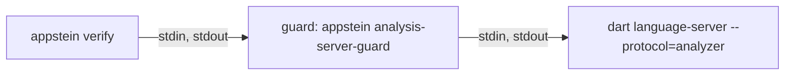

<!-- covers:
packages/appstein_engine/lib/src/verify/**
packages/appstein_protocol/lib/src/verify/**
packages/appstein_cli/lib/src/verify_command.dart
packages/appstein_engine/lib/src/mcp/verify_tool.dart
packages/appstein_engine/lib/src/analysis/**
packages/appstein_cli/lib/src/analysis_guard_command.dart
-->

# Verify

`appstein verify` checks a project against its knowledge and reports **findings** (spec §9). An agent runs it after a change and before it says a task is done. It is the part of Appstein that says "no".

This page covers the frame and the checks of slice 1d.1, and what slice 1d.2 has built so far: the analysis server and the first code check, `dart.error`. The other code checks (deprecated use, warnings, lints, format, fixes, tests), the lint rules, the package gate and the Android and iOS checks arrive later in slice 1d.2 and in slices 1d.3 to 1d.6.

## What a run does

[`runVerify`](../../packages/appstein_engine/lib/src/verify/verify_run.dart) does six things, in this order:

1. **Refresh the knowledge**, as `appstein sync --detect` does ([`refreshKnowledge`](../../packages/appstein_engine/lib/src/knowledge/knowledge_refresh.dart), shared with `appstein docs`). The MCP server has already done this before every tool call, so it passes its result in and the knowledge is refreshed once.
2. **Gather what is slow**, before the lock. Each selected check that implements `GatheringCheck` gets a `VerifyGathering` and asks it for what it will judge. Today that is one thing, the code analysis's reading, taken **once per run** however many checks ask: every check judges the same reading, as every check judges the same knowledge. It comes after the refresh, which may fetch the packages the analysis reads. See [gathering](#gathering-before-the-lock).
3. **Take the knowledge lock** and read the knowledge once. Every check gets the same [`VerifyContext`](../../packages/appstein_engine/lib/src/verify/verify_check.dart): the project folder, its `appstein.yaml`, its packs, one `KnowledgeSnapshot`, the decision records and what was gathered. Under the lock a check only judges; nothing asks the analysis server there.
4. **Run the checks** the mode selects. `fast` runs the fast checks; `full` (the default) runs every check.
5. **Apply `verify.severity`** from `appstein.yaml`, which can raise or lower a finding's severity.
6. **Apply the suppressions**, then sort the findings.

**When the knowledge can't be refreshed** (no Flutter SDK, packages not fetched, a map file that can't be read, another sync holding the lock), the run still happens. A busy lock is waited for once, for the lock timeout; the checks then run without it, because files are replaced whole and reading is safe.

- it reports `knowledge.stale` as an **error**, with the reason;
- a check that reads the project map (`needsMap`) is not run, and is named in `notRun`;
- every other check runs. One that reads the map for only part of its work asks `context.mapProblem`, leaves that part out and reports it with `context.skipped(id)`, which names it in `notRun` too. The decisions check does this for `stack.provider`;
- a suppression of a check that did not run, or ran in part, is not reported as unused: its finding may only be missing.

Old map files usually stay on disk when a refresh fails, and they still parse. `mapProblem` is set all the same: a check judging an old map would give wrong answers that look right, which is worse than saying it didn't run. Nothing is judged against old knowledge, and nothing is skipped silently (spec §9).

The same holds when `.appstein` itself can't be opened (it is a file, or the folder is read-only): `knowledge.stale` with the reason, never a crash.

**A check that throws** is Appstein's failure, not the project's: `runVerify` throws a `VerifyCheckError` naming the check, and the CLI exits 3. The same happens when a check reports an ID it didn't declare.

**An analysis server that can't answer** is Appstein's failure too, but no check's: `runVerify` passes the `CodeAnalysisException` on as it is, and the CLI prints its reason and exits 3. It is never a finding, and never read as "no errors". See [when the server can't answer](#when-the-server-cant-answer).

### Gathering, before the lock

The knowledge lock is shared: while `verify` holds it, an `appstein sync` or another agent's MCP call waits, and gives up after 10 s. An analysis server can take far longer than that to start. So nothing slow happens under the lock.

- **A check with slow work implements `GatheringCheck`.** Its `gather` runs before the lock and asks the run's [`VerifyGathering`](../../packages/appstein_engine/lib/src/verify/verify_check.dart); its `run` runs under the lock and reads the answer from the context.
- **`gathering.code()`** is the code analysis's reading. The first check that calls it asks the analysis server; the others get the same reading. A run in which no selected check calls it asks nothing, and starts no server.
- **`context.code`** is that reading, for a check that asked for it in its own `gather`. Any other check that reads it gets a `StateError` that names it and fails the run, also when another check of the run gathered the reading: a check that only works beside another one would read nothing in a run that leaves the other out. A check can therefore never take "nobody asked" for "no diagnostics".
- **A check is not asked to gather** when the mode doesn't select it, or when it needs the map and the refresh failed: it will not run.
- **Later slow work goes in the same place.** A file's formatting, the pending fixes (17 s) and a test run (minutes) are each a method on `VerifyGathering` that a check calls from `gather`, and a getter on the context.

## The checks so far

[`checksFor`](../../packages/appstein_engine/lib/src/verify/engine_checks.dart) builds the list: the engine's checks, then each pack's. Two checks that declare the same ID are a `StateError`.

| ID | Severity | Mode | Needs the map | What it finds |
|---|---|---|---|---|
| `knowledge.stale` | error | both | | The knowledge could not be brought up to date. Reported by the frame, not a check |
| `docs.stale` | warning | full | yes | A page of the human docs is missing, behind the app, edited by hand, in a merge conflict, or no longer rendered |
| `decision.drift` | warning | full | | An accepted decision names a check that no longer holds, or a check no pack provides |
| `decision.unreadable` | warning | full | | A decision file or the folder can't be read, or decisions supersede each other in a circle |
| `decision.duplicate` | warning | full | | Two decision files have the same number |
| `memory.lessons_long` | info | full | | `.appstein/memory/lessons.md` has more than 200 lines |
| `verify.test_required` | warning | full | yes | A feature has no test |
| `dart.error` | error | both | | An analyzer error, anywhere in the project |
| `dart.plugin_failed` | error | both | | An analyzer plugin could not be loaded, so its rules were not checked. The ID is provisional until the owner confirms it |
| `suppression.no_reason` | error | both | | A suppression has no `reason` |
| `suppression.unknown_check` | error | both | | A suppression names an ID no check reports |
| `suppression.unused` | warning | full | | A suppression hides nothing |

`dart.error` and `dart.plugin_failed` are the fast checks so far, so `verify --fast` on a project whose code compiles reports nothing.

**`dart.error`** ([source](../../packages/appstein_engine/lib/src/verify/checks/dart_error_check.dart)) reads the run's code reading and reports each diagnostic of error level. It reports them wherever they are, in a fast run too: breaking a class in one file gives an error in the file that uses it, and that is the one the agent must hear about.

- It reports what `dart analyze` shows as an error. That includes an error in a file the analyzer reads that isn't Dart, such as `analysis_options.yaml` or `pubspec.yaml`, and a `TODO` comment the project made an error in `analysis_options.yaml`.
- The message is the analyzer's own, followed by its code in backticks, such as ``The getter 'sides' isn't defined for the type 'Shape'. (`undefined_getter`)``. The code is what a developer looks up or names in `analysis_options.yaml`.
- The fix hint is the analyzer's suggested correction, when it has one.
- The file is from the project root with `/` on every system, and the line is the analyzer's.
- It needs no map, so it runs while the knowledge is stale. A project whose code doesn't resolve gets its `dart.error` findings beside `knowledge.stale`.
- Warnings and info-level diagnostics are not reported yet; they get their own checks later in the slice.
- It is a known ID like any other: a `suppressions:` entry hides it and `verify.severity` changes it.

**`dart.plugin_failed`** ([source](../../packages/appstein_engine/lib/src/verify/checks/plugin_failed_check.dart)) reports each analyzer plugin the analysis server could not load or run, for example one whose package can't be resolved. The server says so once and then reports its analysis done as usual, without that plugin's rules. Without this finding, a project whose lint plugin is broken would read as a project with no lint problems. `dart analyze` prints the same message and fails (its exit code depends on what else it found).

- It is an error about the project as a whole (no file), so no suppression hides it.
- The message is the server's own, on one line, without its stack trace. The fix hint names the plugin's entry under `plugins:` in `analysis_options.yaml` and `appstein doctor`.
- The ID is written in one place, the constant `pluginFailedId`, because the owner has not confirmed it yet.

**`docs.stale`** ([source](../../packages/appstein_engine/lib/src/verify/checks/docs_stale_check.dart)) calls `prepareDocs`, the same function `appstein docs` and `appstein docs --check` use, so the three can never disagree about a page. It writes nothing. See [human-docs](human-docs.md).

**The decision findings** ([source](../../packages/appstein_engine/lib/src/verify/checks/decisions_check.dart)) come from one check:

- Only an **accepted** decision is checked. The status is the readers' status: a decision another one replaces counts as superseded, whatever its own `status:` line says.
- A decision names checks in `checks:`. Each name is a [`DecisionCheck`](../../packages/appstein_engine/lib/src/verify/decision_check.dart): `paths.exist` comes from the engine, and `stack.provider` from the `official_mvvm` pack.
- A finding points at the line of `checks:` in the decision file (`paths:` for `paths.exist`). The line is the same with CRLF line endings or a byte order mark.
- A decision check that reads the map is left out while the map can't be used, and named as not run.

**`paths.exist`** ([source](../../packages/appstein_engine/lib/src/verify/checks/paths_exist_check.dart)) says each path pattern of the decision still matches a file or a folder.

- **It never leaves the project.** An absolute path, `..` as a segment or inside braces (also the forms Windows reads as `..`, such as `.. ` with a trailing space) and a path through a link are reported as "could leave the project" and never followed. A decision file can't make `verify` look at folders outside the project.
- **A `\` in a path is read two ways, and the path matches when either reading does.** A `\` is a Windows separator (`lib\ui\x.dart`), or it escapes a glob character (`lib/a\[1\].dart` names the file `a[1].dart`). So a path has up to two readings: *(a)* every `\` is a separator; *(b)* a `\` right before `[`, `]`, `{` or `}` escapes that character and every other `\` is a separator. A reading that is not a valid glob is dropped; the path is "not a valid pattern" only when no reading is valid. The guards above apply to each reading. For example `lib\{ui,data}\x.dart` matches `lib/ui/x.dart` through reading (a), because reading (b) is not a valid glob. The rule is one function, [`decisionPathReadings`](../../packages/appstein_engine/lib/src/decisions/decision_path.dart), which the `decisions` tool uses too (see [decisions-and-memory](decisions-and-memory.md#paths-and-backslashes)).
- **Letter case counts on every system.** `LIB/main.dart` does not match `lib/main.dart`, on Windows too. Otherwise a decision would hold on a laptop and drift in CI on Linux.
- **It is quick on a large project.** The search starts in the folders the pattern names before its first wildcard (`lib/ui/**/x` starts in `lib/ui`), stops at the first match, and never looks in `.dart_tool`, `.git` or `build` at the top of the project unless the pattern names that folder. A folder that can't be listed is skipped; it doesn't decide the others.

**`stack.provider`** ([source](../../packages/appstein_engine/lib/src/packs/official_mvvm/stack_provider_check.dart)) says the app depends on `provider` directly, and no file under `lib/` imports another state-management package. The list of those packages is the pack's knowledge. A `provider` that `pubspec.lock` calls `direct overridden` (it is in `dependency_overrides`) counts when `pubspec.yaml` also lists it under `dependencies`.

**`verify.test_required`** ([source](../../packages/appstein_engine/lib/src/verify/checks/test_required_check.dart)) reads `map/features.json`. What a feature is, and where its tests live, stays the stack pack's knowledge.

## Findings

A [`Finding`](../../packages/appstein_protocol/lib/src/verify/finding.dart) has an `id`, a `severity` and a `message`, and when they apply a `file`, a `line`, a `fixHint`, a `knowledgeRef`, the `pack` that reported it and a `docs` link (spec §9.3). An ID is stable once released.

A [`VerifyResult`](../../packages/appstein_protocol/lib/src/verify/verify_result.dart) holds the findings, how many a suppression hid (`suppressed`), how many suppressions hid at least one (`activeSuppressions`), and the checks that did not run.

## Output

**Text** (`formatVerify`): the findings in groups, one per file, with `(project)` for findings about no file. A group with an error comes before a group without one. Then the checks that did not run, then one summary line. This is from a real run on the fixture app with a decision and three suppressions added, with some groups left out:

```text
appstein.yaml
  error suppression.unknown_check (line 9): No check of this project reports `docs.stael`.
    fix: Did you mean `docs.stale`?
  warning suppression.unused (line 6): The suppression of `verify.test_required` on `lib/ui/booking` hides no finding.
    fix: Remove it, so it can't hide the same finding if it comes back.

.appstein/decisions/0001-state.md
  warning decision.drift (line 7): The path `lib/state/**` matches no file.
    fix: Bring the code back in line, or replace the decision with a new one (`record_decision` with `supersedes`).
  warning decision.drift (line 8): The project does not depend on `provider`.
    fix: Bring the code back in line, or replace the decision with a new one (`record_decision` with `supersedes`).

lib/ui/settings
  warning verify.test_required: The feature `settings` has no test.
    fix: Add a test under `test/ui/settings/`.

1 error, 4 warnings, 0 info. 1 finding suppressed by 1 suppression.
```

With nothing found, the output is the summary line alone. The line gives both numbers about suppressions, because one broad entry can hide many findings: `40 findings suppressed by 1 suppression.` says something `1 suppression` alone would not. With nothing hidden it says `No findings suppressed.`

**JSON** (`--format json`) is one object, and the `verify` MCP tool returns the same object:

```json
{
  "findings": [
    {
      "id": "verify.test_required",
      "severity": "warning",
      "file": "lib/ui/settings",
      "message": "The feature `settings` has no test.",
      "fixHint": "Add a test under `test/ui/settings/`.",
      "knowledgeRef": ".appstein/map/features.json"
    }
  ],
  "summary": {"errors": 0, "warnings": 1, "info": 0},
  "suppressed": 0,
  "activeSuppressions": 0,
  "notRun": []
}
```

Fields without a value are left out, never written as null.

## Exit codes

| Code | When |
|---|---|
| 0 | No finding is an error. Warnings, info findings and checks that did not run never fail a run on their own |
| 1 | A finding is an error |
| 3 | Appstein itself failed: no project, an invalid `appstein.yaml`, bad flags, a check that threw, an analysis server that could not answer |

Exit code 2 (hook mode) arrives with `--hook` in slice 1d.7.

## Suppressions

A project accepts a finding with a `suppressions:` entry in `appstein.yaml` ([config](config.md)):

```yaml
suppressions:
  - id: verify.test_required
    path: lib/ui/profile
    reason: covered by the integration tests
```

- `path` is a file, a folder (everything below it) or a glob.
- `reason` is required. An entry without one hides nothing and is itself an error.
- A finding about the whole project (no file) is never hidden.
- Severity overrides are applied first, then suppressions.

Four IDs can't be suppressed, and `verify.severity` can't change them: `knowledge.stale`, `suppression.no_reason`, `suppression.unknown_check` and `suppression.unused`. Otherwise one line in `appstein.yaml` could make the verifier quiet about its own blind spots.

The code is [`applySuppressions`](../../packages/appstein_engine/lib/src/verify/suppressions.dart).

## The MCP tool

`verify` takes `scope`: `fast` or `full`. See [mcp-server](mcp-server.md). Three things differ from the other tools:

- **Stale knowledge is a finding, not an error reply.** The reply still has `knowledge.stale`, `notRun` and a `freshness` marked `stale`.
- **`summary` is the counts**, as in the JSON above. Every other tool's `summary` is a sentence; `verify`'s sentence is in the reply's text only.
- **Each call starts and stops its own analysis server**, as a terminal run does, so the two give the same findings. Keeping one server running between calls is the next ticket of slice 1d.2.

## The analysis server

The code checks ask a **Dart analysis server**: the program behind `dart analyze` and every Dart IDE. Appstein starts the one of the project's own SDK as a child process, asks it, and stops it. The engine's `analysis/` folder owns it. Why a server and not the analyzer the project map already has, and why this protocol, is decided in [decision record 0001](../adr/0001-analysis-server-beside-the-map-analyzer.md).

| File | What it holds |
|---|---|
| [`code_analysis.dart`](../../packages/appstein_engine/lib/src/analysis/code_analysis.dart) | `CodeAnalysis`, the one interface a run asks; `CodeReading`, `CodeDiagnostic` and `DiagnosticLevel`; `CodeAnalysisScope`; `CodeAnalysisException` |
| [`analysis_server.dart`](../../packages/appstein_engine/lib/src/analysis/analysis_server.dart) | `AnalysisServer`, the real `CodeAnalysis`; `ownAnalysisServer`, the scope a terminal run uses; `projectDartExecutable`; `analysisReadyTimeout` |
| [`analysis_guard.dart`](../../packages/appstein_engine/lib/src/analysis/analysis_guard.dart) | `runAnalysisGuard`, the guard process's whole job |
| [`analysis_guard_command.dart`](../../packages/appstein_cli/lib/src/analysis_guard_command.dart) | In the CLI: the hidden `analysis-server-guard` command, and `analysisGuardCommand`, which says how to start it |



### What a run asks

No check starts a process, and no check asks the server: `runVerify` asks, once, through `VerifyGathering` (see [gathering](#gathering-before-the-lock)). The interface has one question today:

- **`read()`** gives a `CodeReading`, everything in it from the same moment:
  - `diagnostics`: every diagnostic `dart analyze` would show for the project as its files are now, in file and line order. A `CodeDiagnostic` has the file (from the project root, with `/`), the 1-based line, the analyzer's code such as `unused_import`, its message, its level (`error`, `warning` or `info`, after the project's `analysis_options.yaml`) and the analyzer's suggested correction when it has one.
  - `pluginFailures`: what the server said about each plugin it could not load. While it isn't empty, the diagnostics lack that plugin's rules.

**The diagnostics are the set `dart analyze` shows**, compared on the pinned SDK on 2026-10-12:

| What the server sends | `dart analyze` | The reading |
|---|---|---|
| A `TODO`, `FIXME` or `HACK` comment (type `TODO`, level info) | hidden | left out |
| The same comment after `analysis_options.yaml` made its code a warning or an error | shown | included, at that level |
| A diagnostic in `analysis_options.yaml` or `pubspec.yaml` | shown | included |
| A plugin that failed (`server.pluginError`) | printed, and the command fails | in `pluginFailures` |

The interface is small on purpose. The later checks of the slice add their questions to it (can this diagnostic be fixed automatically, which fixes are pending, would this file's formatting change).

**Who owns the server is decided outside the checks**, by a `CodeAnalysisScope`: a function that runs a body with a `CodeAnalysis` and releases it afterwards. `runVerify` takes the `CodeAnalysis`; the caller wraps the run in a scope.

- **A terminal run** uses `terminalCodeAnalysis` in [`verify_command.dart`](../../packages/appstein_cli/lib/src/verify_command.dart), which is the engine's `ownAnalysisServer` with the CLI's guard command: a new `AnalysisServer` for the body, closed in a `finally` when the body ends, normally or with an error. A question asked after that throws a `StateError`: it would start a server nobody stops.
- **`appstein mcp`** uses the same scope for each `verify` call today. A scope that keeps one server between calls replaces it in the next ticket; nothing in the checks or in `runVerify` changes for that.
- **Tests** pass `ScriptedCodeAnalysis().scope`. The stand-in lives in the tests' support folders, one copy per package ([engine](../../packages/appstein_engine/test/support/scripted_code_analysis.dart), [CLI](../../packages/appstein_cli/test/support/scripted_code_analysis.dart)), as `dart_sdk.dart` does.

**Not solved yet, for the kept server.** A reading holds what the server had sent when it last said it was done. On a server kept between calls, a question asked within some 50 ms of an edit can be answered from before the edit, because the server hasn't noticed the file yet. A terminal run starts its server after the files are written, so it can't happen there. The next ticket needs a way to know the server has seen the latest edit, which is not a wait; its place is `AnalysisServer.read`, which every run passes through exactly once.

### How the server is started

`AnalysisServer` starts nothing when it is created. The first question starts the server, so an owner that never asks holds no process.

1. **It finds the SDK's real `dart`.** `projectDartExecutable` detects the project's Flutter SDK with `SdkDetector`, the way the rest of Appstein does (see [sdk-lookups](sdk-lookups.md)), and takes `bin/cache/dart-sdk/bin/dart` inside it (`dart.exe` on Windows). It is never the `dart.bat` wrapper or FVM's: each costs about a second per start on Windows. So `verify` runs the same analyzer as the developer's `dart analyze` and IDE.
2. **It starts the guard**, with that `dart` as the guard's one argument, and reads the line in which the guard names its own process and the server's.
3. **It tells the server what to send and where the project is**: `server.setSubscriptions` for the status, then `analysis.setAnalysisRoots` with the project folder.

It speaks the **legacy analyzer protocol**: one JSON object per line. A request has an `id`; a notification has an `event`. Appstein does not pass `--suppress-analytics`: the server keeps the developer's own Dart setting (the owner's decision, in the decision record).

### When it is ready, and where the diagnostics come from

- **Ready is the server's own word.** The server sends `server.status` with `isAnalyzing: true` when it starts work and `false` when it is done. A question waits for a `false` that follows a `true`. Over this protocol that includes the analyzer plugins, which is why this protocol was chosen: `verify` can't say "no errors" while a plugin is still running.
- **Diagnostics are taken from notifications.** The server sends `analysis.errors` for each file, with all of that file's diagnostics, and sends it again when they change. `AnalysisServer` keeps the latest list per file, and drops a file when the server sends `analysis.flushResults` for it. It never asks `analysis.getErrors`, which leaves a plugin's diagnostics out.
- **Only the project's own files are returned.** A file outside the project folder is left out, and each path is made relative with `/`.

### The guard

A server on this protocol does not end when its parent is killed: it keeps running, with its memory, until the next edit of a project file. So Appstein never starts it directly. It starts a **guard**, a second process that does one job (`runAnalysisGuard`):

- it starts the server and names both processes on stderr: `guarding`, its own process ID, then the server's;
- it passes its stdin to the server and the server's stdout back, byte for byte, and the server's stderr to its own;
- **when its stdin closes, it kills the server and exits.** A process's stdin closes when the process that started it ends in any way, including being killed. That is the whole trick;
- when the server ends first (it was asked to stop, or it crashed), the guard exits with the server's exit code;
- before it ends, it says `guard ended` on stderr, after a line end of its own, because the server's last words may have had none. A guard that ends without saying so was killed itself, and its server is still running. The reader accepts the words at the end of a line too, and takes what stands before them as the server's.

**The guard is the `appstein` binary itself**, in a mode of its own: `appstein analysis-server-guard` followed by the `dart` executable. The command is hidden, so `appstein --help` doesn't list it; nobody types it. Nothing extra is installed.

**How it is started** is `analysisGuardCommand`:

| Appstein is | The guard is started as |
|---|---|
| a compiled binary | the same binary again, with `analysis-server-guard` |
| run from source (its own tests, `dart run`) | the running `dart`, with `bin/appstein.dart` of the CLI package and `analysis-server-guard` |

The second row is the same command through the same code, only slower to start, because `dart` compiles the script first (about 15 s in the CLI's tests, against no measurable time compiled). A compiled binary is recognized by having no package configuration to ask (`Isolate.resolvePackageUriSync` gives nothing).

The engine's own tests can't start the CLI, which depends on the engine. They start [`guard_main.dart`](../../packages/appstein_engine/test/analysis/support/guard_main.dart), a script of a few lines that calls the same `runAnalysisGuard`.

### Stopping

`AnalysisServer.stop` ends both processes and returns when they are gone. It tries three things in order, and stops at the first that works:

1. it sends `server.shutdown`; the server exits, and the guard follows with the server's exit code;
2. after 5 s, it closes the guard's stdin, which makes the guard kill the server;
3. after 5 s more, it kills the guard and the server by the process IDs the guard named.

**A guard that was killed alone** leaves its server running, and closing a dead guard's stdin does nothing. So whenever the guard's process has ended without saying `guard ended`, `AnalysisServer` ends the server by the process ID the guard named, at once, without waiting to be asked or stopped. When the guard did say it, the server has ended, and nothing is killed: by then its ID could belong to another process.

Only processes this `AnalysisServer` started are ever ended. Stopping twice, or before anything was started, does nothing. A question asked after `stop` starts a new server; after `close` it throws.

Measured on the Windows development machine with the compiled binary (2026-10-12): a normal `appstein verify` left no process, and when `appstein verify` was killed while its server was starting, the guard and the server were gone within 0.1 s (3 of 3).

### When the server can't answer

A server that can't answer is **Appstein failing**, never a finding and never "no errors". Every such case throws a `CodeAnalysisException` with the reason:

| Case | The reason says |
|---|---|
| The project has no usable Flutter SDK | so, with the SDK lookup's own problem |
| The SDK has no `dart` executable | the path where it was looked for |
| The guard can't be started | the command and the system's message |
| The server refuses a request, or reports a fatal error (`server.error` with `isFatal`) | what it said |
| The server sends a diagnostic in a form Appstein doesn't know | the file it was for |
| The server ends by itself | its exit code and the last lines it wrote to stderr |
| The guard ends without its server (it was killed) | the guard's exit code |
| Its analysis isn't done within `analysisReadyTimeout` (180 s) | the limit |

Before the exception is thrown, the failed server's processes are ended, the server of a killed guard included, so a failure leaves nothing running. A plugin that fails to load is not in this table: the server still answers, so it is a finding, `dart.plugin_failed`. `runAppstein` prints the reason and "Run `appstein doctor` to check your setup." and exits 3:

```text
The Dart analysis server could not answer: its analysis was not done within 180 s.
Run `appstein doctor` to check your setup.
```

The 180 s limit comes from the starts measured for the decision record: 7 to 22 s normally, and up to 71 s for a first start.

**One consequence for a machine without a usable SDK.** Before slice 1d.2, `appstein verify` there reported `knowledge.stale` and exited 1. Now the code checks can't run either, which is Appstein failing, so the run exits 3 with the reason.

### Tests

| Test | What it covers |
|---|---|
| `packages/appstein_engine/test/analysis/analysis_server_test.dart` | **Real servers:** an error with its file, line, code and message, an error in a file that uses a broken class, a warning's level, a `TODO` comment left out, paths with a space and a non-ASCII letter; a plugin that can't be resolved; both processes gone after a stop, after a failed body, after the guard alone is killed, and within seconds of a killed parent (a separate process, [`server_holder.dart`](../../packages/appstein_engine/test/analysis/support/server_holder.dart)); a question after the scope ended; no `dart`, no SDK, no guard, a server that is never ready ([`silent_guard.dart`](../../packages/appstein_engine/test/analysis/support/silent_guard.dart)) and a server that dies. **A scripted server** behind the guard ([`fake_server_guard.dart`](../../packages/appstein_engine/test/analysis/support/fake_server_guard.dart)), for what a real one can't be made to do: a file taken back with `analysis.flushResults`, a file outside the project, the levels of a `TODO`, a plugin failure told twice, a fatal error, a refused request, a malformed diagnostic, two questions at once, and a stop while the analysis is running |
| `packages/appstein_engine/test/verify/verify_dart_test.dart` | `runVerify` on the fixture app with a real server: the errors in a fast and a full run, suppressed and with another severity; the same app without the errors; and the app with its package configuration removed, where the knowledge is stale and the errors of the code that doesn't resolve appear beside `knowledge.stale` |
| `packages/appstein_engine/test/verify/verify_run_test.dart` | The frame and the checks with `ScriptedCodeAnalysis`: asked once per run, before any check runs and while the lock is free; every check sees one reading; not asked when no check gathers; a check that reads without gathering; which levels are reported; plugin failures; a server that fails |
| `packages/appstein_engine/test/mcp/appstein_mcp_server_test.dart` | The tool's error reply when the analysis can't answer, and that the server keeps running |
| `packages/appstein_cli/test/verify_command_test.dart` | The whole command with a real server and the real guard command; that no child process is left, and that every guard and server the runs named is gone |

A real server costs about 2 s to start in the engine's tests. So a group that only reads starts one server in `setUpAll` and shares it, and no test of such a group edits a file. The helpers are in [`analysis_support.dart`](../../packages/appstein_engine/test/analysis/support/analysis_support.dart): the guard command, `realAnalysisServer`, and `processAlive` and `goneWithin`, which look at process IDs the test itself recorded. A test never ends a process it didn't start.

## Adding a check

See [how to add a check](how-to/add-a-check.md).
